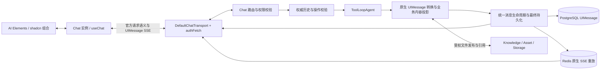

# 当前决策：基于 Vercel AI SDK 的 Chat 协议与交互

状态：当前。Chat 使用官方 UIMessage 协议、transport、Chat/useChat 和工具状态机；服务端拥有会话权限、消息 journal、资源授权和执行边界。实现不保留旧协议兼容层或双轨状态。

本主题负责 `useChat ↔ Chat service` 的消息、传输、工具交互与呈现语义。模型循环和上下文策略仍归 [Agent runtime](agent-runtime.md)，执行耐久性归 [Durable execution](durable-execution.md)，文件所有权归 [Files and assets](files-and-assets.md)，视觉与组件约束归 [DESIGN.md](../../DESIGN.md)。跨栈字段与自定义 part 的唯一契约入口是 [Chat UIMessage stream](../../schemas/streaming/chat-uimessage-stream.md)；本文记录职责和取舍，不成为第二份 wire schema。

## 1. 决策与目标

采用 AI SDK 原生 `UIMessage`、`UIMessageChunk`、`DefaultChatTransport`、 `Chat/useChat` 与工具调用状态机。AI Elements/shadcn 负责呈现；Chat service 负责身份、会话、持久化、资源权限和执行入口。应用扩展只表达官方类型没有表达的业务语义。

“能力完整”具体指：每一种相关原生 part 都有明确的接收、校验、存储、重放、模型投影及 UI 处理规则；每一种用户操作都有明确的请求语义和失败恢复路径。它不要求每种 part 都显示卡片，也不要求每个模型提供所有多模态能力。

终态必须满足：

1. 正常接收、刷新历史和断线恢复得到一致的消息语义；已完成内容不被迟到请求覆盖。
2. 工具输入流、进度、授权、客户端结果、成功和失败使用官方状态，不另造执行协议。
3. 引用能够对应证据；文件能够从受权资源打开；工具生成的产物保留调用上下文。
4. 编辑、重新生成、续跑和恢复是不同操作；读取历史或切换分支不会触发工具执行。
5. 服务端保存权威消息，客户端只能提交用户输入、获准的客户端工具结果或审批决定。
6. 页面断开只释放订阅者；显式停止才取消执行；一次逻辑请求不会因重试重复产生副作用。
7. SDK 拥有协议解析和消息状态归并，应用拥有产品和资源边界，不手写第二套 SSE parser。

## 2. 官方依据与使用方式

本次核对的安装版本为 `ai@7.0.155`、`@ai-sdk/react@4.0.159`，仅作为 API 核对基线，不作为本文维护的依赖版本清单。实际依赖由 workspace catalog 和 lockfile 管理。实施时同时检查当前官方文档和安装包的 types/source，避免复制其他主版本示例。

| 官方资料 | 本设计采用的能力或原则 |
| --- | --- |
| [UI Message Stream Protocol](https://ai-sdk.dev/docs/ai-sdk-ui/stream-protocol) | 原生 chunk/part、消息与 step 边界、SSE 响应格式 |
| [useChat](https://ai-sdk.dev/docs/reference/ai-sdk-ui/use-chat) | 发送、编辑、重新生成、工具回填、审批、错误和恢复入口 |
| [Transport](https://ai-sdk.dev/docs/ai-sdk-ui/transport) | 通过 request preparation 接入业务路由与认证，保留 SDK 请求语义 |
| [Message persistence](https://ai-sdk.dev/docs/ai-sdk-ui/chatbot-message-persistence) | 保存 UIMessage，服务端读取权威历史并验证消息 |
| [Resume streams](https://ai-sdk.dev/docs/ai-sdk-ui/chatbot-resume-streams) | GET 恢复、无活动流返回 204、断开与显式取消分离 |
| [Chatbot tool usage](https://ai-sdk.dev/docs/ai-sdk-ui/chatbot-tool-usage) | server/client tools、人工交互、自动续跑和动态工具 |
| [Tool calling](https://ai-sdk.dev/docs/ai-sdk-core/tools-and-tool-calling) | 工具输入/结果 schema、审批与多模态 `toModelOutput` |
| [Subagent progress](https://ai-sdk.dev/docs/agents/subagents) | preliminary results 与终态结果的区分 |
| [Sources and citations](https://ai-sdk.dev/docs/ai-sdk-core/generating-text#citations) | 检索来源与正文证据分离，原生 `TextUIPart.citations` |
| [Message metadata](https://ai-sdk.dev/docs/ai-sdk-ui/message-metadata) | 消息级信息使用 metadata，不用并行的 data part |
| [Streaming custom data](https://ai-sdk.dev/docs/ai-sdk-ui/streaming-data) | 持久/瞬时 data parts、同 ID 更新 |
| [createUIMessageStream](https://ai-sdk.dev/docs/reference/ai-sdk-ui/create-ui-message-stream) | 合成流的消息所有权、聚合 outcome 和最终持久化 |
| [Reading UIMessage streams](https://ai-sdk.dev/docs/ai-sdk-ui/reading-ui-message-streams) | 服务端需要消息快照时复用 SDK 的组装器 |
| [shadcn AI Elements](https://ui.shadcn.com/docs/ai-elements) | 从官方组合构建 Message、Trace、Sources、Confirmation 等界面 |

SDK API 与协议机制属于官方能力。下文的权限校验、文件发布、历史分支、请求去重及数据库事务是本仓库的设计决定，不声称由 SDK 自动提供。官方示例中的简单存储也不替代本项目的资源权限和并发控制。

安装包核对重点包括 `ai/src/ui/ui-messages.ts`、`ai/src/ui/chat.ts`、 `ai/src/ui/default-chat-transport.ts`、`ai/src/ui-message-stream/` 及 `@ai-sdk/react/src/use-chat.ts`。采用 v7 的服务端 `onEnd`；React 消费端仍是 `onFinish`。这两个回调的职责不同，不能用同名印象替代签名核对。

## 3. 已实施能力与边界

| 能力 | 当前实现与边界 |
| --- | --- |
| 原生 SSE 与多 step | [run](../../apps/backend/services/chat/src/application/agent/runs/run.ts) 组合唯一 start/finish 所有者；[transport](../../apps/frontend/packages/chat/src/lib/transport.ts) 使用 `DefaultChatTransport`，恢复直接重放原生 SSE。 |
| 权威历史与分支 | PostgreSQL 保存 UIMessage journal、父子分支、selected leaf 与单调 history revision；编辑、重新生成、工具续跑和历史选择是不同操作。 |
| schema 与续跑权限 | [共享 metadata/data schema](../../schemas/streaming/chat-ui.ts) 经 `just sync` 生成双端校验器，与 SDK `validateUIMessages` 校验结构；[continuation](../../apps/backend/services/chat/src/application/agent/runs/continuation.ts) 只允许等待中的客户端结果或审批决定，调用身份不可变。 |
| 来源与引用 | 搜索 ToolOutcome 保留给模型并投影原生 source part；正文消费原生 citations。文档来源只通过 workspace ACL resolver 和 journal 关系生成可打开链接。 |
| 文件与产物 | 原生 `file`/`reasoning-file` 发布为受权会话资源；`save_sandbox_file` 保持原生工具结果并显示 Artifact 卡，不复制成同义 file part。任意远程 URL 不由 Chat 代取。 |
| 工具生命周期 | static/dynamic、preliminary、provider-executed、审批和 client tool 使用 SDK 原生状态；业务 ToolOutcome 只承载业务成功/失败数据。内联 `subagents` 的 1–3 条紧凑有界 nested progress 作为 preliminary payload，完整 message 只进入 final tool payload，不增加平行 data part。 |
| 并发与持久化 | `(conversation_id, request_id)` 和完整请求指纹绑定逻辑操作；claim 锁定 revision。工具终态、assistant 消息、run、selected leaf 和 lease 由同一个幂等 finalizer 事务提交。 |
| 恢复与取消 | Redis 只在 run 活跃期间保存可重放 transport stream 和 active pointer；短滑动租约回收崩溃遗留，字节/entry budget 防止运行期无界增长，journal 终态提交并排空流后立即删除。subscriber 断开不取消 run，显式 Stop 才传播用户取消并由同一 finalizer 收口。 |
| 客户端状态 | 一个 `Chat<ChatUIMessage>` 持有实时消息；完整 hydration 和完成回读都检查会话/操作身份与 revision，迟到响应不能覆盖新 run。 |

## 4. 终态架构与职责



| 所有者 | 职责 | 不拥有的职责 |
| --- | --- | --- |
| `ai` / `@ai-sdk/react` | SSE 解析、chunk 校验、part 归并、工具状态、Chat 状态、消息操作 | 会话权限、数据库事务、文件权限、应用业务决策 |
| Chat service | 请求认证后的 scope、权威历史、工具响应验证、run 生命周期、原生流持久化 | 其他服务数据库、另一套模型工具循环 |
| `@repo/chat` | Chat 实例生命周期、业务请求参数、操作 UI、资源解析与工作区 | 自制消息 reducer、JSON/SSE parser、工具执行调度器 |
| `@repo/ai-elements` | 接受原生 parts/普通 props 的展示组合 | 网络请求、会话存储、服务端权限 |
| Knowledge / Asset / Storage | 文件所属关系、不可变字节、资源授权与访问 URL | Chat 消息状态 |
| `schemas/` | 自有业务 metadata/data/request 字段契约 | 复制 AI SDK 全量类型定义 |

同一会话由一个 `Chat<ChatUIMessage>` 实例持有实时状态。`ChatStream` 是高频 `useChat` 订阅者，保留 `throttle` 与一致的 deferred snapshot；停止、审批和客户端回填读取实时 Chat 实例。Zustand 只保存面板、选中资源等应用状态，不复制消息正文。

## 5. 消息模型、校验与持久化

### 5.1 原生 part 覆盖

`ChatUIMessage` 基于 `UIMessage<Metadata, DataTypes, Tools>` 定义。静态工具利用 SDK 的推导类型；动态工具使用 `dynamic-tool`。跨栈共享业务 schema，不从前端导入后端 service 源码，也不手写一份 SDK 的联合类型。

| 原生内容 | 终态处理 |
| --- | --- |
| `text` | Markdown 正文、逐 part streaming 状态、citations 与 provider metadata 完整保留 |
| `reasoning` | 可折叠展示 provider 实际提供的可呈现内容，不从 opaque metadata 推导推理文本 |
| `reasoning-file` | 作为推理附件单独展示，复用受权文件预览，不冒充最终交付物 |
| `tool-<name>` / `dynamic-tool` | SDK 归并输入和结果；统一完整状态展示；业务卡是其呈现方式 |
| `file` | 规范文件引用，区分用户输入、模型直接输出与工具产物；规则见第 9 节 |
| `source-url` / `source-document` | 检索来源集合；文档来源通过受权 resolver 打开，不把 sourceId 猜成 URL |
| `step-start` | 保留顺序与自动续跑边界；可不显示独立行 |
| `custom` | 保留 provider-specific 原生内容，例如 compaction；不把 opaque 元数据输出成普通文本 |
| 已注册 `data-*` | 按 schema、持久性和 renderer 处理；同一对象使用稳定 id |
| 消息 `metadata` | 独立于 parts 保存；用于消息级展示及观测，不作为权限依据 |

`text-start/delta/end`、`reasoning-start/delta/end`、工具输入/输出 chunk、 `start-step/finish-step`、`start/finish`、`error/abort`、`message-metadata` 是流事件；由 SDK 归并为消息和状态，不能要求每个事件都落成一个持久化 part。SSE 的 `[DONE]` 是传输结束标记，不是业务成功证明。

渲染器对原生联合类型做穷尽处理。`custom`、`step-start` 的“不展示”是明确规则；不能通过默认 `return null` 隐藏新增的文件、工具或引用类型。需要诊断的信息进入按需展开的界面，不默认倾倒 provider metadata。

### 5.2 三层校验

1. **传输结构**：`DefaultChatTransport` 使用 SDK 原生 chunk schema；服务端请求通过 `validateUIMessages` 验证原生结构，不自行解析 delta 或 partial JSON。
2. **业务结构**：在 `schemas/` 维护 metadata、自有 data parts 和客户端工具输出契约，metadata/data 的运行时 schema 唯一源码为 [chat-ui.ts](../../schemas/streaming/chat-ui.ts)， `just sync` 生成双端模块，`just sync-check` 检查漂移。服务端提供 `metadataSchema/dataSchemas` 和适用的 tool schemas；客户端配置 `messageMetadataSchema/dataPartSchemas`。完整历史也通过 `validateUIMessages`；无消息的会话允许空数组，普通用户消息允许没有 metadata。有 metadata 时严格验证 run/fork 结构，不能用空数组代替失败的历史校验。
3. **业务权限和状态**：验证消息/工具/审批所属会话、tenant/workspace、当前允许的状态转换及数据来源。结构验证通过不代表允许执行或允许覆盖已存内容。

当前三个自有数据类型保留各自职责：标题为 server→client 的瞬时通知，Plan 执行为客户端持久命令引用，Skill 激活为客户端持久引用。标题的持久真相在会话记录中；不能因为该通知不落 message.parts 就丢掉会话标题。服务端也不能接受客户端伪造的标题通知或 run metadata 作为权威状态。

完整工具集合可能含运行时加载的工具。输出验证使用该次调用的权威定义/schema，不能只因历史工具当前不可调用就丢弃它的结果，也不能让客户端提供自己的验证 schema。

### 5.3 保存 UIMessage，单独投影 ModelMessage

消息 journal 保存原生 `id/role/parts/metadata`；message id 在流、数据库和前端一致。新 assistant 消息由服务端确定 id；客户端生成的 user id 在接收时校验并保持稳定，不在持久化时悄悄换成另一个 id。

生成中的消息允许按官方状态递进；等待客户端回答的 assistant 消息继续使用原 id。已终结消息的修改通过新的历史分支表达。流的 `originalMessages` 必须与当前选中的权威历史一致，避免 SDK 把新回复误判为上一条 assistant 的 continuation。

模型上下文从 journal 经过独立 projector 生成，再使用 `convertToModelMessages`。上下文裁剪、摘要、工具输出压缩和文件字节加载只作用于模型投影，不改写用户能重放的原始消息。provider 游标/引用的使用由所选 provider 与有效执行链决定；不会因模型投影需要重建，就把 journal 的 citations、tool metadata 或 custom 内容统一删掉。

持久化 data part 不意味着 SDK 自动把它发给模型。每个类型必须显式决定 `convertDataPart` 投影；Plan/Skill 引用由各自业务入口解析，UI 进度没有必要进入模型。

### 5.4 合成流只设一个持久化所有者

终态使用一个统一的 UIMessage composition 边界：模型流通过 `toUIMessageStream` 转换，业务来源、文件引用和 data parts 进入同一 composition，最终通过 `createUIMessageStreamResponse` 输出。只有这个完整流的 SDK `onEnd` 执行消息和 run finalizer；内层模型流不能先保存一份缺少额外 parts 的消息。

采用外层拥有消息生命周期的组合方式：外层确定 assistant id 和 start；内层关闭 start，保留 SDK 内部 finish 处理以捕获真实 `finishReason`，在合并前过滤内层 finish。所有内容完成后由外层发出最终 finish。不能设置内层 `sendFinish: false` 后仍期望其 `onEnd.finishReason` 有值。聚合器接收子流 outcome，通过官方 `writer.setOutcome` 明确完成/失败/取消；不因为读到某个 error chunk 或流 EOF 就自行猜测整个执行的结局。具体签名以安装版 SDK 为准。

来源投影、文件发布和模型输出必须在终结前汇合。可选的会话标题更新失败不会把成功回复标成失败；必须交付的文件发布失败则不能把该文件显示为已保存。SDK 的 finish chunk 不等于数据库提交确认。最外层 `onEnd` 必须 await 关键持久化；失败要使响应流失败、呈现“保存未确认”，恢复后查询权威状态，不能吞错后展示“已保存”。trace 写入仍是观测，不得阻断回复；trace step 缺少完成记录只记为观测缺口，不能据此覆盖 SDK 已确认的成功 outcome。

最终 parts、metadata、run 终态与数据库中的运行租约在 Chat 本地事务边界内一致收口。claim 与 finalizer 统一先锁 conversation 再锁 run，避免租约接替与旧 run 收尾死锁。最终状态以锁内读取为准：已确认取消不能被较早的流快照覆盖；消息状态、metadata 和 run 同步提交。已提交的终态不可被迟到的失败清理或孤儿扫描改写；孤儿回收须重新确认租约仍失效，只清理实际被中断的 run。终态 run、缺失 run 或已过期 lease 不能长期阻塞历史选择和会话删除：持有 conversation 锁的事务会回收陈旧 lease，并把仍标记 active 的过期 run 收口为 interrupted。读取选中历史时先在同一数据库事务中取得 selected leaf，再读取消息图，不能由两个并行连接拼接出“新 pointer + 旧 graph”的不存在快照。Redis 不在数据库事务内；active pointer 的续租、运行期容量边界、终态删除和 crash fallback 统一遵循 [Chat 活跃流恢复决策](chat-stream-resumption.md)。清理失败可重试，恢复端以权威 run 状态识别并收口陈旧指针。外部文件服务请求也在事务之外完成，部分失败由文件 owner 的发布/清理机制处理。取消和失败经过同一幂等 finalizer。需要服务端快照时使用 SDK `readUIMessageStream` 或原生回调，不另写逐 delta reducer。

## 6. 请求、编辑、重新生成与分支

### 6.1 请求语义

使用 `DefaultChatTransport` 的 `prepareSendMessagesRequest` 接入现有业务路由，保留 SDK 的 `id`、`trigger`、`messageId` 含义。服务端保存完整历史，因此网络只需发送当前操作必要的原生 UIMessage；不能因为精简载荷而丢掉操作类型。

| 用户操作 | SDK 入口 | 服务端行为 |
| --- | --- | --- |
| 新消息 | `sendMessage`，`submit-message` | 接受新的 user message，接在选中历史末端，创建 run |
| 编辑用户消息 | `sendMessage` 的目标 `messageId` 与新消息 id | 验证目标是所属 user message，以原父节点创建新版本；后续回复不进入新分支上下文 |
| 重新生成 | `regenerate({ messageId })`，`regenerate-message` | 以目标 assistant 的父历史生成新回复，不把被替代回复当作输入 |
| 客户端工具回填 | `addToolOutput` 后由 SDK 续跑 | 只合并获准结果，继续原 assistant 消息；不是普通 assistant 文本提交 |
| 审批 | `addToolApprovalResponse` 后由 SDK 续跑 | 记录匹配 approval id 的决定；实际执行或拒绝仍由服务端 SDK 处理 |
| 恢复接收 | `resumeStream` / `useChat` 的 `resume` | GET 既有 run 的流，不产生新模型调用 |
| 显式停止 | 取消接口 + `chat.stop()` | 取消指定服务端 run，并断开本地接收 |

自动续跑指向的消息不保证是数组末尾；prepare 函数必须结合 SDK 给出的 messageId 选择目标。`id` 必须与路由 conversationId 一致；user/assistant role 不能单独作为“新发送还是重新生成”的判断依据。

业务请求 body 可携带 agent/mode，以及以下应用控制信息：

- 选中历史的期望 revision：防止另一标签页或迟到请求覆盖当前分支。
- 稳定的逻辑请求 id：区分同一次提交的网络重试与用户主动发起的新生成。

这些是应用并发与去重约束，不是新的 SSE part。接收时在同一事务中校验 revision、认领请求并关联 run；重复请求不能创建第二个 run，响应需指出已关联 run，供客户端恢复流或读取结果。对“POST 可能已被接收”的网络错误，先查询/恢复，不能盲目重发一个新的生成请求。事务和唯一约束表达此约束，不增加通用 Agent scheduler。

### 6.2 历史分支终态

Chat 的存储层保留消息父子关系和当前选中路径；客户端仍只向 SDK 提供选中路径的线性 `UIMessage[]`。分支关系是服务端历史管理数据，不塞进另一套消息 content。

重新生成产生同一父历史下的新 assistant 候选；编辑用户输入产生同一父节点下的新 user 消息及其后续路径。原有完成消息保留，选择其他候选只改变展示和后续上下文，不会重放工具。MessageBranch/MessageActions 负责交互，不承担存储或执行。

一次 run 绑定接受请求时的历史路径。运行中不切换该 run 的历史根；修改或重新生成先结束当前 run，再发起明确的新操作。前端不能将两个候选的 delta 写入同一个消息。

工具产生的文件和外部任务不会因编辑/切换分支自动回滚。新 run 的副作用仍需满足服务端策略和审批，已完成调用不会因挂载历史再次执行。现有 Checkpoint 的“创建新会话及文件快照”是另一项产品操作，继续按所属业务规范执行，不与消息候选选择混用。

## 7. 工具状态、客户端执行与审批

### 7.1 统一识别与呈现

使用 `isToolUIPart` 和 `getToolName`，不靠 `startsWith('tool-')` 判断完整工具集合。 `title` 是优先展示名称；`toolMetadata.agent.uiKind` 只选择业务视图，不能决定权限。

| 原生状态                                 | 用户可见含义与允许动作                                                 |
| ---------------------------------------- | ---------------------------------------------------------------------- |
| `input-streaming`                        | 参数生成中；保留 SDK 的 partial input/rawInput/inputEncoding，不能执行 |
| `input-available`                        | 服务器工具待执行/执行中，或客户端工具待处理；由权威 execution 定义区分 |
| `approval-requested`                     | 展示具体工具和影响；手动授权可允许/拒绝，自动策略检查不伪装成用户选择  |
| `approval-responded`                     | 已提交决定、等待服务端处理；不标为执行完成                             |
| `output-available` 且 `preliminary=true` | 中间结果/进度；仍在执行，禁止当成终态触发续跑                          |
| `output-available` 且非 preliminary      | 工具终态结果；业务成功、部分成功或失败由其结果表达                     |
| `output-error`                           | SDK 执行/输入/协议错误或取消收口；展示可理解原因                       |
| `output-denied`                          | 工具被拒绝；保留拒绝事实，不伪造成功 output                            |

`preliminary` 描述工具输出是否终态，业务 ToolOutcome 描述业务结果和进度。两者不能互相取代。异步工具每次 yield 是当前快照；需要累计的 stdout、文件列表或子任务结果由工具在该快照中表达，不在前端猜测拼接。

应用 ToolOutcome 继续承载 domain data、partial/blocked/failed 等业务事实； `toModelOutput` 控制给模型的表示。不能用 ToolOutcome 吞掉 Abort、审批拒绝或原生输入错误，也不能把 SDK `toolSearch` 的原生协议结果套入业务 envelope。

内联 `subagents` 遵循同一规则：外层仍是一个官方 `tool-subagents` part；preliminary ToolOutcome 的 `subagents[]` 携带 1–3 条 child 的紧凑有界进度，终态才为每条 child 保留完整 message、结果、usage 或结构化失败。这样保留官方 preliminary/final tool 语义，同时禁止逐 token 重复累计全文造成 O(n²) SSE；具体更新边界归 [Chat 活跃流恢复决策](chat-stream-resumption.md)。前端用 `uiKind: subagent` 分别展示委派任务；主模型通过 `toModelOutput` 只接收压缩后的各任务结果。普通文件由主 Agent 在 run sandbox 中生成，`save_sandbox_file` 的原生工具结果以 `uiKind: artifact` 呈现；没有另一条 Executor 文件批次 UI 语义。

### 7.2 客户端工具

无 server execute 的工具分为人工交互和浏览器执行两种。人工交互由 Questionnaire 回填，浏览器执行通过 `onToolCall` 访问明确注册的本地能力；不因为收到任意工具名称就执行 JS、访问资源或发起外部写入。浏览器工具按 toolCallId 去重执行和结果交付，失败通过 `addToolOutput({ state: 'output-error', errorText })` 回填。存在外部副作用时还必须由资源 owner 实现幂等；客户端内存中的去重集合不能保证跨刷新或进程故障的 exactly-once 执行。

当前启用的客户端交互工具是 `ask_user`；尚未注册浏览器自动执行工具，不为展示能力而虚构权限或执行策略。新增浏览器工具时必须同时注册本地 `onToolCall` handler与服务端输出校验器；未知客户端工具结果默认拒绝。自动续跑只在本会话发生实际回答/审批动作后启用；用户在流结束前回填的结果也必须保留到 SDK 续跑判断完成。

自动续跑使用 SDK 的 `lastAssistantMessageIsCompleteWithToolCalls` 和 `lastAssistantMessageIsCompleteWithApprovalResponses`，外侧只加本项目“本轮确有客户端响应”的必要条件，防止纯 server-tool 完成后再次 POST。provider-executed 工具不进入客户端执行队列。不要 await 一个依赖当前 `onToolCall` 返回才能完成的整轮请求，避免形成等待环。

人工问题和待审批状态从原生 parts 推导。`Chat.status === 'ready'` 只说明当前传输可交互，不说明全部业务问题已解决。历史加载只恢复 UI，不自动执行已完成工具。

### 7.3 服务端续跑校验

服务端从已存 assistant 消息构建合并结果，客户端整条消息不能直接替换它：

1. 验证消息属于当前用户、scope、conversation 和可续跑路径；消息 id 必须匹配。
2. 每个 toolCallId 唯一，且确实处于等待客户端结果或等待审批的状态。
3. 输入、工具类型/名称、tool metadata、providerExecuted、非响应 parts 均来自服务端；客户端修改这些字段应被拒绝。
4. 只有服务端登记为 client execution 的调用可接受 output/output-error；server/provider 工具结果不可由浏览器伪造。preliminary 不能作为客户端终态提交。
5. 审批只接受匹配的 approval id、approved 和可选 reason；不能以提交 output 绕过审批，也不能通过浏览器伪造自动审批结论。
6. 按调用的输出 schema 验证结果。`ask_user` 还需验证问题 ID、选项及单/多选规则。
7. 原子认领这些响应并更新消息；重复点击、并发响应和请求重试不会执行两次。

拒绝响应保留原权威消息并返回可识别错误；不能为了“继续聊”接受任意 assistant消息或忽略无效 toolCallId。审批决定只授予这一次工具调用，不永久改变工具权限。

## 8. 引用与来源

Sources 是检索来源集合，citations 是支持某段生成文本的证据。终态同时支持两者，不把“出现于搜索结果”解释为“已被这句话引用”。

Provider 提供的来源由 `sendSources: true` 进入原生 parts；原生 citations 直接从 `TextUIPart.citations` 消费，不能要求它必须在独立 sources 数组中再次出现。自有 web/knowledge search 在服务端执行边界将验证后的结果投影为 `source-url/source-document`，通过第 5.4 节的同一条流发送并持久化。工具输出仍保留模型需要的搜索数据，不增加 `data-sources`。

引用渲染规则：

- 有可靠的生成文本位置时，按 provider 的字符索引语义映射到对应 text part；Markdown 使用 Streamdown 的公开 `BlockComponent` 扩展，先把 text part 全局偏移换算为块内 AST 偏移；标记在清洗后的 AST 中插入，不改写原始 Markdown。同一块的引用位置未变时保持插件身份，后续 delta 不重解析已经完成的引用块。
- 无范围或无法可靠解释范围时，引用附在所属文本块旁；不猜测数字引用或任意匹配句子。
- 支持同一来源的多个证据位置，不通过 URL 去重把不同引用折叠成一个。
- 保留 URL 查询参数和 fragment；`citedText` 是来源证据，不能当作生成文本位置。
- `source-document` 和文档 citation 由 Chat 持有的来源引用关系解析到可访问文档、revision 和可用定位信息。没有授权映射时显示来源名称及不可打开状态，不猜 document id。
- 原生 citations 可在 `text-end` 才到达，来源也可能晚到；正文不重置、不重复追加，来源更新不更换 Markdown renderer 身份。文档点击由 `@repo/chat` 经鉴权 POST 申请 `/sources/{sourceId}/delivery`，再打开短期 capability；`@repo/ai-elements` 只接收通用的打开回调，显示等待和可重试错误。不能把 Bearer 保护的 API URL 直接赋给新标签页链接，也不将临时访问能力写回 journal。
- 一条回复存在任何原生 citation 时，不再把正文显式 URL 再提升成 citation；URL 仍是普通安全链接。定位和未定位 citation 共用原 citation/source 序号，不各自从 1 重新编号。

对没有原生 citations 的模型，保留“正文显式 URL 与来源匹配”的展示方式；它是能力降级规则，不制造缺失证据。Source 标签区分检索来源与正文引用。

## 9. 文件、产物与多模态

### 9.1 三种语义

| 情况 | 使用的原生表达 | 产品行为 |
| --- | --- | --- |
| 用户上传附件 | user `file` part | 上传/授权成功后发送稳定引用，由 projector 决定模型读取方式 |
| 模型直接输出图片/文件 | assistant `file` part | 文件发布后展示预览/下载卡，保留 MIME、filename 和原生 metadata |
| `save_sandbox_file` 等工具发布产物 | 对应 `tool-*` 的终态 output | 以 Artifact 卡展示结果，同时保留调用、审批、失败与执行记录 |

`save_sandbox_file → tool-save_sandbox_file.output → Artifact card` 是正确的生成式 UI；不把工具结果改写成 file，也不为同一产物额外造一个重复附件卡。 `file` 与工具结果只在同一次内容确实同时承担不同语义时并存。

### 9.2 文件发布与访问

原生 `file.url` 可以承载 hosted URL 或 data URL，但平台的持久消息使用稳定、受权的业务资源引用。模型直接返回的文件在发送最终 file part 前，通过所属服务保存原始字节并建立会话所属关系；data URL 解码发生在受控服务端。发布逐新 file chunk 执行并保留原始顺序，不重扫 continuation 中已经存在的文件。模型投影按会话权限读取 user image、assistant file 与 reasoning-file 的字节，再传给 SDK；相对业务 URL 不能直接进入 `convertToModelMessages`。不把临时签名 URL、大段 base64 或任意远端地址当作长期会话资源。

当前发布入口接收 SDK data URL 或已有受权会话资源，拒绝任意远端 URL。后续 provider 如需 hosted output，必须提供可验证的来源与现有网络边界，不能凭模型给出的 URL 增加通用服务器代取能力。前端点击时经资源 owner 解析访问能力，复用图片、音视频、PDF 和文件工作区。刷新、链接过期和取消加载都有明确状态。实际存储、授权与字节交付遵循 [Files and assets](files-and-assets.md)，不在 Chat 增加第二套签名或文件数据库。

`reasoning-file` 保留自己的 part 类型，放入推理披露区域。服务端从 provider 产生的 `providerReference` 按 provider 语义保存和投影，不当作公开下载地址；客户端提交的 user file 不得自带 providerReference 绕过会话文档授权，入口与 projector 都拒绝。图片投影通过 Knowledge/Storage 的受权读取派生最长边 1536 的模型输入，不把未限制的原始大图整体 base64 进 provider 请求；journal 继续保存稳定资源引用。工具、附件和文档来源可以引用同一不可变资源，UI 通过资源身份避免重复交付展示。

### 9.3 给模型的多模态工具结果

文件卡可预览不等于模型已经看到其内容。截图检查、图片复核等确有需要的工具，使用 `toModelOutput` 将受权读取的内容转换为官方多模态 tool result；其 UI output 仍保留稳定文件引用。根据所选 provider 的真实能力决定图片/文档输入表示，不能只把 document id 返回给模型就声称完成视觉检查。此能力需要 provider 集成测试；不支持的模型显示明确能力限制，不静默降成“模型已看过”。

## 10. metadata、业务 data 与 Context

消息 metadata 保存 run/model/usage/finishReason 等消息级信息。run metadata 与 fork provenance 分别有明确 schema，不能用断言将只含 fork 的历史消息当作完整 run。前端 hydration、完成刷新和恢复都保留 metadata；message-level 展示不另开 data channel。

`status`、SDK `finishReason` 与具体 part 状态共同解释结果：一次 run 已结束可以仍有等待客户端回答的工具；不能由 `ready`、EOF 或 token usage 推断整个任务完成。单条消息 usage 与整个会话可用上下文不是同一指标，ContextUsage 继续使用上下文 projector 的实际快照和模型容量；不把所有历史 token 简单相加当作当前窗口占用。

对没有原生对应类型的业务动态数据，使用注册的 `data-*`：需要重放的对象给稳定 id，更新同一对象使用同一 id；瞬时通知使用 `transient: true` 和 `onData`。持久数据渲染从 `message.parts` 读取，不能在 `onData` 中另维护一份会与历史漂移的对象集合。标题、Plan、Skill 的具体字段仍归 stream 契约；不为 token、来源、文件、工具进度再发明 data part。

工具结果已能表达的表格/图表/任务快照直接使用工具 UI。只有独立于某次工具调用的业务对象才采用持久 data part。结构化输出若使用 SDK Core 的结构化生成能力，进入主聊天时仍必须选定官方消息承载方式；不把独立 `useObject` 流伪装成 useChat SSE。

## 11. 恢复、取消、错误与并发

### 11.1 恢复传输

Redis 只保存 active run 的原生 SSE，GET 恢复与初始 POST 使用相同响应协议。从头重放时使用安装版 `DefaultChatTransport` 的 `resumeStreamIsReplay: true` 语义，让 SDK 重建当前消息；不在应用里清空所有历史或额外拼接相同文本。完成、失败、取消或 orphan 收口后按 [Chat 活跃流恢复决策](chat-stream-resumption.md) 删除 stream，历史恢复读取 PostgreSQL journal；没有活动流返回 204，再读取权威 run/message 状态。重放不执行任何工具。网络失败保留部分消息；显式重试先确认服务端 revision 未前进且无活动 run，只有确认未被 claim 的请求才重新 POST，并复用原始请求内容、目标、revision 和 request_id。revision 已前进时只恢复/同步。停止接口未确认终态时保留“停止未确认”及重试动作。

历史加载并通过 schema 验证后，由一个 `useChat` 订阅者仅在权威 detail 指出活动 run 时启用 `resume`，使用 SDK 的公开恢复能力；空闲会话不发送 204 探针和随后的全量刷新，不同时保留第二套挂载时 GET effect。后台断线后恢复可见性采用安装版支持的 SDK 行为；显式“恢复连接”使用 `resumeStream()`。任何自动行为都要检查仍是当前会话，不调用 SDK 内部私有方法，不增加无依据的重试次数或永久轮询。

页面卸载仅终止当前 subscriber 的 fetch/Redis blocking reader；生产者由服务端持续消费，确保断开时仍能完成持久化。恢复能力只覆盖传输，不宣称恢复丢失的 ToolLoopAgent 进程栈。进程丢失后的 run 必须由服务端权威状态解释为可见的终态/故障，而不是永久 streaming。

### 11.2 显式停止

取消请求携带指定 run 身份，服务端校验归属并传播 AbortSignal，等待该 run 的 finalizer。所有未完成/preliminary 工具按取消规则收口；保留已完成部分和产物，业务 todo 的取消规则沿用 runtime 所有者。清除 active pointer 时比较 run id，迟到的取消不能清掉下一次生成。

浏览器先 await `chat.stop()` 结束接收，再读取会话权威 `active_run_id`，优先取消该 run并刷新确认；这覆盖 POST 已被 claim、但响应头尚未到达浏览器的窗口。取消接口失败时明确提示“停止未确认”，保留可重试取消/查询入口，不把本地断流当作服务器已停止。

### 11.3 错误与完成刷新

前端使用 SDK `error`、`isAbort`、`isDisconnect`、`isError`、finishReason 与服务端 run 状态区分失败；不用错误字符串是否含有 `abort` 作为唯一依据。

| 情况                   | UI 与后续操作                                                     |
| ---------------------- | ----------------------------------------------------------------- |
| 正常完成               | 保留当前消息；读取权威元数据/资源变化，防止覆盖较新的交互         |
| 等待客户端工具/审批    | 保留 SDK 内存中的 parts 和未提交选择，不整体替换消息              |
| 网络断线               | 保留部分内容，显示连接状态，恢复既有流；禁止自动创建新 run        |
| 显式取消               | 显示权威取消结果，后续新请求由用户明确发起                        |
| provider/协议/存储失败 | 保留已产生内容和失败事实；根据 run 状态提供恢复、重新生成或新请求 |
| schema 校验失败        | 显示可识别错误，保留原历史和诊断信息；不清空消息继续执行          |

错误采用持久可见的消息级反馈和明确动作，toast 不能是唯一恢复入口。`clearError` 只清理客户端错误显示，不等于执行已经恢复。SDK onError/onFinish 的通知避免重复。

所有异步 history/detail 响应都绑定会话身份、操作身份和期望 revision；只有仍与当前状态一致时才能应用。需要替换 Chat.messages 时验证期间没有新发送、工具回填、审批或分支切换。`onFinish` 不能无条件把 active_run_id 置空，数据库事实是权威来源。初次 hydration 未完成或校验失败时禁止所有 history mutation，不能发送缺失 `expected_revision` 的请求。history selection 和显式 retry 各自只允许一个进行中的操作；selection 应用响应前还要核对 SDK 消息快照，避免迟到响应覆盖本地操作。

## 12. AI Elements 的组合边界

使用当前官方 shadcn AI Elements 组合与本仓库 Base UI 底座，不引入第二套 primitive。组件存在不等于相应协议或业务已经实现，必须先有真实数据和操作。

| 数据/操作          | 组合与行为                                                         |
| ------------------ | ------------------------------------------------------------------ |
| 消息与流式正文     | Message/MessageContent/MessageResponse，稳定 renderer 与滚动锚点   |
| 工具与过程         | Tool/Trace、Reasoning；通用状态一致，业务结果按 uiKind 选择卡片    |
| 审批、提问         | Confirmation、Questionnaire；基于原生 approval/tool parts          |
| 来源与证据         | Sources、InlineCitation；文档引用可解析，迟到 citations 可补充     |
| 文件与产物         | Attachment、Artifact、FileTree 及已有预览工作区                    |
| 编辑与候选         | MessageActions、MessageBranch；由服务端历史路径驱动                |
| 使用量             | ContextUsage；区别每条回复计量与当前模型上下文占用                 |
| 错误与恢复         | 消息级错误反馈及恢复/取消/重新生成动作，不假装网络恢复等于重新执行 |
| 子任务、终端、测试 | Subagent、Terminal、TestResults；只呈现真实执行结果                |

正文、推理和工具详情保持同一个会话纵向滚动视口。普通参数/JSON 渐进披露，授权、待回答问题和错误直接可见。媒体按需加载；Markdown 保持 sanitize/harden，不通过插入任意 HTML、远程图片或 provider metadata 来实现引用/文件能力。

语音、独立结构化表单、额外建议按钮等有官方可用组合，但没有对应产品需求时不纳入基础 Chat 协议的完成判据。这里的全量覆盖针对原生消息与操作语义，不以安装全部 registry 文件作为验收。

## 13. 不采用的设计与代价

| 不采用                                   | 原因与采用的方案                                           |
| ---------------------------------------- | ---------------------------------------------------------- |
| 自定义 SSE event 名、手写 parser/reducer | 与官方校验/状态机分叉；使用原生 chunk 与 SDK transport     |
| 将所有业务对象包装为 `data-*`            | 文件、来源、工具和 metadata 已有语义；只对独立业务对象扩展 |
| 工具保存文件后再发一份同义 file 卡       | 重复消息与生命周期；直接展示官方工具结果中的 Artifact      |
| UIMessage 原样信任客户端覆盖             | 客户端不是历史/权限所有者；按操作验证后合并权威消息        |
| 每次 onFinish 全量回读替换               | 与新输入、审批、续跑存在竞争；按身份和 revision 应用结果   |
| 为重连重发 POST 或另开业务进度 SSE       | 容易重复副作用和分叉状态；恢复同一 native stream           |
| 用 provider response id 代替会话记录     | 无法完整表达本地交互与分支；保留 journal 并按需投影        |
| 直接复制演示项目的数据库/权限策略        | 官方示例解释机制；生产并发、授权和资源边界由本项目负责     |

采用终态方案需要消息分支和操作去重的服务端建模、统一流 finalizer、业务 schema 以及受权文件发布。代价换来一致的历史、可验证的执行语义和可扩展的原生 UI。这些边界不扩展为通用工作流引擎，长生命周期业务仍交给 Executor。

## 14. 实现入口与验收

### 14.1 代码职责

| 入口 | 当前职责 |
| --- | --- |
| [agents route](../../apps/backend/services/chat/src/api/http/routes/agents.ts) | 识别官方操作、scope/归属校验、恢复与取消响应 |
| [run](../../apps/backend/services/chat/src/application/agent/runs/run.ts) | 权威历史、composition、单一 finalizer、请求/run 对应关系 |
| [continuation](../../apps/backend/services/chat/src/application/agent/runs/continuation.ts) | 不可变调用身份、输出/审批 schema、响应去重和状态转换 |
| [model file tests](../../apps/backend/services/chat/src/application/agent/context/model-files.test.ts)、[projector](../../apps/backend/services/chat/src/application/agent/context/projector.ts) | journal 与模型表示分离、数据引用、多模态输入 |
| [stream service](../../apps/backend/services/chat/src/application/agent/streams/service.ts) | 原生 SSE 重放、取消 subscriber、active pointer 一致性 |
| [tool manifest](../../apps/backend/services/chat/src/application/agent/tools/manifest.ts) | 原生工具定义、业务 outcome、展示 metadata 与 toModelOutput |
| [frontend transport](../../apps/frontend/packages/chat/src/lib/transport.ts) | 精简但完整的操作语义、认证、原生 replay 配置 |
| [useConversationChat](../../apps/frontend/packages/chat/src/hooks/useConversationChat.ts) | 实例生命周期、完整 hydration、错误恢复、过期响应拒绝 |
| [ChatStream](../../apps/frontend/packages/chat/src/components/ChatStream.tsx) | 单一订阅与恢复入口，消息/状态快照和性能 |
| [ChatMessageView](../../apps/frontend/packages/chat/src/components/ChatMessageView.tsx) | 原生 part 穷尽处理、引用/文件/工具呈现 |
| [AI Elements compositions](../../apps/frontend/packages/ai-elements/src/AiChat) | Base UI 组合和无业务副作用的展示 API |

### 14.2 行为验收矩阵

所有协议用例使用真实 SDK producer/consumer 或官方确定性 transport；不能通过 mock 掉 SDK 状态机来证明协议正确。下表同时维护要求、实现入口与验证证据；真实 provider 和浏览器交互仍须在可用环境中执行，不能由单元测试替代。

| 范围 | 必须区分的行为 | 实现与验证证据 |
| --- | --- | --- |
| 原生协议 | 正确 headers、SSE 分片、Unicode、text/reasoning 输入序列、多 step、finish/error/abort、无效 chunk 拒绝 | [run native parts tests](../../apps/backend/services/chat/src/application/agent/runs/run-native-parts.test.ts) 使用真实 `create/readUIMessageStream`，[transport tests](../../apps/frontend/packages/chat/src/lib/transport.test.ts) 使用真实 `DefaultChatTransport` parser，[Redis stream integration](../../apps/backend/services/chat/src/application/agent/streams/service.integration.test.ts) |
| 生命周期 | 每次 HTTP 响应流只有一套消息 start/finish；工具 continuation 的新流继续原消息 id；新候选获得新 id | [run native parts tests](../../apps/backend/services/chat/src/application/agent/runs/run-native-parts.test.ts)、[repository integration](../../apps/backend/services/chat/src/application/agent/runs/repository.integration.test.ts) |
| 合成流 | 模型正文、额外 source、file、持久 data 和 metadata 全部在最终 journal 中；瞬时通知不进入 parts | [run](../../apps/backend/services/chat/src/application/agent/runs/run.ts)、[run native parts tests](../../apps/backend/services/chat/src/application/agent/runs/run-native-parts.test.ts)、[message schemas](../../apps/backend/services/chat/src/application/agent/chat-ui-schema.ts) |
| 历史一致性 | 流完成、刷新与恢复所得 parts/metadata 语义一致；custom/provider metadata 不被泛化删除 | [useConversationChat tests](../../apps/frontend/packages/chat/src/hooks/useConversationChat.test.tsx)、[run history tests](../../apps/backend/services/chat/src/application/agent/runs/run-history.test.ts) |
| 动态工具 | static/dynamic 的输入流、providerExecuted、所有审批与输出状态；文字编码工具输入由 SDK 正确处理 | [continuation tests](../../apps/backend/services/chat/src/application/agent/runs/continuation.test.ts)、[ChatMessageView tests](../../apps/frontend/packages/chat/src/components/ChatMessageView.test.tsx) |
| preliminary | 多次中间快照可更新；中间结果不显示完成、不触发续跑；最终结果后才结束 | [runtime tool tests](../../apps/backend/services/chat/src/application/agent/tools/builtins/runtime.test.ts)、[conversation fork tests](../../apps/backend/services/chat/src/application/conversation-fork.test.ts)、[ChatMessageView tests](../../apps/frontend/packages/chat/src/components/ChatMessageView.test.tsx) |
| 客户端续跑 | 人工回答与浏览器结果成功/失败；篡改名称、input、metadata、approval id、重复 ID、伪造 server output 全部拒绝 | [continuation tests](../../apps/backend/services/chat/src/application/agent/runs/continuation.test.ts)、[useConversationChat tests](../../apps/frontend/packages/chat/src/hooks/useConversationChat.test.tsx) |
| 审批 | 允许、拒绝、重复点击、并发提交、自动审批检查；拒绝不会执行工具 | [AI Elements transport test](../../apps/frontend/packages/ai-elements/src/AiChat/transport.test.tsx)、[continuation tests](../../apps/backend/services/chat/src/application/agent/runs/continuation.test.ts)、[Chat page tests](../../apps/frontend/packages/chat/src/pages/chat/Chat.test.tsx) |
| citations | 无独立 source chunk 的 citation、晚到 citation、同源多位置、原生/URL fallback 不重复、全局编号、文档来源、emoji 索引与 Markdown 结构不破坏 | [citation tests](../../apps/frontend/packages/chat/src/components/ChatFeaturePatterns.test.tsx)、[source relationship tests](../../apps/backend/services/chat/src/application/message-branches.test.ts) |
| 文件 | 用户附件、模型 file/reasoning-file、工具 Artifact；用户 providerReference 拒绝、图片投影预算、发布失败、链接过期、资源越权、取消预览与重复引用 | [model file tests](../../apps/backend/services/chat/src/application/agent/context/model-files.test.ts)、[run native parts tests](../../apps/backend/services/chat/src/application/agent/runs/run-native-parts.test.ts)、[ChatMessageView tests](../../apps/frontend/packages/chat/src/components/ChatMessageView.test.tsx)、[Knowledge resolver test](../../apps/backend/services/knowledge/src/api/http/routes/test_internal_source_resolver.py) |
| metadata/data | schema 验证、fork provenance、metadata 合并、同 ID 更新、不同 ID 独立对象、瞬时通知不持久化、非法业务类型拒绝 | [real SDK producer/consumer tests](../../apps/backend/services/chat/src/application/agent/runs/run-native-parts.test.ts)、[backend schemas](../../apps/backend/services/chat/src/application/agent/chat-ui-schema.ts)、[frontend schemas](../../apps/frontend/packages/chat/src/lib/chat-message.ts)、[hydration tests](../../apps/frontend/packages/chat/src/hooks/useConversationChat.test.tsx) |
| 编辑与重新生成 | 正确选择历史前缀，原候选保留，刷新可选，新回复不混入旧分支 delta；副作用不因选择历史执行 | [transport tests](../../apps/frontend/packages/chat/src/lib/transport.test.ts)、[message branch tests](../../apps/backend/services/chat/src/application/message-branches.test.ts)、[history selection tests](../../apps/frontend/packages/chat/src/hooks/useConversationChat.test.tsx) |
| 请求并发 | 双提交、模糊网络失败、同请求单 replay、旧 revision、迟到 history/detail 响应、pointer/graph 一致快照、陈旧 lease 回收；只认领一次执行 | [repository integration](../../apps/backend/services/chat/src/application/agent/runs/repository.integration.test.ts)、[transport tests](../../apps/frontend/packages/chat/src/lib/transport.test.ts)、[late response tests](../../apps/frontend/packages/chat/src/hooks/useConversationChat.test.tsx) |
| 恢复与停止 | 初始加载、空闲不探针、部分流断开、完整重放不重复、204、后台恢复、切换会话、响应头前 Stop；旧取消不影响新 run | [Redis stream integration](../../apps/backend/services/chat/src/application/agent/streams/service.integration.test.ts)、[useConversationChat tests](../../apps/frontend/packages/chat/src/hooks/useConversationChat.test.tsx) |
| 异常收口 | provider 失败、critical persistence 失败、取消、进程丢失的权威 run 状态；部分内容保持可见 | [stream outcome tests](../../apps/backend/services/chat/src/application/agent/runs/stream-outcome.test.ts)、[run native parts tests](../../apps/backend/services/chat/src/application/agent/runs/run-native-parts.test.ts)、[repository integration](../../apps/backend/services/chat/src/application/agent/runs/repository.integration.test.ts) |
| 模型投影 | 仅当前分支进入模型；data part 是否入模按定义；多模态工具确实发送受权内容而不只是文件 ID | [run history tests](../../apps/backend/services/chat/src/application/agent/runs/run-history.test.ts)、[message branch tests](../../apps/backend/services/chat/src/application/message-branches.test.ts)、[model file tests](../../apps/backend/services/chat/src/application/agent/context/model-files.test.ts)、[projector](../../apps/backend/services/chat/src/application/agent/context/projector.ts) |
| UI | 错误与待交互状态可访问，键盘操作、滚动稳定、窄屏、媒体按需加载、完成消息不随无关 delta 重渲染 | [ChatMessageView tests](../../apps/frontend/packages/chat/src/components/ChatMessageView.test.tsx)、[stream performance tests](../../apps/frontend/packages/chat/src/components/ChatStreamingPerformance.test.tsx)、UI contracts 和真实浏览器验收 |

从仓库根目录执行相关验证：

```bash
just test backend/chat
CHAT_POSTGRES_INTEGRATION=1 just test backend/chat src/application/agent/runs/repository.integration.test.ts
CHAT_REDIS_INTEGRATION=1 just test backend/chat src/application/agent/streams/service.integration.test.ts
just test frontend/@repo/chat
just test frontend/@repo/ai-elements
just test-affected HEAD all --list
just typecheck-ts
pnpm lint:ui-contracts
just build chat
just build canvas
just build platform
just check-repo
```

共享能力的消费者以 `just context` 和 affected graph 为准；实际代码变更还需按根规则执行 `just lint`。REST/共享契约改变时运行 `just sync` 并验证生产者、消费者，不手改生成结果。真实 Redis/数据库的恢复、幂等和事务，以及 provider 的多模态与 citations，要分别做边界集成验证；缺少运行条件属于未验证，不能由单元测试替代。纯文档更新只执行链接、命令与一致性检查。
