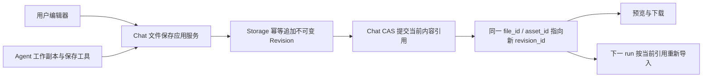

# 会话产物原文件编辑与保存

状态：当前。本文是 Chat 会话文件原内容编辑、同 Asset 多 Revision 保存与跨 run 恢复的现行决策；通用文件生命周期见 [files-and-assets](files-and-assets.md)。

决策键：Chat 会话产物如何在保持文件身份的同时允许用户与 Agent 保存修改，并通过下一 run 的文件重载恢复最新内容。

## 目标与范围

用户看到的是一份可持续编辑的文件，不是版本组。Agent 创建并发布产物，之后用户和 Agent 均可保存到该文件；只有 Agent 可以另存为一份独立文件。产品不提供版本编号、版本列表、版本切换或回滚入口。

首期覆盖 Chat-owned 文本产物：Markdown、JavaScript、TypeScript、Python、Go、Rust、HTML、CSS、JSON、YAML、普通文本等可安全解码的文本/代码文件。首期至少验收 `.md`、`.js`、`.py`、`.go`、`.rs`、`.html`。格式判断沿用已有预览分类并由后端给出可编辑能力；扩展名与声明 MIME 不能绕过内容编码、大小和权限检查。文本编辑采用独立内存预算 `CHAT_EDITABLE_FILE_MAX_BYTES`，默认 2 MiB，可由运维配置；这是 JSON/编辑器全量文本的资源限制，不改变 Storage 二进制流式上传额度。详情返回 `edit_max_bytes`，超预算文件保留预览/下载但不可编辑。请求解析前限制最坏 JSON 转义体积，解码后再检查实际 UTF-8 字节数。

非目标：二进制文件编辑、多人实时协作、CRDT/OT、持久 sandbox、文件系统实时双向同步、用户创建/另存为/重命名/删除文件、通用知识文档重构、版本管理产品。已有二进制生成、预览和下载保持可用；Agent 对已有二进制的覆盖编辑不属于首期承诺。

## 决策

1. `conversation_files.id` 是稳定的业务文件身份，前端卡片、文件列表、链接和 Agent 保存目标均使用它。不增加 `group_id`。
2. 同一文件保存时保持 `file_id` 和 `asset_id`，Storage 向该 Asset 追加不可变 Revision/Blob，Chat 以 generation CAS 原子更新该文件的 `revision_id` 及内容元数据。
3. 首次发布与另存为创建新 `file_id`、新 Asset；另存为不建立产品版本关系。Blob 可复用现有去重能力。
4. Chat 文件记录中的明确 `asset_id + revision_id` 是已保存内容的唯一业务权威。Storage 的 `current_revision_id` 不用于推断 Chat 当前内容。
5. 人和 Agent 共用同一个文件保存应用服务、权限校验、并发控制与幂等结果；只有输入内容来源不同。
6. 保留 run-scoped sandbox：每次新 run 的首次使用按 Chat 当前文件引用重新导入。已有只读 sources、可写 work/outputs、明确发布与销毁机制不变。
7. 不覆盖既有 Revision 或物理 Blob。内部 revision 是存储实现，不成为面向用户或模型的版本工作流。

概念关系如下，准确 wire 字段及错误类型在实施时落入 [schemas](../../schemas/AGENTS.md) 的所属契约，不以本文替代契约定义。

### 实现边界

| 边界 | 实现 |
| --- | --- |
| Chat | 稳定文件身份、保存操作幂等记录、内容 CAS 与 Claim intent |
| Sandbox | 精确 revision 导入、显式 checkout 工作副本、保存后推进该副本基准 |
| Storage | 同 Asset 追加不可变 Revision、上传尝试隔离与幂等重试 |
| 前端 | 按需加载编辑内容、Markdown/代码编辑、保存与草稿保护 |
| 恢复 | 保持新 run 从 Chat 当前精确引用重新导入 |

## 身份、权限与数据职责

### Chat

Chat 拥有文件的会话归属、用户权限、标题、文件名、类型、当前内容引用、编辑资格和保存操作结果。查询、保存、签发下载均验证 user/tenant/workspace/conversation/file 完整归属，禁止仅凭 asset_id 或 workspace 授予访问。

文件补充真实 `updated_at`、最近写入者信息和独立内容 generation。对外提供基于 generation 的不透明强 ETag，作为读取内容与保存操作之间的并发令牌；时间戳、文件名、Storage 全局 head 和模型自行填写的散列不能替代它。内容从 A 改为 B 再改回 A，旧令牌仍必须失效。

创建时 generation 初始化；每次成功改变已保存内容递增。内容与当前内容完全相同且基准有效时按无变化成功处理，不制造新的可见文件或更新时间。基准失效优先返回冲突，即使请求内容碰巧等于当前内容，也不能冒充本次基于最新状态的保存。

保存操作需要独立、持久的幂等身份及最终结果，不能反复覆盖现有文件行上的“创建幂等键”。幂等键绑定调用身份、文件、基准、内容摘要与操作类型；同键不同请求拒绝。幂等记录是操作恢复记录，不是文件历史版本列表。

### Storage

Storage 的既有模型和读取侧已经支持一个 Asset 下的多个不可变 revision：`asset_revisions` 以 `(asset_id, revision_number)` 唯一，调用方按精确 `asset_id + revision_id` 读取，Claim 也可绑定精确 revision。创建上传仍新建 Asset 并写入首个 revision；内部追加入口为既有文件写入后续 revision。

追加入口限内部已认证 caller，并绑定 tenant/workspace、目标 Asset、owner/slot/generation 与本次读取的 base revision。Storage 在 staging 前和最终提交时都校验该 caller 在目标 Asset 上的 strong Claim；不能因某服务知道 Asset ID 就允许任意跨 owner 追加。浏览器不能直接指定任意 Asset 创建 revision；首期文本保存由 Chat 接收并调用内部 Storage，执行独立文本字节预算。

在 Storage 本地事务中锁定目标 Asset，重新验证其状态与精确 Claim，分配唯一递增 revision_number、插入 Revision、更新 Storage head，并完成上传幂等结果与 upload lease。字节仍先 staging 后原子 promotion；失败和取消遵循已有残留清理。不得用未加锁的 `max + 1`。`deleting`、`deleted`、`quarantined` 禁止追加；`candidate` 只有在有效阻塞 Claim 与本次 upload lease 能恢复其 active 状态时才可提交。

Storage 完成只表示候选 revision 已耐久化；独立追加可以都成功，只有 Chat 的最终 CAS 决定哪一份成为该业务文件当前内容。Storage 的 `current_revision_id` 仅表示最近追加的 head，不保证是任意 Chat owner 的已发布内容；CAS 失败或 Chat 提交结果不确定时以同一操作键恢复，Chat 的读取、签发、fork 和 sandbox 导入始终传精确 revision。

### 文件元数据与 Plan

原文件保存不修改 filename、title、kind 或归属。内容散列、大小、媒体类型由服务端验证并与新内容一致；用户不能借保存接口把文本文件替换为不支持的二进制。另存为可由 Agent 选择新标题、文件名和类型，仍走现有发布验证。

Plan 同样是稳定文件。保存 Plan 保持 `active_plan_file_id`；首次发布/另存为 Plan 沿用已有选中逻辑。`data-plan-execution` 指向稳定 file_id，执行时解析当时当前 revision 并完整读取；历史消息中的旧 Plan 内容不能当作最新事实。一个已经开始的 run 使用其读取基准，不承诺用户中途修改能实时改变已开始的执行。

## 保存事务与恢复

### 读取

文件详情返回当前元数据、可编辑能力和内容 ETag。编辑器加载的 bytes 必须与该 ETag 对应：使用精确 revision 获取内容，不能先获取元数据再读一个会漂移的 latest URL。文件在加载过程中变化可以得到旧内容及旧 ETag，但两者必须一致，后续保存会正确冲突。

### 更新已有文件

1. Chat 验证已有文件、权限、编辑资格和基准令牌；登记或恢复同一保存操作。早期基准检查只用于避免浪费，不能替代最终事务校验。
2. 将提交内容以稳定的操作幂等键流式追加为该 Asset 的新 Revision；核对返回的 Asset、revision、散列、大小和类型。
3. Chat 在本地事务中按现有顺序锁定 conversation 再锁定 file，重新检查归属、存在性和内容 generation。
4. CAS 成功时，一起提交新 revision 引用、内容元数据、文件/会话更新时间、写入者、递增 generation、Claim intent 和操作成功结果。
5. 本地事务提交后才返回“已保存”。Claim relay 在事务外投递；不能把 Storage 上传成功或 HTTP body 发送完毕当成文件已保存。
6. 前端使用响应中的当前元数据刷新缓存并重新签发 preview/download URL。Agent 工具返回同一 file_id 和保存成功事实。

Claim intent 的 generation 随内容切换递增并绑定同 Asset 的新精确 revision，重置投递状态并使用已有 state_version fencing。旧 relay 回执不得把新 intent 标记完成；迟到的旧 generation 不得恢复旧 revision 引用。

### 幂等、失败与取消

| 情况 | 必须行为 |
| --- | --- |
| 上传失败、字节截断、类型不合法 | 原引用不变，不显示保存成功 |
| Storage 完成，Chat CAS 冲突 | 返回冲突，保留用户/Agent 草稿；候选 revision 仅由 upload lease 暂保，不自动覆盖或另存为 |
| Storage 完成，Chat 数据库暂时失败 | 同一操作可重试；不得为一次重试重复追加 revision |
| Chat 已提交但响应丢失 | 同键重试先读操作成功结果，再考虑基准冲突；不得二次保存 |
| 同一文件两次并发保存 | 至多一个基于相同 generation 的修改成功，另一个明确冲突 |
| 保存期间删除会话 | 最终事务重新检查会话；删除先提交则保存失败，保存先提交则删除释放最新 Claim |
| Stop/请求取消 | 未提交不切换；已提交不回滚文件，重试/查询可确认真实结果 |
| run 结束/进程丢失 | 只保留已提交文件内容；不宣称恢复临时修改或工具执行现场 |

幂等操作清理窗口必须覆盖已承诺的重试周期；在操作结果尚需恢复期间，不允许因清理幂等记录使重复请求变成第二次写入。Storage 追加执行租约为两分钟，成功后的上传幂等记录仍保留既有 24 小时窗口。失败或过期 uploading 尝试重试时，将旧记录标为 aborted、保留其清理责任，以新 upload ID 接管原幂等键；旧执行者不能提交或修改新尝试。

## Sandbox 与 Agent 契约

保留现有目录和生命周期：`sources/` 导入原始附件及已发布文件，只读；Agent 复制到 `work/` 或 `outputs/` 后编辑，使用保存工具明确提交。业务上的“原地修改”表示更新同一 file_id，不要求原地修改 sources inode，也不要求覆盖 Storage 字节。

`save_sandbox_file` 增加明确的“更新已有文件”和“创建文件”两种互斥意图。具体 schema 放在工具所属代码与生成契约中，遵循当前 SDK 严格 schema 支持方式。语义要求：

- 创建用于首次发布或另存为，沿用 path/filename/title/media_type；返回新 file_id。
- 更新必须指定已存在 file_id 和本次读取对应的基准，内容来自明确 sandbox path；返回原 file_id。禁止文件不存在时退化创建。
- 不按同名、标题、最近活跃产物或模型猜测决定覆盖目标。
- 更新前必须通过 `checkout_conversation_file` 把指定导入 ETag 的精确 bytes 复制到目标工作路径。它会替换目标草稿；冲突后须先保留自己的修改，refresh 后重新 checkout 并重做修改。
- RunSandbox 在导入时记录 file_id 对应的 revision/generation；保存必须使用该已读取基准。不得在提交前偷偷取最新令牌为旧工作副本“升级”基准。
- 成功更新后，记录该工作副本的新基准，允许同一 run 再次编辑并保存；其他旧副本仍保持旧基准，不能因同 file_id 被保存过就获得新令牌。
- 冲突作为可解释的业务失败返回。Agent 可显式刷新 sources、读取新内容、重新应用修改，再保存；不能只换令牌重传旧内容。另存为仍是 Agent 有意选择的独立操作，不能作为冲突自动降级。
- 正常结束、Stop、异常均沿用现有资源释放；文件写入本身不触发自动发布。

每次新 run 导入 Chat 当时当前的文件内容，天然包含用户前次保存。运行中的 sources 不实时变化；`refresh_conversation_sources` 保留显式刷新能力，不能覆盖 work/outputs 中未保存修改。若改动刷新语义，必须保持上传是完整文件替换，不能让命令读到半份导入文件。

不增加持久工作区、文件 watcher、后台同步进程或全局 Agent 调度锁。文件 CAS 只保护文件提交，不串行化整个工具循环。

## 前端编辑行为

| 类型 | 编辑器 | 预览 |
| --- | --- | --- |
| Markdown | 复用 `MarkdownEditor`，提供 `CodeEditor` 源码回退 | 沿用现有 Markdown 展示 |
| 文本/代码 | 复用 `CodeEditor`，按文件类型选择语言能力 | 沿用代码展示 |
| HTML | `CodeEditor` 编辑原始 HTML | 现有 iframe，提供“预览/源码”切换 |
| 不支持或不能无损解码的文件 | 无编辑入口，后端也拒绝 | 现有预览与下载 |

复用组件，不复用 Knowledge 的资源归属和保存 API。Chat-owned 文件仍由 Chat 保存，禁止为编辑创建 Knowledge document 或复制一份脱离原 file_id 的资源。

首期使用明确保存动作与快捷键，不按每个按键追加 revision。编辑状态至少区分加载中、未修改、已修改、保存中、已保存、冲突和失败。保存失败保留草稿；关闭/切换存在未保存修改时提供保存、放弃或取消操作。用户界面不出现另存为和新建入口。

保存期间用户继续输入时，响应只确认已提交的那份草稿；后续输入仍标记未保存，不能被响应覆盖或错误标为已保存。重复点击复用该次操作身份；新一轮内容保存生成新操作身份。冲突不自动重试覆盖，允许保留草稿并重新加载/对照当前内容。

HTML iframe 预览最近一次保存成功的原文件；源码草稿不自动注入宿主页，也不新增草稿脚本执行环境。保存成功重新解析当前 revision 并续签 URL，保持现有 CSP/iframe 隔离、资源加载与下载规则。切换预览不等于保存。

CodeEditor 保存原始文本，不做 JSON parse/stringify 或默认格式化；支持的编码须明确，不能用替换字符静默解码后覆盖原件。Markdown 使用已有 MarkdownEditor，初始化和外部赋值不触发保存；实际编辑才更新草稿。含原始 HTML 的 Markdown 使用源码回退以免富文本解析丢失原始标签；用户也可显式切换源码。保真测试覆盖代码围栏、链接和表格。

保存成功刷新文件详情、列表/卡片元数据、预览和下载缓存。历史消息中的 file_id 仍打开当前文件；历史工具结果记录当时操作事实，不批量改写旧消息。其他标签页不要求实时同步，重新聚焦/打开可刷新，旧编辑页由 CAS 防止覆盖。优先复用现有工具完成事件和查询失效，不另建一条 SSE；确需新增 stream 字段时遵守 [stream contract](../../schemas/streaming/chat-uimessage-stream.md)。

## 分支、引用与回收

会话 fork 延续现有规则：创建独立 file_id/owner/Claim，引用分支时的精确 Asset/revision，共享不可变字节。分支随后可向共享 Asset 追加 revision，但仅更新本分支的 Chat 引用；另一分支不得跟随 Storage head。用户另存为与会话 fork 是不同操作，前者创建新 Asset，后者保留既有快照共享。

首期明确沿用现有 **Asset 级回收**：只要 Asset 仍有阻塞 Claim，其 revisions 均保留；旧 revision 以及上传完成但未赢得 Chat CAS 的 revision 不立即删除。整个 Asset 无保留引用、upload lease 到期并满足保留窗口后，再按现有 fencing 与共享 Blob 检查回收。首期不顺带引入 revision 级 GC。

这是同 Asset 追加方案的已知成本：长寿命文件的存储随保存次数增长，失败追加也可能占用字节直至 Asset 可回收。明确保存、无变化不追加及幂等重试减少无意义写入，但不构成容量上限。必须沿用配额/容量检查和运维观测；不能宣称旧内容已即时释放。以后若增加 revision 级 GC，需单独设计精确 revision Claim、未投递 intent、活跃下载 capability 与共享 Blob 的保留语义，不能简单删除“非 head revision”。

## 兼容与迁移

- 只追加版本化迁移，不能修改已应用 baseline、重置数据库或原件。遵循 [数据库迁移规范](../开发规范/database-migrations.md)。
- 旧 conversation_files 保持 file_id、asset_id、revision_id、标题与引用；回填真实 updated_at 为 created_at，generation 初始化为有效起点。旧文件可在资格检查后直接编辑，不需复制迁移字节。
- 旧文件创建幂等键保持含义；新增保存操作持久记录及其唯一性约束。历史作者缺失使用可表达的未知值，不伪造用户身份。
- Storage 既有 revision_number=1 保持有效；新增追加入口分配后续序号，不改变旧创建上传及所有非 Chat 消费者语义。
- 新保存工具与接口以增量方式引入；旧的不带更新意图的发布请求仍创建新文件。不能把旧请求按同名自动解释成覆盖。
- 部署时迁移、Storage、Chat 与前端需按配套版本发布；不支持新旧 Chat 进程混跑。仅在后端能力可用时展示编辑。
- 本次不承诺旧版应用回退兼容；不为此增加数据库默认值或双写。保留数据，不做 schema downgrade 或重置。
- 实施完成后同步 [files-and-assets](files-and-assets.md)、[agent-runtime](agent-runtime.md)、[Chat](../微服务/chat.md)、[Storage](../微服务/storage.md)、[Sandbox](../微服务/sandbox.md) 和 Chat 就近规则。宽泛文档仅保留概要与本文链接，不复制完整保存状态机。

## 实现入口与边界

| 责任 | 阅读/修改入口 |
| --- | --- |
| Chat 文件发布、读取、fork、Claim | [conversation-files.ts](../../apps/backend/services/chat/src/application/conversation-files.ts)、[asset-claim-relay.ts](../../apps/backend/services/chat/src/application/asset-claim-relay.ts)、[持久模型](../../apps/backend/services/chat/src/infrastructure/persistence/schema.ts) |
| Chat HTTP 文件鉴权及保存 | [conversations.ts](../../apps/backend/services/chat/src/api/http/routes/conversations.ts) 与现有 delivery 应用层 |
| Sandbox 导入、基准与发布 | [sandbox-session.ts](../../apps/backend/services/chat/src/application/agent/tools/builtins/sandbox-session.ts)、[runtime.ts](../../apps/backend/services/chat/src/application/agent/tools/builtins/runtime.ts)、对应测试与指令 |
| Storage 追加与事务 | [service.go](../../apps/backend/services/storage/internal/application/service.go)、[ports.go](../../apps/backend/services/storage/internal/application/ports.go)、[repository.go](../../apps/backend/services/storage/internal/infrastructure/persistence/repository.go)、HTTP/OpenAPI 与迁移 |
| 服务间传输 | [storage.ts](../../apps/backend/libs/transport-ts/src/storage.ts) 与生成契约；禁止跨服务导入源码/查库 |
| Chat 编辑面板 | [ChatFileArtifactPanel.tsx](../../apps/frontend/packages/chat/src/components/ChatFileArtifactPanel.tsx)、[ChatArtifactPreview.tsx](../../apps/frontend/packages/chat/src/components/ChatArtifactPreview.tsx)、文件列表/卡片与查询缓存 |
| 编辑器复用参考 | [ChatDocumentArtifactPanel.tsx](../../apps/frontend/packages/chat/src/components/ChatDocumentArtifactPanel.tsx)，只复用组件及交互经验，不改变 Knowledge 流程 |

执行时先运行 `just context <path>` 并读取相关 AGENTS；前端按要求读取 DESIGN，契约修改先读 schemas 路由。一个主 Agent 负责端到端交付；本文不授权拆分前后端所有权。先补行为测试，再实现 Storage 追加、Chat 保存事务、Agent 工具和前端编辑，最后联调并同步当前规范。实现若发现本文依赖的既有机制与代码不符，先核实并原地修订设计，不保留互相冲突的说明。

## 验收与验证边界

| 场景 | 可观察断言 |
| --- | --- |
| 用户保存 md/js/py/go/rs/html | file_id/asset_id 不变，revision 更新，列表不新增，重新打开得到保存内容 |
| Agent 修改已有文件 | 读取后在工作副本编辑并保存，原卡片/链接解析到当前文件 |
| Agent 另存为 | 新 file_id/Asset，原文件内容与引用不变 |
| 人无创建权限 | 不存在目标、伪造 ID、换归属或调用创建操作被后端拒绝 |
| 下一 run 恢复 | 销毁旧 sandbox 后新建，导入用户/Agent 最近提交的精确 bytes，包括尾随换行 |
| 同一 run 多次保存 | 正确工作副本可继续保存；旧副本/旧读取基准仍冲突 |
| 人与 Agent/两个标签页并发 | 相同基准最多一个修改成功，另一份草稿保留且原内容不被覆盖 |
| 重试与响应丢失 | 同键只追加一次/提交一次；已成功请求的旧基准不导致伪冲突 |
| 上传成功但提交失败 | 文件仍指向旧内容；重试有确定结果；不能跟随 Storage head 提前展示 |
| Claim 乱序/延迟 | 新 intent 不被旧回执确认或覆盖；当前文件字节可读 |
| fork 后独立编辑 | 两分支共享初始 bytes，更新一方不改变另一方；删除一方不破坏另一方 |
| 删除、Stop、回收竞态 | 无已删会话复活，无已提交内容因取消丢失，无共享 Blob 误删 |
| HTML 源码与预览 | 预览展示保存内容；隔离保持；保存后换新 URL，草稿切换不隐式保存 |
| Markdown/代码保真 | 未编辑不重写；特殊语法不静默丢失；非法编码不覆盖原件 |
| 保存中继续输入 | 返回响应不覆盖后续输入，仍显示未保存状态 |
| 升级兼容 | 旧文件无需改 ID/字节即可读取和编辑；非 Chat 上传/读取仍通过 |

检查从根执行，以 `just test-list` 和 `just context` 确认实际 target：

- 受影响测试：`just test backend/storage`、`just test backend/chat`、transport-ts 对应 target、`just test frontend/@repo/chat` 及受影响 API/编辑器包。
- 契约：`just sync`，核对 Storage → transport → Chat → frontend 全链路，禁止手改生成输出。
- 构建/静态检查：`just build storage`、`just build chat`、`just build frontend`、根 `just lint` 与 `just check-repo`。
- 迁移：所属新迁移校验和、`just migrate-check`、`just test-db-migrations`，在保留旧数据的测试库验证升级。
- 集成：真实 PostgreSQL 验证 CAS、追加序号、操作幂等、Claim 乱序和删除 fencing；真实 Storage 文件卷验证追加、精确读取与回收；sandbox 集成验证新 run 重载。如果改动 sandbox 行为，运行其目标测试/构建和 `just test-sandbox-integration`。
- 渲染：真实浏览器验证 Markdown 编辑、HTML 源码切换/iframe 保存刷新和未保存提示。DOM/mock 测试不能证明 iframe 隔离或网络加载正确。

缺少依赖、真实数据库、Docker 或浏览器时记录未验证项，不将跳过视为通过。实现交付必须运行受影响测试、构建及真实边界验证。

## 依据、替代方案与代价

Codex 官方 [App Server](https://learn.chatgpt.com/docs/app-server#filesystem) 描述路径式文件读写、变化通知，以及会话历史与文件状态分离。这支持稳定文件身份和独立文件状态的产品语义；公开文档没有证明 Codex 云端 artifact 的表结构，本文不声称复刻其内部存储。

OpenAI [Sandbox 恢复文档](https://developers.openai.com/api/docs/guides/agents/sandboxes#resume-or-seed-future-work) 区分运行状态、sandbox session 与文件 snapshot。本项目选择保持已有每 run 重建并加载已保存文件的方式，不引入供应商 SDK 的恢复实现。

[S3](https://docs.aws.amazon.com/AmazonS3/latest/userguide/conditional-writes.html) 与 [Google Cloud Storage](https://cloud.google.com/storage/docs/request-preconditions) 的条件写入说明通过 ETag 或 generation 基准防止并发覆盖；[Google Drive](https://developers.google.com/workspace/drive/api/guides/manage-revisions) 将稳定 file ID 与内容 revision 区分。本项目同样分离 Chat 文件身份和不可变存储对象，但把最终 CAS 放在 Chat 数据库，使用业务 generation ETag，不要求使用云对象存储，也不把 Blob 散列或 Storage head 当成文件 generation。

| 备选 | 不采用的原因/取舍 |
| --- | --- |
| 每次修改新建可见 artifact | 用户的保存变成另存为，无法满足稳定文件体验 |
| 新增 group/version 产品模型 | 首期无版本浏览/回滚需求，稳定 file_id 已承担身份 |
| 直接覆盖旧 Blob | 破坏不可变引用、共享字节、散列、缓存和分支隔离 |
| 稳定 file_id，每次换新 Asset | 可复用当前上传并让失败候选独立回收，但丢失 Storage 层稳定文件身份；本次明确补齐单 Asset 多 revision 能力，接受 Asset 存续期内旧 revision 一起保留的成本 |
| 常驻 sandbox 与实时双向同步 | 当前每 run 重载已满足恢复要求，额外引入脏工作区、同步和运行资源生命周期 |
| 最后写入者覆盖/用全局锁禁止编辑 | 前者丢用户修改，后者不必要地限制整个 run；文件级 CAS 更符合本范围 |
| 本轮增加 revision 级 GC 或实时协作 | 均是独立复杂生命周期，不是首期文件编辑的必要条件；明确保留上述容量成本与冲突处理限制 |
