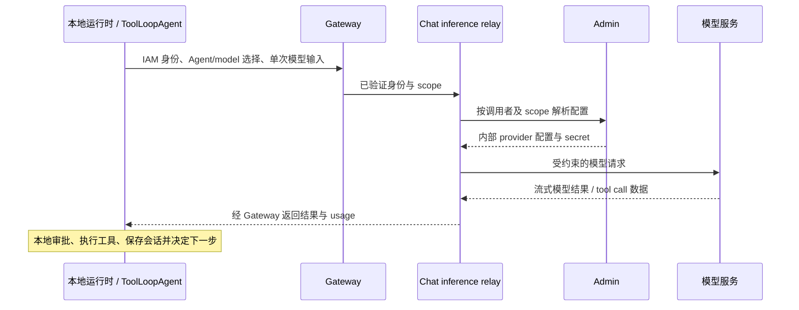
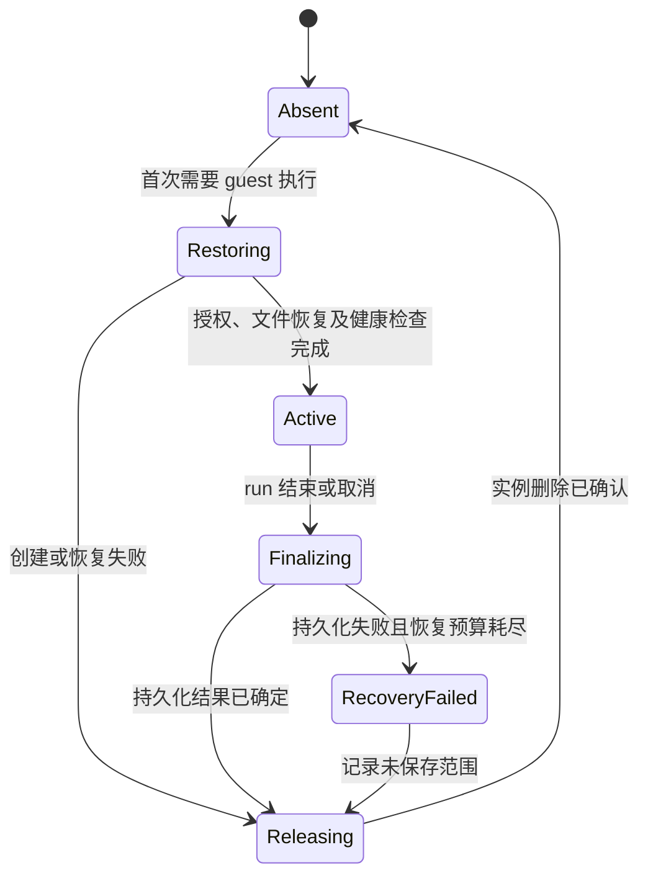

# 以 Codex App 核心模型构建本地与云端 Sandbox

状态：部分实现。云端稳定路径、自动工作区持久化、durable 实例收尾、运行中同目录编辑协调与 Agent 外部变更感知已进入代码；目标环境仍须完成停写回填、最终约束切换和生产故障验证。本地 Electron URL 宿主、共享 harness 的原生执行宿主、原生 IPC 流、SQLite journal、macOS Seatbelt、文件编辑及 Chat inference relay 已进入代码；正式分发和真实 provider 联通仍需目标环境验收。当前行为见 [Sandbox 服务](../微服务/sandbox.md) 和 [会话文件编辑](editable-conversation-files.md)。

决策键：如何全面参考 Codex App 的核心模型，零兼容重构本地与云端会话、执行、工作区和权限，并在用户与 Agent 编辑同一文件的前提下管理持久化、恢复和云端资源成本。

## 首要原则：以 Codex App 的核心模型重新建模

以 Codex App 及其公开 App Server 的核心模型为主参考，覆盖客户端与运行时分离、Thread/Turn/Item、工作区与执行位置、命令进程、权限与审批、会话继续和文件操作。不是只模仿本地/云端选择器，也不是在现有 `RunSandbox` 上增加一个 local provider。

设计从这些模型及本项目的产品约束出发，现有数据库形状、HTTP 路由、工具接口、状态机、目录结构和类名都不是必须保留的约束。不要求旧客户端、旧 API、旧工具调用或旧运行状态兼容；不建立长期双轨或兼容适配层。保留已有实现必须因为其符合目标模型，而非为了减小改动。

“全面参考”以公开资料可确认的模型为边界：不把 Codex App 当作可完整复制的开源产品，不把其 UI 行为推断成未公开的后端实现。模型与职责借鉴 Codex；Agent 循环及消息原语继续使用官方 AI SDK；未公开的云端回收、持久化和成本策略由本 ADR 明确决定。

| Codex 参考概念 | 本项目的目标语义 | 必须区分的边界 |
| --- | --- | --- |
| Client / App Server | Electron 或 Web 是客户端；独立 Agent 运行时拥有执行和会话生命周期 | 界面组件、连接或窗口不拥有命令进程的寿命 |
| Thread | 可恢复的会话，创建时绑定本地或云端及其工作区 | 会话不等于一个容器、一个进程或一条网络连接 |
| Turn | 一次用户请求及其模型推理、工具执行与结果；本文称逻辑 run | 一轮可以包含多个 model step；HTTP 重连和工具结果回传不天然创建新一轮 |
| Item | 消息、命令、文件变更、工具结果等可观察的输入输出单元 | 对接 SDK 原生消息/工具原语，不另造平行的模型历史或通用事件包 |
| Workspace / cwd | Agent 实际读写的文件目录；用户与 Agent 面对同一文件 | 工作目录不等于授权边界，也不等于 IAM workspace |
| Local / Worktree / Cloud | 本地原目录、可选的本地隔离工作副本、独立云端工作区 | Worktree 仍是本地；本项目的会话模式不可变，且不提供跨模式同步 |
| Cloud environment | 预置工具、依赖、初始化和访问配置 | 可复用环境不等于某个任务的可写文件，也不要求实例常驻 |
| Command / process | 受管理的命令、输出、退出结果、取消和子进程 | 命令完成、Turn 完成和 Thread 结束分别处理 |
| Permissions / approvals / sandbox | 权限策略确定可访问能力，审批决定是否允许动作，sandbox 执行限制 | `cwd`、提示词或用户点过同意不能替代 OS/执行环境隔离 |
| Resume / fork | 继续既有会话与创建独立会话是不同操作 | 对话恢复不等于进程恢复；不要求跨模式恢复或迁移 |

上述是语义映射，不要求复制 Codex 的 wire 字段或替换本项目 SDK。工程上的执行 attempt、租约、恢复清单及存储引用是实现对象，不冒充 Codex 公开核心原语，也不成为额外的用户工作流。审批/工具结果续接应保持原 Turn 归属；新的独立用户请求创建新 Turn，不能只按 HTTP 请求次数划分逻辑执行。

## 背景与决策

本地模式使用用户本机资源，直接操作指定目录，不要求上传文件、交付物或会话记录到云端。云端模式消耗平台计算和存储资源，需要在保持文件连续性的同时及时释放实例。两种模式不需要状态兼容、会话迁移或工作区同步。

采用以下终态：

1. 创建会话时确定 `local` 或 `cloud`，会话存续期间不可切换；使用另一模式必须创建新会话。
2. 本地使用独立本地运行时，在授权目录中执行命令和操作文件；本地 sandbox 是权限边界，不等于终端，也不要求每个 run 创建容器。
3. 云端按 run 懒创建隔离实例，同一 run 复用；run 结束后完成持久化和清理，销毁实例；后续 run 创建新实例并恢复文件。
4. 用户与 Agent 操作同一逻辑文件和稳定路径，例如 `/workspace/demo.js`。不引入面向用户的文件版本、分支、提交或合并工作流。
5. 云端内部使用不可变 Storage 内容、并发令牌和恢复清单保证完整性；这些是实现细节，不产生第二套用户文件。
6. 文件持久化是运行时责任；把文件显示为成果是产品行为，两者分开。模型不负责手工搬运 revision、复制只读 source 或记得保存每个草稿。
7. 会话历史、执行实例、文件内容和进程具有不同生命周期。恢复文件不等于恢复内存、终端或重新执行历史命令。

不改变 IAM 对租户和组织工作区的所有权。下文“执行工作区”指会话文件目录，不是 IAM workspace。

## 范围与非目标

包含 Electron 本地执行与推理凭据边界、云端实例生命周期、稳定文件路径及旧数据迁移、用户编辑感知、文件恢复、权限和资源回收。继续使用官方 AI SDK 的 Agent、工具循环、消息与流原语，harness 只承担环境、授权、持久化和取消边界。

不包含本地与云端同步、跨模式继续原会话、CRDT/OT、通用 Git 替代品、透明迁移运行进程、任意 shell 的 exactly-once 执行，以及无界常驻开发服务器。Git worktree 可以成为本地独立能力，不是直接编辑普通目录的前提。

本地使用云端模型时仍会传输必要的模型输入并产生推理成本；“不上传云端”在本决策中指本地会话和文件不依赖云端持久化，不意味着云端模型可以在没有输入传输的情况下推理。

## 模式、身份与所有权

| 对象 | 本地模式 | 云端模式 |
| --- | --- | --- |
| 会话与执行记录 | 本地运行时管理本地持久记录 | Chat 管理会话、run、执行结果 |
| Agent 循环与工具调度 | 本地运行时拥有 `ToolLoopAgent` | Chat 拥有 `ToolLoopAgent` |
| 模型调用与 provider secret | 本地经 Chat inference relay 推理；secret 留在服务端 | Chat 经 Admin 授权解析 secret 后推理 |
| 执行工作区 | 用户明确选择的目录 | Chat 管理文件身份、路径和持久引用 |
| 文件字节 | 本地磁盘是权威内容 | Storage 管理不可变字节；Chat 决定当前业务引用 |
| 活跃文件操作 | 本地运行时与用户外部编辑器 | 经 Chat 协调，由 Sandbox 操作活跃目录 |
| 执行进程 | 本地执行宿主管理 | Sandbox 服务及 guest supervisor 管理 |
| 成果 | 本地文件引用、预览与打开 | 会话文件引用、Storage 预览和下载 |
| 恢复 | 打开原目录并检查实际内容 | 新建实例，按当前持久引用恢复 |
| 跨模式行为 | 不自动上传、转换或切换 | 不自动拉取或覆盖本地目录 |

会话身份、run 身份、执行实例身份和文件身份分离。路径只在绑定的工作区内有意义，不能仅凭绝对路径访问另一会话。每个云端 run 重新授权，实例控制绑定 tenant、IAM workspace、user、conversation、run 和执行代际；旧执行者不得覆盖新 run 的文件引用或删除新实例。

共享的可以是客户端组件、Agent 核心及工具行为契约，不要求两端使用相同数据库、目录布局、checkpoint 格式或恢复实现。具体跨进程和跨服务 wire contract 由 [schemas](../../schemas/AGENTS.md) 定义，不在本 ADR 固化一套伪代码 API。

## 唯一 harness 与工具协议

`apps/backend/libs/agent-runtime-ts` 是两个执行位置的唯一主循环实现，使用官方 AI SDK 的工具执行、审批与流原语。Chat `createToolLoopAgent` 负责注入云端资源和观测；Electron `session-host.ts` 负责注入本地资源和 journal。宿主不自定义第二套 `prepareStep`、终止策略或工具结果协议。

两端文件操作共用 `createBashTool` 的 schema、说明、manifest、审批策略与 `ToolOutcome`，以 `toolMetadata.agent.uiKind=terminal` 交给同一个 ChatStream 渲染。本地没有独立的 `list_files/read_file/write_file` 模型工具；原生文件 helper 仅用于文件编辑器受限 I/O。云端必须通过共享 `createUploadArtifactsTool` 一次批量把完成文件发布为 Chat/Storage 身份，并把成功结果逐文件投影为 `data-file`。本地磁盘已经是持久化边界，因此不向模型暴露上传工具；本地 runtime 在 turn 的 `finish` 前验证本轮真实变更文件，直接生成同构 `data-file`。两端由同一个正文 `ChatFileTag` 渲染，不把模型生成的 HTML/XML 字符串当 UI 协议。其他服务能力由已授权 catalog 提供；能力缺失不意味着另一套工具协议。

固定提示词组装器共用核心策略和执行协议；工作区路径、网络与文件持久化/发布能力是环境事实。变更提示仅作为一次性临时上下文，不写成新用户请求。普通能力问答直接回答，不因工具存在或目录监听而启动检查循环。

`application/local-inference` 已移除。`application/inference/provider.ts` 统一模型构造，服务端直连与原生 relay 共用 provider 设置；relay 只传输单次推理，不拥有 Agent-loop。现有 `/local-inference/*` HTTP 地址仅保留为已安装客户端的传输入口，不对应独立运行时或日配额。已有计量表和会话数据不重置。

## 本地模式

### 桌面入口与资源加载

Electron 是现有 Platform 的宿主，所有页面继续由 Platform / Chat MFE 提供。
日常 `just dev` 仍启动 Web，不自动启动桌面；`just desktop-dev` 显式打开 Electron，
`just desktop-package` 生成 macOS `.app`。当前按用户选择通过 URL 加载 localhost
或 VPS 的 Platform 根地址，绑定精确 origin 和主 frame 的 preload 能力。
远程 HTTP 只允许显式开发验证开关；renderer 不获得 Node 或通用 IPC。

**TODO（正式版本发布前）：改为安装包内置 Platform 与 MFE 资源。**
届时调整页面资源协议与网关配置，沿用相同能力契约和本地运行时，不创建第二套 UI。
内置资源、离线历史、签名公证和版本完整性尚未验收，当前产物是开发验证包。
具体命令和发行待办见 [Desktop README](../../apps/frontend/apps/desktop/README.md)。

### 当前本地实现与边界

Web 与 Electron 的云端/本地会话共用 Chat 侧栏、`ChatStream` 消息渲染和 `ChatPrompt` 富文本输入框。
两种 controller 共同渲染唯一 `ConversationSessionView` 会话骨架；标题栏、消息区、问题区和 composer 布局不按 runtime 复制。可选能力用回调/adapter 显式注入，缺失时不渲染对应动作，不传空函数伪装支持。
只有 Electron 新建会话时在输入框工具栏选择「云端 / 本地电脑」，发送时创建对应会话；本地模式随后请求原生目录授权，取消不创建云端会话。
Web 不渲染执行位置选择器并固定创建云端会话；已有会话的模式不可切换，因此也不渲染伪选择器。本地文件通过会话内文件面板访问，关闭面板不得丢弃未保存草稿。

- `apps/frontend/apps/desktop/electron` 的 main 管理身份与原生授权，utility process
  调用共享 `@backend/agent-runtime-ts` harness，管理 SQLite journal。Chat MFE `/local/:id?` 通过
  `useChat` 与 IPC `ChatTransport` 消费 SDK 原生 UIMessageChunk；重连从原始消息及
  当前流片段重放，仅取消订阅不会 Stop。契约由 [schemas/desktop](../../schemas/desktop/README.md) 生成两端。
- 本地 journal 的 authority 是稳定 runtime home，而不是 Electron `userData` 或应用名。默认 `~/.monorepo-agent`，绝对路径环境变量 `MONOREPO_AGENT_HOME` 可覆盖；身份分区数据库位于 `sessions/<scope>/sessions.sqlite`。Desktop 与未来 CLI 只有指向同一个 runtime home 才共享本地会话；不同机器、容器或 home 自然隔离，项目文件仍以会话绑定的原目录为准。
- 从旧 Electron 目录切换时，一次性导入已知开发版和打包版 journal，Thread ID 冲突按 `updatedAt` 选择较新的整份历史。导入与来源标记在同一事务提交，旧库保留用于回滚；已导入来源不重复读取，避免用户删除的会话被旧数据复活。SQLite 是本项目的 journal 实现细节，不作为 renderer、CLI 或云端数据库的共享契约。
- 原生目录授权由 main 显示确认；工具审批沿用共享 manifest/policy 与 SDK 原生审批状态；账户/租户/工作区和 origin 分区保存
  journal，切换身份关闭旧 runtime。没有本地记录到云端会话或 Storage 的写入路径。
- macOS Seatbelt 同时约束 Bash 和文件 helper，目录身份在每次调用前复核；默认断网，
  最小环境，应用控制目录被拒绝访问。native supervisor 通过继承的独立策略标记识别
  后代、监测父进程死亡并清理 detached 子进程；依赖 macOS sandbox SPI，启动探测失败
  即拒绝执行，需在每个支持的 OS 版本/架构上验证，不能等同于受支持的公共 Apple API。
- 文件工具与用户保存按同一本地目录串行；同目录至多一个活跃 Agent。普通 UTF-8
  文件编辑上限 2 MiB，hash 比较拒绝旧内容覆盖，保留文件执行权限。目录观察提供变更
  提示，文件真实内容仍是权威来源；外部编辑器与 shell 不参与全局事务。
- 首发固定工作区读写、系统运行依赖只读、命令网络关闭；不支持动态扩大权限、持久开发
  服务或 Windows/Linux 本地执行。Node 由 Electron 提供，用户 shell 配置和 Homebrew
  环境不会自动继承。每条命令默认 120 秒、输出 8 MiB；文件 helper 30 秒；模型循环沿用
  项目 50 step 上限，单段 UI replay 16 MiB，超限失败并清理，均为本项目运行保护策略。
- 本地模型不使用远端存储的 response lineage。上下文超过 relay 准入预算时明确拒绝并
  保留历史，用户可新建会话；当前没有自动摘要压缩，不能声称无限长会话续接。
- Chat relay 只做一次模型推理，验证 IAM scope、Admin 授权模型与生成参数；每用户/组织
  工作区一个并发请求，PostgreSQL 事务记录预留与实际 usage，未知结果保留预留用量。
  本地与云端共用 IAM/Admin 授权规则，不设置本地专属日额度或默认关闭开关；既有用量表
  保留用于 accounting，不承担独立配额准入。不保存 prompt、工具结果或文件。上游五分钟硬限时、8 MiB 输出上限，不自动重试。
- 工作区创建不产生虚假变更提示。真实 watcher 变更按会话和版本仅通知一次，作为当前模型步骤的临时系统上下文，不追加用户消息；普通问候和能力介绍不要求读取目录。
- 运行中 composer 保持可编辑；补充内容经带 `expectedTurnId` 的受限 IPC admission 调用 `steer()`，进入该 turn 唯一的 AI SDK steering 通道，并在 editor 上方显示到 SDK 确认于下一个 step 投递。`not_delivered` 保留为可见失败状态，不自动成为下一 turn；应用崩溃前仅确认 admission、未确认模型接收的输入标记 `unconfirmed`，同样不自动重放。已投递内容由官方 `steering-message` part 进入本地 journal，不能再复制一条用户消息。
- 窗口重载/关闭保留 utility 任务（macOS 应用仍在后台）；退出应用停止执行。
  崩溃恢复仅恢复 journal，并将运行中工作标记 interrupted，不重放未完成工具。
  实现验证含真实 Electron + mock provider 集成和真实 macOS 沙箱测试；不代表真实
  provider、分发签名或所有 macOS 版本验收。

### 运行时与权限

Electron renderer 负责会话和文件界面；main 负责目录选择、桌面授权和运行时生命周期；Agent、文件访问、命令监督与会话持久化放在独立本地运行时。界面刷新或订阅断开不自动终止 run。

本地运行时提供受限 IPC，不向 renderer 暴露任意宿主 shell 或任意文件访问。Electron renderer sandbox 与 Agent 命令的 OS sandbox 是不同边界；`cwd` 只决定命令起始目录，不能代替访问控制。

用户指定的工作目录构成写入授权范围，读取范围、临时目录、运行时依赖和网络权限由有效策略明确决定。文件工具与命令都必须执行相应策略，覆盖路径穿越、符号链接和目录替换；不能仅凭字符串前缀判断安全。平台能力不足时明确失败，不隐式改为无约束执行。

### 本地推理与 provider 凭据

共享 `@backend/agent-runtime-ts` 拥有唯一主 `ToolLoopAgent`、固定提示词组装、工具封装、step 和审批策略。本地 session host 仅提供沙箱、文件变更、模型连接和 journal 适配；云端 host 提供对应的服务适配。服务端 `application/inference` 为共用模型访问层，流式 relay，只执行一次受授权的模型调用；Gateway 继续承担身份验证和流式路由，不承载 Agent 或 provider 业务。复用 [身份与配置](identity-and-configuration.md) 的所有权：IAM 管理身份和成员关系，Admin 管理 Agent/provider/model 配置及凭据，Chat 校验模型使用权限与预算并执行转发。

桌面端只取得授权后的非敏感 Agent 配置、模型标识与能力信息；不得下发内部 provider snapshot、apiKey、服务间 credential 或可复用上游认证头。不引入 BYOK，也不让 Chat 为本地会话创建云端 conversation/run 或代跑 Agent 循环。桌面登录凭据由可信宿主持有，不注入命令环境、工作文件或模型上下文。

relay 必须满足以下边界：

- 每次调用按真实 IAM 身份验证 tenant/workspace 成员资格、Agent 使用权、启用状态、允许的 provider/model 与额度。客户端传来的 ID、模型参数和已展示的模型列表都不能替代服务端授权；管理员变更配置后，后续调用重新校验。
- 上游地址、dialect、认证和额外参数由服务端授权配置决定，并执行出站地址校验。拒绝客户端任意 URL、认证头、未授权模型、任意透传参数及绕过地址校验的重定向。多模态输入也不能让 relay 任意抓取客户端指定地址。
- 只传递模型输入、输出、工具声明及工具结果数据；tool call 的审批与执行始终在本地。不得获得本地文件操作权、启动云端 sandbox，或接受上游托管的 shell/文件执行工具。relay 不接受远程控制本地工具的回调通道。
- 用 AI SDK 的模型与流原语承载单次推理；跨进程模型调用契约归 `schemas/`，不把 Chat 的整轮 UIMessage 流当作模型传输协议。请求大小、输出、并发和预算由服务端约束；准入时预占预算，按结果结算，未确定结果不能当作零消耗无限重试。
- 断连或取消须中止上游请求并释放请求资源；输出已开始或上游结果未知时不透明重放。重试使用可对账的请求身份，避免重复计费；无法证明上游未执行时，如实返回未知结果，由本地运行时决定后续动作，不承诺供应商 exactly-once。
- 服务端不持久化本地 prompt、响应正文、工具参数/结果、文件字节或会话历史，不使用云端消息表、Redis 回放或内容日志保存它们。只保留必要的请求身份、授权结论、usage、计费及故障元数据；日志、trace、错误采集同样不得携带正文和 secret。配额记录不代表服务端拥有本地会话。

本地 journal 是继续会话的唯一持久历史来源，relay 不维护服务端会话游标。默认逐次提交所需上下文，不依赖服务端保存的 `previous_response_id`；支持的 provider 应关闭可关闭的响应存储。供应商自身的日志、缓存与保留政策仍须按 provider 明示，不能把“平台不持久化”宣传为上游零保留。模型上下文包含被选择的本地文件内容时，界面需如实说明它会经 relay 传给模型服务。

此边界是本项目基于既有 IAM/Admin 与集中 provider 配置作出的设计，不声称 Codex App 使用同样的 relay。原始内部 snapshot 只留在受信服务端调用链。

### 首发平台与 OS 强制机制

首发本地模式只支持 **macOS + Seatbelt**。这是本项目发布范围，不是 Codex 的平台限制；当前仓库尚无 Electron 桌面入口，增加 Electron main、独立运行时、签名打包及原生隔离启动器属于必要实现。

| 平台 | 本项目首发行为 | 后续加入的强制机制 |
| --- | --- | --- |
| macOS | 通过 Seatbelt 启动隔离的命令和文件工具进程；启动自检失败则拒绝本地执行 | 在发布声明的系统版本与 CPU 架构上验证签名包、策略与子进程继承 |
| Linux / WSL2 | 明确标记本地模式不可用，在任何工具执行前拒绝 | 单独实现并验证 bubblewrap、所需内核能力及发行版限制 |
| Windows 原生 | 明确标记本地模式不可用，在任何工具执行前拒绝 | 单独实现并验证 Windows 原生受限执行机制；不是调用一个名为 sandbox 的终端 |

不提前承诺未经打包和隔离测试的最低系统版本或架构。其他平台仍可创建独立云端会话，但不能把已有本地会话自动转为云端。没有“平台不支持时退化为 Node 路径检查”的分支。

强制机制在工具进程启动前生效，使用显式权限策略约束文件、网络与子进程；命令及其后代继承限制。内置 read/write/list/stat 等文件工具也必须由同一策略下的隔离 helper 执行，不能通过不受限的 Electron main 或 Node `fs` 绕过。可信宿主只处理授权、目录选择、受限 IPC 与控制数据，不提供任意路径/命令的万能代理。

策略默认只允许授权目录与明确列出的运行依赖、临时路径；应用 journal、登录凭据、控制 socket 和其他敏感目录显式隔离，即使它们位于用户选定目录之下也不能被工具访问。最小化继承环境与文件描述符；网络权限单独授权并由 OS 限制及必要的受控代理强制执行，不能只过滤命令字符串或在 UI 隐藏入口。模型 relay 的网络权限属于可信运行时，不自动授予 shell。

approval 与 sandbox 独立：用户同意动作仍须在当前 OS 策略中执行；新增目录或网络能力须先更新有效授权并重新建立对应隔离进程，不能因批准而直接无约束执行。对 shell 和内置文件工具分别验证越界读写、符号链接/目录替换、子进程继承、敏感控制数据访问、网络绕过与取消清理；仅启动终端或通过 renderer sandbox 测试不能验收本地模式。

### 文件、进程与恢复

- Agent 直接操作授权目录，例如用户目录下的 `demo.js`；编辑器打开同一文件，不要求上传 Storage 或维护一份云端副本。
- 本地 file tag 的 `file_id` 是会话内稳定引用，正文 part 仅保存授权工作区相对路径和 ETag；点击后仍通过受限文件 helper 读取。云端 file tag 使用 Chat 文件身份，不暴露 sandbox 临时路径。两者共享 `data-file` 显示契约，但不共享文件字节或文件 ID 命名空间。
- 本地运行时保存会话、工具结果和必要执行记录；控制数据放在应用受保护目录，避免被 Agent 作为普通工作文件修改。
- run 结束清理其拥有的命令和子进程，不删除用户目录，也不要求退出整个本地 Agent 服务。用户自行启动的其他进程不属于清理对象。
- 显式 Stop 取消本次执行并清理受管理的子孙进程；窗口关闭、应用退出和后台运行的产品行为须明确，不能让脱离父进程的任务成为无主进程。
- 恢复会话时重新检查目录权限、存在性和文件现状。目录不可用则报告不可恢复，不切到云端；旧快照不得自动覆盖用户在停机期间的修改。
- 外部编辑器和 shell 不受应用数据库锁控制。文件观察用于发现变化，受控编辑前重新读取并核对基线；不能宣称任意外部写入具有全目录事务或完全避免并发覆盖。

## 云端实例生命周期

### 分配单位与状态

一个云端会话持有持久文件，一个逻辑 run 同时至多持有一个按需创建的主执行实例。等待续接或失败后的新执行 attempt 可以创建新实例，但不能有两个代际同时拥有写入权。只读网页工具、模型问答、文件列表、预览、下载和持久文件的文本编辑，不因会话打开而创建实例。

这些是职责状态，不规定具体字段名。`Absent` 表示没有计算实例，不表示会话或文件不存在。

同一 run 的模型推理间隔和连续工具调用复用实例，不在每条命令后销毁。正常结束后不保留跨 run 热实例，不为每个会话设置长期 idle Pod，也不引入单独的用户不活跃计时器。下一 run 始终通过新实例取得明确的文件和权限基线。

### “结束”与“空闲”

回收由本轮工作结束、取消或进入可持久化的用户等待状态触发，先进入 finalizer；实际删除前必须确定文件持久化结果并收口受管理执行。正常模型推理、工具仍在运行、文件传输进行中、浏览器暂时断线都不能单独作为回收依据。

等待用户若仍属于活跃工具调用，须先由运行时收口为可恢复的等待状态；后续用户输入通过新的执行尝试继续，不能仅看到“等待”文字就删除实例。一次 run 的终态不能与仍活动的写进程并存。

后台进程默认属于当前 run。结束时停止并确认其子孙退出；不允许用 daemonize 绕过回收。不提供通过普通会话 sandbox 永久托管服务的承诺。

### 结束顺序

1. 关闭旧 run 的新命令和文件变更准入，确定正在处理的用户保存操作的归属。
2. 收口已准入的命令；正常结束停止仍存活的 run-owned 后台进程，取消时终止相关进程树，确认不会继续写工作区。
3. 从稳定文件视图获取变更，持久化内容及恢复引用，记录每个保存操作的确定结果。
4. 提交 run 的执行结果及文件持久化结果。正常完成不能宣称未提交内容已经保存；取消本身不撤销此前成功保存的文件。
5. 幂等删除实例，确认后释放其资源计量；删除失败由独立回收器继续承担责任。

下一 run 与前一 run 的文件收尾按会话协调。不能前一 run 尚在导出，后一 run 就用旧清单恢复，再接受前一 run 的迟到覆盖。需要用户干预的冲突不能无限占用实例：候选内容先持久化为受限草稿，当前文件保持不变，释放计算后再解决。

持久化失败可以在明确的恢复预算内保留实例并重试；到硬性资源期限后，必须标记未保存范围并执行回收。禁止无限保留实例，也禁止把这种被迫回收记录为“保存成功”。节点已丢失时只能恢复此前提交的状态。

### 新 run 恢复

1. 获取会话执行权与新的执行代际，确认前次写入已收口；重新验证当前权限。
2. 固定本次读取的持久文件映射和环境版本，按精确内容引用创建新实例；不从历史模型输出猜测文件内容。
3. 在尚未开放执行的目录中恢复字节、路径与必要元数据，验证摘要和配额，拒绝路径穿越、逃逸链接及特殊设备文件。
4. 追平恢复期间已成功提交的用户编辑，再以明确屏障开放文件操作和命令执行。
5. 加载会话记录并提供恢复结果；新实例不继承旧进程 ID、工作终端或未确定命令的执行权。

已保存内容缺失不能降级为空文件或让模型自行重建。恢复失败保持持久引用不变，删除部分实例并报告具体失败。

## 同一文件、稳定目录与持久化

### 文件模型

云端使用稳定根目录 `/workspace`，例如 `/workspace/demo.js`。文件树、编辑器和 Agent 指向同一逻辑文件；下一次恢复仍使用相同路径。已保存文件以会话内文件身份和精确 Storage 引用定位，路径到文件身份的映射由 Chat 管理。

Chat 拥有权威 `workspace_path`、文件存活/删除状态和并发代际；`filename` 只能作为展示信息，不能再用来推导恢复路径。对同一 tenant、IAM workspace、conversation 的存活文件强制路径唯一；路径使用规范的 `/workspace` 根下绝对路径、按大小写区分，禁止 `..`、根外路径和非法路径分量。恢复、编辑、重命名、交付入口只使用这份映射。删除写入 tombstone 与新代际；迟到保存不得复活旧文件。同路径重新创建使用新文件身份，不能复用旧操作的写入权。

取消“只读 saved source → 手工 checkout → 临时副本 → 另一次发布”作为可编辑文件的必经流程。来自 Knowledge 等其他 owner 的原始附件仍保持原有权威与权限；只有明确导入为可编辑工作文件后才在工作区修改，不隐式回写源资源。

内部 revision、hash、generation 和恢复清单用于内容验证、并发控制和恢复，不暴露成文件版本产品。无需建立通用 `WorkspaceCommit`、Git 分支或自动合并系统。重命名和删除必须作为文件树变更记录；不能用同名或 inode 猜测覆盖其他文件。shell 中无法可靠识别的重命名可表达为删除与新增，不承诺隐式保持原文件身份。

### 哪些内容跨 run 保留

| 内容 | 持久化责任 |
| --- | --- |
| `/workspace` 中的业务文件、脚本、草稿、输出及必要目录元数据 | 自动持久化，包括尚未展示为成果的文件；删除也进入恢复记录 |
| 已交付成果 | 引用同一逻辑文件及已提交字节，不复制成独立且失联的内容 |
| 基础工具链、系统依赖 | 运营管理的固定镜像或预置环境版本 |
| 工作区内安装的项目依赖 | 作为工作区文件持久化并计入配额，或使用明确可重建的环境配置；不能默默丢弃 |
| 显式临时目录、可重建缓存 | 不承诺恢复；路径和用途必须可见，不能按扩展名猜测业务文件是缓存 |
| 凭据、控制 socket、PID、活动连接和进程内存 | 不进入业务文件快照；授权和连接在新实例重新建立 |

持久化覆盖真实文件系统变化，包含 Bash、Python、Node 和其他 CLI 写入。watcher 只是定位变化的优化，不是完整性依据。通过受管理写进程的静止边界、稳定快照或等价机制捕获文件；不能逐个读取仍在变化的文件后宣称获得一致状态。

在文件操作或有文件影响的执行批次收口时保存变更，并在 run 结束时核对剩余差异。上传原始字节采用流式传输，不放进模型上下文。未变化内容复用 Storage 引用，不在每次 run 打包和上传完整系统盘。

### 保存与交付

“写入沙箱”“上传完成”“业务保存成功”是不同状态。只有持久引用提交后才向用户或模型确认文件已保存。成果展示可以稍后发生，不影响草稿的持久性。

保存协议复用 [文件生命周期](files-and-assets.md) 的 owner/claim 原则：

1. 为操作建立幂等身份，验证 scope、文件基线与执行代际。
2. 将确定内容上传为候选对象，验证摘要、大小和类型，并保护候选内容免于提前回收。
3. Chat 在本地事务中校验并发基线，更新当前文件引用、路径或删除状态、恢复元数据、操作结果和事件/Claim intent。
4. 将正式引用投递到 Storage；确定正式保护生效后再释放候选保留。未决操作不得因租约到期被静默当作可删除垃圾。

Storage 不决定业务文件的“当前内容”。跨服务不假设数据库与对象写入原子提交；上传后失败由同一操作恢复，冲突不覆盖现有引用。恢复清单引用不可变内容，旧执行者只能留下候选，不能推进当前文件指针。

### 旧文件的确定性路径迁移

现有 [conversation_files](../../apps/backend/services/chat/src/infrastructure/persistence/schema.ts) 只有展示文件名和内容引用，没有权威路径或 tombstone。不得简单恢复到 `/workspace/<filename>`；多个同名文件会被静默覆盖。所有既有云端会话明确回填为 `cloud`，不制造本地副本，也不从历史命令或临时 sandbox 猜测持久文件。

迁移以冻结后的持久记录为输入，按会话、`created_at`、`file_id` 排序，生成并保存逐文件映射。路径分配规则固定如下：

1. 先验证旧文件名为单个安全分量：非空、非 `.`/`..`、不含斜杠、反斜杠、NUL 或控制字符；采用 NFC 规范化并按大小写区分。非法名称使用 `file~<id-token>`，不通过截取 basename 猜测原路径；原展示名保留在迁移映射中。所有候选名称，包括 fallback，都执行下述长度与唯一性校验。
2. 先为全量文件计算基础名称并预留这些名称，再分配冲突路径。规范化后唯一且合法的文件使用 `/workspace/<name>`；同名组的每个成员使用 `<stem>~<short-id><ext>`，例如 `/workspace/demo~01ab23cd.js`，不把它们合并成一个文件的历史版本。`ext` 指最后一个非首位点号起的扩展名，单独的点文件没有扩展名。
3. 对已有安全的 ASCII 字母、数字、`_`、`-` 组成的 `file_id`，`id-token` 直接使用原 ID；其他 ID 使用 UTF-8 字节的小写十六进制编码。短 ID 从 8 个字符开始，不足则使用全部，冲突每次延长 1 个字符。生成名同时避开已分配路径和预留的自然名称，避免占用已有的 `demo~01ab23cd.js`；完整 token 仍冲突时按上述稳定排序追加从 1 递增的计数后缀。单分量最多 255 UTF-8 字节，先为后缀预留空间，再按字符边界截短 stem；扩展名或 token 本身无法容纳时使用 `file~<file_id 的 SHA-256 十六进制摘要>`，仍用同一计数规则消解碰撞。所有排序固定按时间及 ID 字节序，不能依赖数据库默认 collation 或随机数。
4. 每个 `file_id` 只提交一次分配结果，任务重跑使用已提交映射，不能因文件集合变化重新命名既有文件。保留文件字节及 `file_id`、`asset_id`、`revision_id`、内容摘要、已有引用和 Claim；同字节文件也不在本次迁移中合并身份。不凭缺少删除记录推测删除，所有仍有效的旧文件初始为存活。

实施采用一次明确的停写切换，不要求旧 API、旧客户端与新数据模型并行运行：

1. 备份并验证可恢复性，停止旧会话文件写入与新 run 准入；收口活跃 run、保存操作、上传与 Claim intent，阻止旧 worker 在切换后继续发布。无法确定的操作先解决，不带着未决写入迁移。
2. 通过新增版本化迁移引入字段与迁移状态；由 Chat 拥有的幂等回填任务做清单、冲突报告及映射。小规模事务内回填与大规模分批任务遵守 [迁移规范](../开发规范/database-migrations.md)，不得在 schema 事务内访问 Storage 或修改已应用基线。
3. 对账迁移前后文件数、身份和精确内容引用，校验 Storage 内容可读、大小/摘要及引用保护，验证全部路径合法且唯一。抽样不能替代全量元数据/引用对账；字节验证可复用 Storage 已验证摘要，不以重新上传改写内容。缺失内容或任何不一致均阻止切换，不能跳过、覆盖或生成空文件。
4. 对账完成后施加完整非空/唯一性约束并切换新运行时和客户端，再移除 `sources/saved → checkout → work → save` 必经链路。对外只有新模型；旧链路不成为长期兼容层。回填或验证失败时保持停写或恢复已验证旧部署，已开始新模型写入后不能直接回滚为旧路径推导逻辑。

零兼容针对接口、运行语义和实现结构；确定性数据迁移与内容保全属于终态正确性。路径碰撞处理是一次旧数据导入规则，不是后续用户保存冲突时自动另存为的产品行为。

## 用户编辑与 Agent 感知

### 云端编辑

实例不存在时，用户直接通过 Chat 保存到 Storage 并更新会话文件引用，不创建沙箱。若实例正在创建，恢复完成前必须追平已提交编辑，再开放工具执行。

实例存在时，用户和 Agent 的文件操作通过同一个会话协调入口到达同一工作目录。用户编辑保存携带读取时的基线；冲突保留草稿，不替换令牌重试旧内容，也不自动另存为。

针对共享可写文件系统建立操作边界：用户保存不能在未知 shell 正写文件时强行覆盖。对无法证明只读的命令按可写操作管理；所有仍可写工作区的后台进程也纳入边界。在安全边界处理保存；等待期间界面表示“保存中”，不能提前表示“已保存”。互不涉及该工作区的工具仍可按 SDK 原语并发，不引入全局 Agent 调度锁。

对已准入的用户保存，在稳定边界验证磁盘与已读基线、持久化候选、更新工作文件及业务引用；只有活跃文件与已提交引用一致才释放边界并通知成功。中间失败冻结后续相关操作，按操作记录确定已提交结果或恢复原内容；不能让磁盘和业务引用分叉后继续执行。

用户在保存过程中继续输入时，成功响应只确认已提交的那份内容，后续输入仍是未保存草稿。预览和下载固定到一次已提交内容，不读会变化的 latest 流。

### 两端的感知保证

本地通过文件观察和重新读取发现实际磁盘变更；云端通过已提交的有序变更记录、通知和重新查询发现变更。通知可以重复或丢失，版本/内容对账才是兜底。

在下一次可控模型步骤向 Agent 提供变更路径、来源以及需要重读的事实，并保证文件工具读取新内容。历史工具结果不改写；压缩和 provider continuation 不得丢掉待投递的变更。AI SDK 的 step-boundary steering/`prepareStep` 可承担上下文接入，具体行为须用安装版本验证。

模型推理中的上下文不能瞬间更新。写入前重新校验基线；用户改变输入文件时，Agent 的派生结果也可能失效，不能仅检查输出文件是否同名冲突。对无法获得可靠读取依赖的 shell 操作采用工作区变化校验，要求重新检查后才能宣告结果适用于当前输入。

系统保证变更被提供给模型并阻止已识别的过期覆盖，不承诺模型一定理解正确，也不承诺撤回已经发生的外部副作用。

## 故障、取消与恢复

| 情况 | 必须行为 |
| --- | --- |
| 创建成功但响应丢失，或创建期间 Stop | 通过操作身份和资源标签确定结果；观察迟到创建并回收，不能留下无主实例 |
| 内容恢复失败、缺文件或摘要错误 | 不开放执行，不静默启动空目录；回收部分实例并报告失败 |
| 用户编辑与恢复/收尾竞争 | 按会话操作顺序处理；新实例必须包含已经确认保存的编辑 |
| 上传失败或超配额 | 不推进对应文件引用；报告未保存内容，不默默排除大文件或截断 |
| 引用已提交但响应丢失 | 同幂等键返回真实结果，不重复创建文件或重复追加内容 |
| 用户显式 Stop | 停止进程写入，保存可稳定捕获的修改；取消不等于文件回滚 |
| Chat 或控制器崩溃 | 独立回收器依据 run/租约与资源身份收敛；有界保存尝试后释放资源 |
| 节点或实例直接丢失 | 标记执行中断，保留最后已提交文件；未确认写入可能丢失 |
| 命令结果未知 | 不自动重放 shell 或外部副作用；记录未知结果并由新执行明确处理 |
| 删除会话后旧执行者返回 | tombstone/代际校验拒绝重新发布；仅清理旧实例及其候选 |
| 本地应用重启或用户移动目录 | 核对真实目录和授权；不使用旧快照自动覆盖，不转为云端执行 |

恢复语义是“恢复对话记录和已保存文件后开始新的执行”，不是恢复旧程序指令位置。SSE 重新订阅、会话加载、文件恢复与命令续跑必须分别报告。

## 云端成本与回收

正常 run 完成后不保温，减少按会话数量增长的内存和 CPU 占用。冷启动通过固定镜像预拉取、授权范围内的预置依赖和内容复用优化，不依赖跨用户复用脏工作目录。

计算管理必须具备单实例 CPU/内存/磁盘/PID/输出上限、命令 deadline、run 执行租约、独立硬性期限、租户并发与总容量控制，以及可重试删除的回收器。数值由容量测试和产品预算确定，本 ADR 不引用未经验证的供应商默认值。容量不足应明确排队或拒绝，不能静默挤掉仍在执行的任务。

工作区使用有配额的临时磁盘；不把较大的业务目录默认放在内存型 tmpfs。tmpfs 可用于明确有界的临时或控制数据。具体落盘形式由基础设施实现，guest 不获得宿主业务目录、Docker socket 或 Storage 全局凭据。

分别计量模板缓存、会话文件、恢复元数据和成果引用。旧快照只在无保留引用且超过策略窗口时回收；活动读取、候选上传和当前成果不能被误删。内部不可变 revision 不意味着无限保留所有历史。

至少观察：活跃实例数、实例驻留时间与实际执行时间、创建/恢复 P95、恢复字节量、每会话新增持久字节、存储失败、回收积压和过期实例数。Pod 释放只代表容量释放；在弹性部署中还需验证节点整合与缩容，固定主机下不能把空闲容量直接等同于云账单下降。

本地模式不进入云端 sandbox 配额和 Storage 生命周期，不为统一计费而强制上传本地文件。

## 公开实践与证据边界

- [Codex 环境](https://learn.chatgpt.com/docs/environments/modes)明确 Local 在当前目录工作、Worktree 在本机隔离修改、Cloud 使用独立远端工作区。本项目的“会话模式不可变、无跨模式同步”是明确产品决策，不从某个客户端按钮推断供应商内部契约。
- [Codex Cloud 保存状态](https://learn.chatgpt.com/docs/environments/cloud-environments#reuse-and-update-saved-state)区分可复用预置环境与任务自身文件；没有公开“每次 run 结束立即销毁实例”的策略。本项目选择按 run 回收，是自身成本与恢复取舍。
- [Codex Legacy 容器缓存](https://learn.chatgpt.com/docs/environments/cloud-environment#container-caching)说明最多 12 小时的状态缓存，不等于运行实例保温 12 小时，也不是当前云端策略的依据。
- [Codex App Server](https://learn.chatgpt.com/docs/app-server)提供独立运行时与富客户端的集成边界；本项目借鉴职责分离，继续采用自己的 AI SDK Agent 核心，不假定可复制未公开的 Codex Cloud 调度器。
- [Codex Windows App](https://learn.chatgpt.com/docs/windows/windows-app#share-config-auth-and-sessions-with-wsl)明确 App 与 native CLI 使用同一 Codex home，而 WSL 默认 home 不同便不会自动共享 session history；本项目据此采用稳定 runtime home，而不是按 Desktop 应用名分配会话目录。Codex 公开 App Server 文档描述 rollout/log 与 sessions 目录，并未规定本项目必须采用相同落盘格式。
- [Codex Sandboxing](https://learn.chatgpt.com/docs/sandboxing#prerequisites)明确 macOS 使用 Seatbelt、Linux/WSL2 使用 bubblewrap、Windows 原生执行使用 Windows sandbox；[Permission modes](https://learn.chatgpt.com/docs/permissions)区分权限、sandbox 与审批。本项目首发只交付 macOS，其他平台拒绝本地执行；这是发布决策，不能把供应商支持矩阵当成本项目已经具备的能力。
- [Anthropic sessions](https://code.claude.com/docs/en/agent-sdk/sessions)区分会话与文件系统；[文件 checkpoint](https://code.claude.com/docs/en/agent-sdk/file-checkpointing)有 Bash 修改覆盖边界，因此不能只追踪编辑工具来保证工作区恢复。
- [Electron sandbox](https://www.electronjs.org/docs/latest/tutorial/sandbox)说明 renderer 的权限边界；[utilityProcess](https://www.electronjs.org/docs/latest/api/utility-process)是进程承载能力，不是任意 Agent shell 的文件隔离证明。
- [AI SDK loop control](https://ai-sdk.dev/docs/agents/loop-control)提供步骤边界与 steering 机制；文件提交、外部变更校验和资源租约仍是应用责任。

另参考本地 `hibot_engine` 仓库的 `hibot-pkg/sandbox/shared_snapshot.go`、`hibot-pkg/sandbox/rdb/workspace_snapshot_attempt.go` 与 `hibot-agent/cmd/hictld/internal/daemon/workspace_snapshot_restic.go`：可借鉴 writer/generation fencing、候选提交和 staging 恢复校验；不复制其多 provider、Restic 仓库及原生 runtime 会话适配体系。对这些源码的阅读不等于其集群故障测试已通过。

## 备选方案与取舍

| 方案 | 取舍 |
| --- | --- |
| 每会话长期保留实例 | 连续执行快，但空闲资源随会话累积；不采用 |
| run 结束跨轮保温 | 减少恢复开销，但引入 idle 策略和常驻成本；本决策不采用 |
| 每条命令后销毁 | 反复恢复、破坏同一 run 的文件与进程连续性；不采用 |
| 仅保存模型明确发布的成果 | 无法接续草稿与中间工作；不作为工作区恢复机制 |
| 保存完整系统盘和进程内存 | 成本和恢复耦合过大；采用业务文件及明确环境配置 |
| 所有文件必须有用户可见版本/分支 | 超出“同一文件持续编辑”的产品语义；仅保留内部一致性元数据 |
| 本地文件统一上传再编辑 | 违背本地资源闭环与无同步边界；不采用 |
| 将 Admin provider secret 下发桌面 | 扩大凭据泄露边界；采用服务端受约束的单次推理 relay |
| 由 Chat 运行本地会话的 Agent 循环 | 云端成为会话与工具调度 owner；采用本地循环及本地历史 |
| 把本地 journal 放在 Electron `userData` | 开发版、正式版和未来 CLI 因应用名产生孤岛；采用稳定 runtime home，并保留身份分区 |
| 要求本地用户自行配置 API key | 引入另一套配置与付费模型；本决策沿用集中 provider 管理，不引入 BYOK |
| 用 Node 路径检查覆盖所有本地 OS | 无法约束任意命令和子进程；按平台实现并验收 OS 强制机制 |
| 旧同名文件覆盖或合并 | 改变既有文件身份及内容；采用确定性独立路径迁移 |

代价是云端每个使用执行环境的新 run 都要恢复文件，且节点丢失可能损失未提交写入；收益是计算资源不随历史会话无限累积、已保存文件独立于实例、用户编辑的文件身份和路径稳定。恢复吞吐与大目录成本必须在上线前测量。

## 当前差距、实施边界与验收

现有 [ToolLoop](../../apps/backend/services/chat/src/application/agent/agents/tool-loop.ts) 创建 [RunSandbox](../../apps/backend/services/chat/src/application/agent/tools/builtins/sandbox-session.ts)，结束时销毁；[Engine](../../apps/backend/services/sandbox/src/engine.ts) 已有隔离资源、期限和回收。按 run 回收本身可以保留。

云端代码已具备：不可变 `execution_mode` 字段、确定性旧路径回填与全量 Storage 校验任务、最终非空/存活路径唯一约束迁移、稳定路径恢复、静止文件清单、新增/修改/删除自动提交、内容与路径 generation fencing，以及 `restoring → active → finalizing → releasing` 的崩溃重试与实例回收。旧 `sources/saved + checkout` 工具链已从运行时移除；`upload_artifacts` 只承担完成文件的批量发布与正文引用。目标环境尚未实际执行停写回填，因此不能把代码就绪当成已部署切换。

活跃 run 的在线编辑也已进入代码：Sandbox guest 先阻止新命令并短暂等待已准入命令结束，再授予带操作 token 的工作区写屏障；Chat 在屏障内核对磁盘摘要与编辑器 etag，将新字节原子替换到同一路径，再提交 Storage revision 和 Chat 当前引用。业务提交失败时恢复原字节；无法恢复时保留屏障，使用同一幂等操作重试，不能开放分叉工作区。等待预算耗尽、恢复/收尾状态或其他编辑仍返回 `workspace_busy`，前端保留草稿后重试。每个受控模型 step 对账文件 etag，把用户已提交的变更路径作为重读指令注入；通知不是事实源，磁盘和 Chat 内容对账仍是兜底。

云端还待生产验证真实 Docker/gVisor/K8s 的停止写入回填、大目录恢复、Storage 故障、进程崩溃、TTL 丢失和节点缩容指标。当前 Docker 的 `/workspace` 使用 tmpfs，K8s 使用磁盘型 emptyDir；两者资源行为不能当作一致。

本地侧仍包括 Electron 运行时、Seatbelt 执行边界、受约束 inference relay、本地 journal/进程生命周期及 UI 接入。当前 [Admin client](../../apps/backend/services/chat/src/infrastructure/clients/admin.ts) 的内部 provider snapshot 包含 `apiKey`，不能直接复用为桌面配置契约。

所有权落点：Chat 负责云端会话、文件路径/引用、编辑协调与本地推理 relay；Admin 保留配置和 provider secret 的所有权；Gateway 仅执行认证与路由；Storage 负责内容与保留；Sandbox 负责云端实例、进程及文件桥；本地运行时负责本地会话、Agent 循环、工具及 OS 隔离。Executor 继续管理既有 durable 业务任务，不接管普通会话 sandbox。前端消费明确的文件和执行结果；新增流字段须遵守 [UIMessage 契约](../../schemas/streaming/chat-uimessage-stream.md)。

按照 Codex 核心模型进行整体重构，不以保留现有会话/run 划分、API、工具调用形式、临时目录布局、数据模型或旧 sandbox 状态为前提，不保留兼容层或过渡双轨。不要求本地与云端持久格式兼容。零兼容不授权删除现有用户文件：既有资源必须完成上述确定性路径迁移及内容对账后再切换；数据库仍遵守 [版本化迁移](../开发规范/database-migrations.md)，不得修改已应用基线或重置数据。数据保全不是旧接口或旧运行语义的兼容承诺。

| 验收场景 | 应观察到的结果 |
| --- | --- |
| 核心模型与重连/续接 | Thread、Turn、Item、工作区和实例身份独立；连接重建不重复创建 Turn 或重放副作用 |
| 会话创建后尝试切模式 | 服务端拒绝；新模式只能新建会话 |
| 本地创建、编辑、预览文件 | 原目录字节改变；无 Storage 上传及云端实例创建 |
| 本地模型调用与会话恢复 | Agent 循环和历史只由本地拥有；relay 不创建云端会话，不保存输入/输出正文，桌面与工具均拿不到 provider secret |
| relay 越权、任意 URL/模型、参数或额度绕过 | 服务端拒绝；不发起越权上游调用、不执行 tool call；取消与未知结果可收口、对账，无透明重放 |
| relay 故障、日志与可观测性 | 凭据、上下文、工具结果不进入日志/trace/回放；usage 可结算，断流不伪装成完整模型结果 |
| 本地外部编辑后继续 Agent | 重新观察实际内容；恢复不覆盖外部修改 |
| 本地越界访问及进程取消 | 权限有效；取消清理受管理子孙且保留用户文件 |
| macOS shell 与内置文件工具绕过测试 | 两者均受 Seatbelt 约束；越界文件/网络、敏感控制数据、继承的子进程不能绕过策略；批准不解除隔离 |
| 不支持 OS、无效 profile 或隔离启动失败 | 任何工具执行前拒绝，无自动降级或模式转换 |
| 旧数据同名、规范化同名、短 ID 与自然后缀冲突 | 分配不同且稳定的路径，重跑不变；每个原文件字节与身份、内容引用均保留 |
| 非法/超长旧文件名、迁移中断或内容缺失 | 安全确定性映射或阻止切换，无静默截断内容、覆盖、丢弃或空文件替代 |
| 删除、同路径新建与旧保存迟到 | tombstone 和代际生效；旧文件不能复活或覆盖同路径的新文件 |
| 云端纯对话、下载或无实例编辑 | 不创建执行实例 |
| 云端连续命令与 run 终态 | 同 run 复用；完成持久化后实例最终删除 |
| 草稿、目录、二进制、删除后开始新 run | 新实例以相同路径恢复已提交内容及删除结果 |
| 用户编辑与 Agent 命令、实例恢复竞争 | 已保存内容不丢失；等待/冲突明确，Agent 重新读取 |
| 保存通知漏发、重复或 continuation 裁剪 | 对账可恢复；待感知变更不被静默丢弃 |
| 上传成功后数据库失败、响应丢失 | 操作可幂等恢复，未提交内容不冒充成功 |
| Stop、Chat 崩溃、节点丢失、Storage 不可用 | 保存结果如实记录，资源在有界期限内回收，无自动副作用重放 |
| 旧 worker 迟到、删除会话、并发新 run | 旧写入和错误实例删除被拒绝 |
| 配额、缓存和垃圾回收 | 不截断文件，不删有效引用，不保留无界实例或历史对象 |

现有测试入口包括 [sandbox-session tests](../../apps/backend/services/chat/src/application/agent/tools/builtins/sandbox-session.test.ts)、[Engine tests](../../apps/backend/services/sandbox/src/engine.test.ts)、[runtime tests](../../apps/backend/services/sandbox/src/runtime.test.ts) 和 [Docker integration](../../apps/backend/services/sandbox/integration/docker.ts)。新增行为需增加能复现失败的测试，不能把已有 suite 当作目标能力已验证。

实施时运行受影响的 Chat、Sandbox、Storage、Admin/Gateway 边界测试与构建，契约变化运行 `just sync` 并验证消费者；执行层需通过 `just test-sandbox-integration` 和目标生产隔离环境故障验证。relay 验证鉴权、参数约束、配额、取消、重试与无正文落盘；迁移在代表性旧数据上验证升级、幂等重跑、碰撞、失败恢复及首次工作区恢复。本地须在发布支持矩阵内的真实 macOS 签名包验证隔离、外部编辑和进程树清理，其他系统验证明确拒绝。单元测试不能替代这些检查。仅编写本 ADR 时运行链接、命令、内容一致性检查与 `just check-repo`，不据此声称运行时行为通过。
