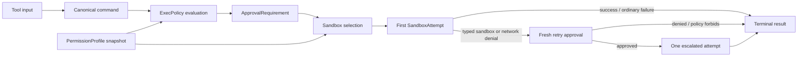
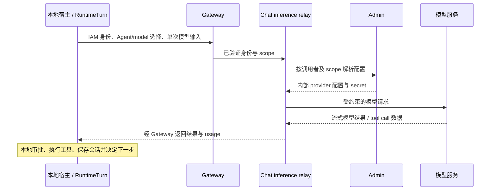
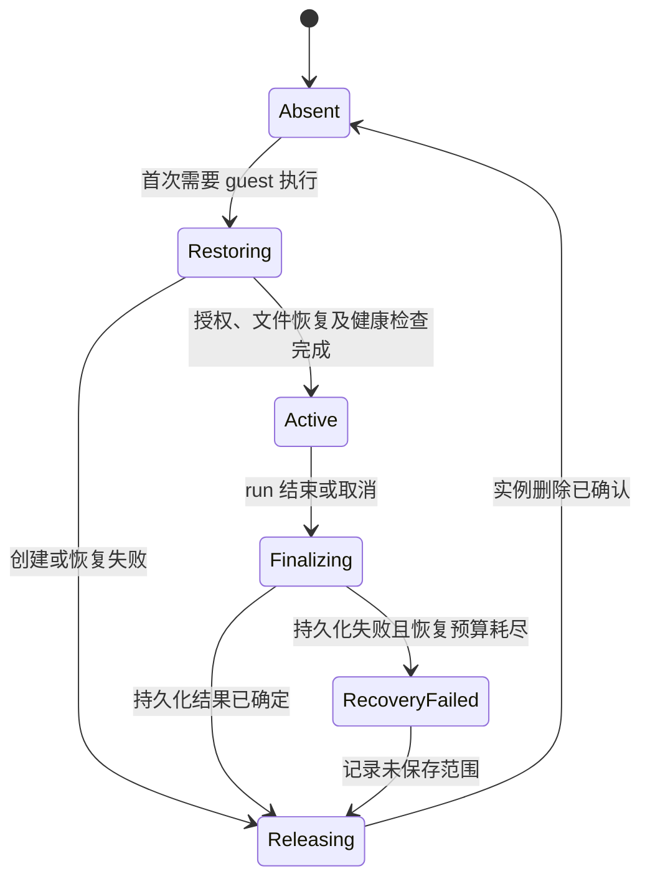

# 以 Codex App 核心模型构建本地与云端 Sandbox

状态：核心执行链已实现，环境验收中。共享 runtime 已按
`PermissionProfile → ExecPolicy → ApprovalRequirement → SandboxAttempt → ProcessManager`
重构；Desktop 与 Cloud 使用同一审批冻结、typed denial、单次升级重试和进程身份语义，旧三档
`ApprovalMode`、原始命令正则和旧执行入口已经删除。Docker guest 已加入 bubblewrap 命令级文件视图和
逐命令网络 broker。尚未完成的是 `granular` 的分类配置、macOS 与 Kubernetes 的逐 host 网络 broker，
以及真实 Docker/gVisor/Kubernetes 和正式签名 macOS 包的环境验收。当前事实见
[Runtime sandbox role](../微服务/sandbox.md) 和 [会话文件编辑](editable-conversation-files.md)。

决策键：如何全面参考 Codex App 的核心模型，零兼容重构本地与云端会话、执行、工作区和权限，并在用户与 Agent 编辑同一文件的前提下管理持久化、恢复和云端资源成本。

## 首要原则：以 Codex App 的核心模型重新建模

以本地 `~/projects/codex` 当前 `main` 源码及其公开 App Server 模型为主参考，覆盖客户端与运行时分离、Thread/Turn/Item、工作区与执行位置、命令进程、权限与审批、会话继续和文件操作。不是只模仿本地/云端选择器，也不是在现有 `RunSandbox` 上增加一个 local provider。

设计从这些模型及本项目的产品约束出发，现有数据库形状、HTTP 路由、工具接口、状态机、目录结构和类名都不是必须保留的约束。不要求旧客户端、旧 API、旧工具调用或旧运行状态兼容；不建立长期双轨或兼容适配层。保留已有实现必须因为其符合目标模型，而非为了减小改动。

“严格复刻”指复制 Codex 开源执行核心的技术分层、状态转换和 fail-closed 语义，而不是复制 Rust wire 名称或受许可证约束的源码文本。`PermissionProfile → ExecPolicy → ApprovalRequirement → SandboxAttempt → ProcessManager` 是不可替换的核心链路；本项目只在 AI SDK 工具接入、云端 workspace 持久化和产品 UI 上做边界适配。Anthropic 的当前官方 sandbox 文档与开源 `sandbox-runtime` 用于补齐网络代理、凭据隔离、配置来源信任和 violation 归因，不替换 Codex 主模型。

| Codex 参考概念 | 本项目的目标语义 | 必须区分的边界 |
| --- | --- | --- |
| Client / App Server | Electron 或 Web 是客户端；独立 Agent 运行时拥有执行和会话生命周期 | 界面组件、连接或窗口不拥有命令进程的寿命 |
| Thread | 可恢复的会话，创建时绑定本地或云端及其工作区 | 会话不等于一个容器、一个进程或一条网络连接 |
| Turn | 一次用户请求及其模型推理、工具执行与结果；本文称逻辑 run | 一轮可以包含多个 model step；HTTP 重连和工具结果回传不天然创建新一轮 |
| Item | 消息、命令、文件变更、工具结果等可观察的输入输出单元 | 对接 SDK 原生消息/工具原语，不另造平行的模型历史或通用事件包 |
| Workspace / cwd | Agent 实际读写的文件目录；用户与 Agent 面对同一文件 | 工作目录不等于授权边界，也不等于 IAM workspace |
| Local / Worktree / Cloud | 本地原目录、可选的本地隔离工作副本、独立云端工作区 | Worktree 仍是本地；本项目的会话模式不可变，且不提供跨模式同步 |
| Cloud environment | 预置工具、依赖、初始化和访问配置 | 可复用环境不等于某个任务的可写文件，也不要求实例常驻 |
| Command / process | 受管理的命令、输出、退出结果、取消和子进程 | 命令完成、Turn 完成和 Thread 结束分别处理 |
| Permissions / approvals / sandbox | 权限策略确定可访问能力，审批决定是否允许动作，sandbox 执行限制 | `cwd`、提示词或用户点过同意不能替代 OS/执行环境隔离 |
| Resume / fork | 继续既有会话与创建独立会话是不同操作 | 对话恢复不等于进程恢复；不要求跨模式恢复或迁移 |

上述是语义映射，不复制 Codex wire 字段，也不替换本项目 SDK。工程上的执行 attempt、租约、恢复清单及存储引用是实现对象，不冒充 Codex 公开核心原语，也不成为额外的用户工作流。审批/工具结果续接应保持原 Turn 归属；新的独立用户请求创建新 Turn，不能只按 HTTP 请求次数划分逻辑执行。

## 背景与决策

本地模式使用用户本机资源，直接操作指定目录，不要求上传文件、交付物或会话记录到云端。云端模式消耗平台计算和存储资源，需要在保持文件连续性的同时及时释放实例。两种模式不需要状态兼容、会话迁移或工作区同步。

采用以下终态：

1. 创建会话时确定 `local` 或 `cloud`，会话存续期间不可切换；使用另一模式必须创建新会话。
2. 本地使用独立本地运行时，在授权目录中执行命令和操作文件；本地 sandbox 是权限边界，不等于终端，也不要求每个 run 创建容器。
3. 云端按 run 懒创建隔离实例，同一 run 复用；run 结束后完成持久化和清理，销毁实例；后续 run 创建新实例并恢复文件。
4. 用户与 Agent 操作同一逻辑文件和稳定路径，例如 `/workspace/demo.js`。不引入面向用户的文件版本、分支、提交或合并工作流。
5. 云端内部使用不可变 Storage 内容、并发令牌和恢复清单保证完整性；这些是实现细节，不产生第二套用户文件。
6. 文件持久化是运行时责任；把文件显示为成果是产品行为，两者分开。模型不负责手工搬运 revision、复制只读 source 或记得保存每个草稿。
7. 会话历史、执行实例、文件内容和进程具有不同生命周期。恢复文件不等于恢复内存、终端或重新执行历史命令。

不改变 IAM 对租户和组织工作区的所有权。下文“执行工作区”指会话文件目录，不是 IAM workspace。

## 范围与非目标

包含 Electron 本地执行与推理凭据边界、云端实例生命周期、稳定文件路径、本地 journal 零兼容切换、用户编辑感知、文件恢复、权限和资源回收。继续使用官方 AI SDK 的 Agent、工具循环、消息与流原语，shared kernel 只承担 Turn、上下文、输入、环境、授权、工具 admission 和取消边界。

不包含本地与云端同步、跨模式继续原会话、CRDT/OT、通用 Git 替代品、透明迁移运行进程、任意 shell 的 exactly-once 执行，以及无界常驻开发服务器。Git worktree 可以成为本地独立能力，不是直接编辑普通目录的前提。

本地使用云端模型时仍会传输必要的模型输入并产生推理成本；“不上传云端”在本决策中指本地会话和文件不依赖云端持久化，不意味着云端模型可以在没有输入传输的情况下推理。

## 模式、身份与所有权

| 对象 | 本地模式 | 云端模式 |
| --- | --- | --- |
| 会话与执行记录 | 本地运行时管理本地持久记录 | Runtime 管理 Session、run、执行结果 |
| Agent 循环与工具调度 | 本地宿主调用 shared `RuntimeTurn` | Runtime host 调用同一个 shared `RuntimeTurn` |
| 模型调用与 provider secret | 本地经 Runtime inference relay 推理；secret 留在服务端 | Runtime 经 Admin 授权解析 secret 后推理 |
| 执行工作区 | 用户明确选择的目录 | Runtime 管理文件身份、路径和持久引用 |
| 文件字节 | 本地磁盘是权威内容 | Storage 管理不可变字节；Runtime 决定当前业务引用 |
| 活跃文件操作 | 本地运行时与用户外部编辑器 | 经 Runtime 协调，由 sandbox role 操作活跃目录 |
| 执行进程 | 本地执行宿主管理 | Runtime sandbox role 及 guest supervisor 管理 |
| 成果 | 本地文件引用、预览与打开 | 会话文件引用、Storage 预览和下载 |
| 恢复 | 打开原目录并检查实际内容 | 新建实例，按当前持久引用恢复 |
| 跨模式行为 | 不自动上传、转换或切换 | 不自动拉取或覆盖本地目录 |

会话身份、run 身份、执行实例身份和文件身份分离。路径只在绑定的工作区内有意义，不能仅凭绝对路径访问另一会话。每个云端 run 重新授权，实例控制绑定 tenant、IAM workspace、user、conversation、run 和执行代际；旧执行者不得覆盖新 run 的文件引用或删除新实例。

共享的可以是客户端组件、Agent 核心及工具行为契约，不要求两端使用相同数据库、目录布局、checkpoint 格式或恢复实现。具体跨进程和跨服务 wire contract 由 [schemas](../../schemas/AGENTS.md) 定义，不在本 ADR 固化一套伪代码 API。

## 唯一 runtime kernel 与工具协议

`packages/agent-runtime` 是两个执行位置唯一的 Turn/context kernel，使用官方 AI SDK 的工具执行、审批与流原语。
Bash 定义、网页读取、网页检索契约、Code Mode、tool search、Ask User、Todo、Skill loader 与 subagent 核心
等非业务原子能力均归该包；其中 `createPortableToolRegistry` 是所有宿主复用的唯一公共定义注册表，宿主
不能维护第二份公共名单或增加 Agent profile 选择层。Runtime 与 Desktop 直接追加各自宿主 manifests
和 Turn-frozen plugin manifests，重名能力失败关闭；本地与云端 Bash 由各自 execution host 追加，
而不是分叉 Agent 能力模型。Runtime 只保留 Memory、Media、Storage 发布、文件投影及 provider 等
真实 host adapter；Knowledge search、Canvas 和外部 MCP tools 统一走
[Agent plugin lifecycle](agent-plugins.md)。Backend
`application/agent/runtime/cloud-turn.ts` 注入云端资源和观测；Electron
`electron/runtime/session-manager.ts` 注入本地 sandbox、relay 和 journal。两者都创建 shared
`RuntimeTurn`，不能直接创建 `ToolLoopAgent`。宿主不自定义第二套输入队列、上下文策略、终止策略或工具结果协议；暂不支持 SDK client-tool continuation 的
宿主必须显式声明该协议差异，而不是复制其余公共工具。

两端通过同一个 `ExecutionHost` 公开 `bash`、`read_file`、`apply_patch`、`write_file` 与
`upload_artifacts`；云端在存在只读外部 source 时再追加 `refresh_session_sources`。Bash 以
`toolMetadata.agent.uiKind=terminal` 交给同一个 ChatStream 渲染；原生文件工具在 admission 时冻结精确
路径集合，并与 Bash 一样进入下述 `ToolOrchestrator + ProcessManager`。manifest metadata 不能自行决定
审批或绕过 sandbox，文件 helper 也不能从 Node `fs` 旁路这一边界。`read_file` 返回 SHA-256 和有界
完整行；`write_file` 的 overwrite 强制携带该内容身份；`apply_patch` 在执行前解析全部 source/destination，
用 `@@ change_context` 和单调原文件游标定位有序 hunk，只替换 add/remove 区间以保留未触碰缩进与逐行
terminator；无锚点上下文不唯一时拒绝猜测。多文件失败或写入后取消都返回已提交变更而不虚构回滚。
Bash 保留通用 CLI/目录发现/二进制能力，其每个输出流只向模型保留最后 2000 行或 50 KiB 并明确报告
遗漏；远端 retention 已丢弃前缀时继续传播绝对字节游标，并把不可确认的原始行数标为 unknown。完整日志须由命令显式重定向到 workspace。
两端用同一
`upload_artifacts({ paths })` 指定交付文件。云端基于工作区导入时的文件身份、ETag 和路径代际提交；
本地校验授权目录中的普通文件并生成本地引用。两个宿主将工具结果投影为同一 `data-file`，草稿留在
工作区。两端由同一个正文 `ChatFileTag` 渲染，不把模型生成的 HTML/XML 字符串当 UI 协议。其他服务
能力由已授权 catalog 提供；能力缺失不意味着另一套工具协议。

初始 model step 只携带高频且可直接完成工作的热工具。Code Mode、subagents、Runtime Media/Memory、
source refresh 和 plugin/MCP 等低频或大 schema 工具使用 AI SDK 原生 `deferLoading + tool_search`
渐进激活；`web_search`/`web_fetch`、Ask User、Todo 和 artifact publication 保持直接可见。延迟加载
不移出 Turn-frozen catalog，不建立 per-Agent 能力选择，也不改变 tool approval 或 executor admission。

固定提示词组装器共用核心策略和执行协议；工作区路径、网络与文件持久化/发布能力是环境事实。变更提示仅作为一次性临时上下文，不写成新用户请求。普通能力问答直接回答，不因工具存在或目录监听而启动检查循环。

### 执行环境是宿主契约

共享 Agent 核心消费结构化 `ExecutionEnvironment` 和由 `ExecutionHost` 生成的工具 manifests；sandbox manager 另行消费 Turn-frozen `PermissionProfile`、`ExecPolicy` 与 approval policy。模型可见的环境描述只包含据此行动的事实：执行位置、工作区根与持久化、外部 source、网络可用性、进程寿命、交付方式和审批摘要；它不是权限 authority。Docker 网络、Squid、Unix socket、Kubernetes Service、Electron IPC、Seatbelt profile、Storage claim 和文件代际均属于宿主实现，不进入模型契约。

本地与云端都通过 `createExecutionHostManifests` 绑定同名 `bash`、`read_file`、`apply_patch`、
`write_file` 与 `upload_artifacts`，云端按已声明的只读外部 source 能力追加
`refresh_session_sources`。工厂拒绝宿主回调与环境声明不一致。shared instruction renderer 在 Turn
开始时注入固定 `<execution_environment>`；运行中变化以 transcript runtime fact 进入，宿主不能在每个
step 重写 system prompt。Runtime contract 不按 local/cloud 维护两套执行说明。

这个边界借鉴 Codex 公开产品把 Project/Environment、Task workspace、权限与审批分开管理的做法。环境拥有仓库与依赖准备、工具和服务、文件与网络访问策略；Thread/Task 选择执行位置并在该边界内运行；Agent 决定任务步骤并观察工具结果。当前云端仍只有部署级默认环境，尚未提供可发布、共享和按会话选择的环境资源；后续增加环境产品能力时必须扩展环境 owner 与绑定关系，不能把 setup script、域名、凭据或镜像选择塞回 Agent 提示词或 Bash 工具 schema。[Codex Cloud environments](https://learn.chatgpt.com/docs/environments/cloud-environments)、[Codex permissions](https://learn.chatgpt.com/docs/permissions)、[Codex worktrees](https://learn.chatgpt.com/docs/environments/git-worktrees)。

`application/local-inference` 已移除。`application/inference/provider.ts` 统一模型构造，服务端直连与原生 relay 共用 provider 设置；relay 只传输单次推理，不拥有 Agent-loop。现有 `/local-inference/*` HTTP 地址是 Runtime 的受限传输入口，由 Chat 保留产品侧代理，不对应独立运行时。

## Sandbox 管理内核：严格复刻 Codex 执行链

本地与云端共用一个 sandbox manager 内核。它拥有权限编译、命令策略、审批、sandbox
选择、执行 attempt、网络 broker、进程和 violation；AI SDK 只负责产生工具调用和承载原生审批
part，宿主 adapter 不能直接执行命令。Turn 开始时冻结权限及策略来源快照，每条命令只在该快照
上计算；配置变化只影响后续 Turn，不能在一次执行中悄悄扩大权限。

### 权限是结构化执行输入

有效权限使用与 Codex 同构的 `PermissionProfile`，不再用产品文案或 `local/cloud` 推导：

- `Managed`：Runtime 构造 sandbox，包含 `fileSystem` 与 `network`。文件项是路径或特殊路径加
  `read | write | deny`；特殊路径至少包含 root、最小运行时、project roots、运行时临时目录和
  `/tmp`。冲突按更具体路径优先，同等具体度 `deny > write > read`；缺失路径行为必须显式。
- `Disabled`：明确不施加外层 sandbox，即 danger-full-access。只能由受信部署/用户设置选择，
  不能由仓库配置、模型参数或普通工具审批生成。
- `External`：外部环境已经实施文件隔离，Runtime 仍管理命令策略、网络、审批和进程；不得把
  “运行在容器里”自动当作 `external`，必须有可验证的 enforcement owner 与能力声明。

内置 profile 身份严格使用 `:read-only`、`:workspace` 和 `:danger-full-access`；产品可增加命名
profile，但编译后仍必须落入上述结构。每条命令可以请求 `AdditionalPermissionProfile`，只表达本次
需要增加的目录或网络能力。批准产生有边界的 overlay，不修改基础 profile，也不允许丢失已有
deny-read。project roots、home 和临时目录在真正拥有路径命名空间的 executor 端物化；controller
不能先用自己的宿主路径展开后再传给远端。

策略来源由低到高合并，但安全约束单调：组织 managed policy 是不可放宽的 floor；用户和会话设置
可收紧或选择允许的 profile；仓库文件视为工作区不可信输入，不能启用 full access、删除 deny、
配置 credential injection、指定 sandbox executable 或把自己加入允许前缀。无效、未知或平台无法
实施的 profile 在任何工具执行前失败，不回落到较弱默认值。

### ExecPolicy 取代命令正则

所有 shell 调用先规范化为 argv，并按真实 shell 语义拆解 `bash -lc`、pipeline、chain 和受支持的
PowerShell wrapper；策略对 token prefix 匹配，不对原始字符串做关键词正则。规则决策为
`allow | prompt | prompt-user | forbidden`，多段命令及多条匹配取最严格结果。规则可声明允许的
host executable 绝对路径，防止同名可执行文件或工作区 PATH shadowing 绕过。

未命中规则时才使用 Codex 同构的危险命令 classifier；classifier 处理强制递归删除、提权、任意
解释器/eval、不可安全拆解的命令和平台特有逃逸。它是保守 fallback，不是新的 allowlist。规则加载
失败、shell 无法可靠解析或 executable 身份不确定时按 `prompt-user` 或 `forbidden` 收口，绝不因
“没匹配到危险正则”自动放行。

审批策略只保留 `never | on-request | unless-trusted | granular`：

- `never` 不展示审批；本可安全地在 sandbox 内执行的普通命令继续执行，任何需要审批或升级的动作
  直接拒绝。
- `on-request` 对受限 profile 下的普通命令依赖 sandbox 自动执行；显式额外权限、危险命令和策略
  prompt 才询问。
- `unless-trusted` 对没有显式 allow rule 的命令询问，适用于不可信项目。
- `granular` 的终态分别控制 exec-policy rule、sandbox escalation 与 network approval 是否允许询问；
  被禁止的审批类别直接拒绝。当前 wire/UI 已保留这一独立策略值，但 runtime 还只有单值行为，尚未接入
  Codex `GranularApprovalConfig` 同构的分类开关；在分类结构落地前不能宣称这些类别可分别配置。

一次批准只覆盖界面展示的 canonical argv、cwd、追加权限、网络目标及 attempt authority。
`ApprovedForSession` 按序列化 approval key 缓存；“始终允许”生成最小 token prefix rule，并拒绝
`bash -c`、`python -c`、`node -e`、`git`、`rm` 等过宽前缀。策略变更原子写入受信用户配置，不能
写进仓库 policy。当前 `request | auto | full`、`bashNeedsApproval()` 和两条 command regex 全部删除，
不建立旧值映射或双读。

### Approval、sandbox 与 denial retry 相互独立

`ToolOrchestrator` 是所有可执行工具的唯一入口，严格执行以下顺序：

1. 用 frozen `PermissionProfile` 和 `ExecPolicy` 计算 `Skip | NeedsApproval |
   NeedsHumanApproval | Forbidden`，并在需要时先取得首次执行审批。
2. 根据 profile、平台能力、managed network 与工具偏好选择 sandbox。选择失败即拒绝；不能把
   sandbox unavailable 当作普通命令失败，也不能自动无隔离执行。
3. 首次 attempt 默认在 sandbox 内运行。显式 allow rule 只有在 profile 不含 deny-read 且规则本身
   授权 bypass 时才可首轮绕过；普通用户批准不等于 bypass。
4. executor 用 typed result 区分普通非零退出、启动错误、timeout、filesystem denial、network
   denial 与 sandbox unavailable。平台 adapter 可以用 OS violation 事件或 Codex 同构的有界
   exit/output signature 归类，但必须集中实现并测试后返回统一类型；orchestrator、工具和业务层不得
   各自用任意 stderr regex 猜测升级。
5. 只有可升级的真实 denial 才能请求第二次审批，并展示第一次输出、被拒路径或目标 host 以及将
   扩大的 authority。审批通过后最多重试一次；不透明重放、循环升级和失败后自动改写命令均禁止。
6. 若基础 profile 有 deny-read，第二次 attempt 仍在 sandbox 中，仅扩大批准的 write/network；绝不
   通过 unsandboxed retry 丢失 deny-read。普通结果和第二次失败原样终止。

网络审批是独立 authority。文件执行已批准不代表目标域名已批准；晚到的代理 deny 必须取消仍在运行
的进程并把明确结果归到原 tool call。审批记录和 telemetry 只保存 canonical identity、决策来源、
profile hash、violation 类别和耗时，不记录完整命令输出、文件内容或 secret。

### 统一 ProcessManager 与执行协议

每次启动先保留当前进程表内唯一的 `processId`，状态至少为 `starting → running → exited → closed`；
释放后的数值可以复用，因此跨异步审批、poll 或 stdin 操作必须同时持有并重新核对原 process entry identity，
不能只凭整数命中新进程。远端 executor handle 另带不可猜测 identity。controller 只持有进程表与有界恢复
数据；Thread/Turn、执行实例、command process 和网络 proxy 各有独立身份与生命周期。进程协议同时支持
非 TTY/TTY、poll、stdin、signal、terminate 与 close：

- start request ID 和 stdin write ID 幂等；同 ID 异参拒绝，未知结果不能在新实例自动重放。
- stdout/stderr 使用有界 retention、单调绝对 offset 与逐流 truncation 标记；慢消费者、断连和微小 chunk
  不能造成无界 JSON/RPC 队列。
- timeout、Stop、Turn dispose、宿主丢失、网络 deny 和 TTL 都终止完整受管理进程树；先停止 admission，
  再终止进程、关闭输出、释放 proxy/approval，最后释放 workspace/实例。后台进程只有显式 durable
  Job 能力才可越过 Turn。
- 父进程死亡、double-fork、setsid、TTY leader 提前退出和退出后仍持有 pipe 的后代都必须有测试；
  取消不能只关闭 stdin 或只杀 leader PID。
- 进程启动环境采用 allowlist，清除 `LD_*`、`DYLD_*` 与非继承 secret，关闭 core dump/ptrace，设置
  no-new-privileges 和资源限制；额外文件描述符默认关闭，控制 FD 永不传给 guest。

内置文件 helper、apply-patch 等产生文件副作用的本地执行，以及本地 MCP/hook/plugin 子进程，都必须
使用同一 `ToolOrchestrator + ProcessManager + PermissionProfile`。暂未接入的可执行能力在该宿主上
不可用，不能从 Electron main、Node `fs` 或普通 `child_process` 旁路。可信模型 relay 和 UI 进程不
进入 guest profile，但它们也不提供任意命令/路径代理。

### OS adapter、网络与凭据

policy compiler 与 orchestrator 跨平台共享，只有 enforcement adapter 不同：macOS 使用 Seatbelt；
Linux/WSL2 使用 bubblewrap 文件视图、独立 network namespace、`no_new_privs` 与 seccomp；Windows
必须使用经过单独验收的原生受限执行后端。云端 gVisor/Pod 是租户与宿主之间的外层边界，guest 内每条
命令仍经 Linux adapter 编译权限；外层容器不能替代命令级 profile、exec policy 或 network broker。

文件与网络是两个独立且同时必需的边界。默认网络为 restricted，guest 没有直连路由，只能连接
Runtime 建立的 HTTP/HTTPS 和受控 TCP proxy。proxy 每次请求核对 allow/deny domain、解析后的 IP、
端口、协议、loopback/private/metadata 地址和 Unix socket policy；规则未决时交 network approval，
不能把 `HTTP_PROXY` 环境变量本身当作隔离。每个 command 使用不可猜测 ID 注册临时网络授权和 violation
归因，进程结束立即撤销。

credential policy 独立列出文件和环境变量的 `deny | mask`。`deny` 在所有来源中单调合并；`mask`
只允许来自用户/managed 设置，并将 guest 所见 sentinel 绑定到明确 inject hosts。真实 secret 只在
受信代理中对已批准目标注入；TLS 无法安全终止、格式无法可靠掩码或目标不匹配时 fail closed。首个版本
若不实现 mask，就只支持 deny，不能把真实凭据注入命令环境作为临时兼容。

## 本地模式

### 桌面入口与资源加载

Electron 是现有 Platform 的宿主，所有页面继续由 Platform / Chat MFE 提供。日常 `just dev` 仍启动 Web，不自动启动桌面；`just desktop-dev` 显式通过 URL 打开 localhost 或受控远端 Platform，`just desktop-package` 生产构建并内置 Platform、Chat、Admin、Canvas 后生成 macOS `.app`。正式包从标准、安全的 `app://platform` 协议读取 ASAR 内资源，只把同源 `/api/*` 请求流式转发到构建时固定的 API authority；renderer origin 与 API/journal authority 分离。preload 能力仍只开放给精确 renderer origin 和主 frame，renderer 不获得 Node、任意文件或通用 HTTP 代理。

当前内部正式包使用 ad-hoc 签名，尚未完成 Developer ID、hardened runtime、Apple 公证、升级回滚及完整离线历史验收。内置页面不意味着 IAM 和远端推理可以离线使用。具体命令和发行待办见 [Desktop README](../../apps/frontend/apps/desktop/README.md)。

### 当前本地实现与边界

Web 与 Electron 的云端/本地会话共用 Chat 侧栏、`ChatStream` 消息渲染和 `ChatPrompt` 富文本输入框。两种 controller 共同渲染唯一 `ConversationSessionView` 会话骨架；标题栏、消息区、问题区和 composer 布局不按 runtime 复制。可选能力用回调/adapter 显式注入，缺失时不渲染对应动作，不传空函数伪装支持。Electron 新建会话默认「此计算机」，并在输入框工具栏内先选择历史项目或通过原生目录选择新增项目；发送只在已选且已授权的项目中创建本地会话，不得再触发目录选择。切到云端后使用与云端会话一致的 composer 能力。Web 不渲染执行位置选择器并固定创建云端会话；已有会话的模式不可切换，因此也不渲染伪选择器。本地文件通过会话内文件面板访问，关闭面板不得丢弃未保存草稿。云端与本地选中文件复用同一 `FileArtifactPanel` 预览、编辑、保存和未保存确认 UI；差异只保留在数据源 adapter：云端调用 Runtime/Storage，Electron 调用受限 Desktop bridge。本地目录浏览仍是桌面工作区能力，不复制选中文件的编辑器。

- `apps/frontend/apps/desktop/electron` 的 main 管理身份与原生授权，utility process 通过 shared `RuntimeTurn` 执行，`electron/runtime/` 只管理 SQLite journal、workspace、relay 和 sandbox adapters。Chat MFE `/local/:id?` 通过 `useChat` 与 IPC `ChatTransport` 消费 SDK 原生 UIMessageChunk；重连从原始消息及当前流片段重放，仅取消订阅不会 Stop。契约由 [schemas/desktop](../../schemas/desktop/README.md) 生成两端。
- 本地 journal 的 authority 是稳定 runtime home，而不是 Electron `userData` 或应用名。默认 `~/.monorepo-agent`，绝对路径环境变量 `MONOREPO_AGENT_HOME` 可覆盖；身份分区数据库位于 `sessions/<scope>/runtime.sqlite`。Desktop 与未来 CLI 只有指向同一个 runtime home 才共享本地会话；不同机器、容器或 home 自然隔离，项目文件仍以会话绑定的原目录为准。
- `runtime.sqlite` 直接使用 Thread/Turn/Item/context checkpoint/Turn plugin snapshot schema，并以 revision CAS 安装摘要。它不读取或迁移旧 `runtime-v1.sqlite`、`sessions.sqlite`；旧文件不会被覆盖或删除。SQLite 是本项目的 journal adapter，不是 renderer、CLI 或云端数据库的 wire contract。
- Bridge v4 只把 plugin activation ID/bindings 放入本地 Thread。utility process 经受信 main/Chat/Runtime 通道解析 snapshot；去密 projection 在模型调用前落 SQLite，connection grant 只留内存并随 Turn cleanup。renderer 不接触 MCP endpoint、header 或 token。
- 原生目录授权由 main 显示确认；账户/租户/工作区和 origin 分区保存 journal，切换身份关闭旧 runtime。没有本地记录到云端会话或 Storage 的写入路径。Bridge v4 分别持久化 `approvalPolicy` 与 `permissionProfile`；旧 `approvalMode` 或缺失新字段的 journal 直接 fail closed，不迁移、不映射。
- macOS Seatbelt 当前同时约束 Bash 和文件 helper，目录身份在每次调用前复核；文件写入限制在 profile 授权目录及隔离临时目录，应用控制目录被拒绝访问。`:workspace` 默认禁止命令网络，只有有效 profile 明确启用网络或批准 `require_escalated` 才扩大能力；普通命令批准不解除 Seatbelt。当前仍没有按 host enforcement 的本地网络 broker，因此 `restricted.allowedHosts` 不能作为已实现网络能力。native supervisor 通过继承的独立策略标记识别后代、监测父进程死亡并清理 detached 子进程；依赖 macOS sandbox SPI，启动探测失败即拒绝执行，需在每个支持的 OS 版本/架构上验证，不能等同于受支持的公共 Apple API。
- 文件工具与用户保存按同一本地目录串行；同目录至多一个活跃 Agent。普通 UTF-8 文件编辑上限 2 MiB，hash 比较拒绝旧内容覆盖，保留文件执行权限。目录观察提供变更提示，文件真实内容仍是权威来源；外部编辑器与 shell 不参与全局事务。
- 当前首发实现由 `PermissionProfile` 编译工作区读写、只读运行依赖、受保护路径和网络开关，支持单次追加文件权限与 typed denial retry；不支持持久开发服务或 Windows/Linux 本地执行。Bash 与模型可见的 `read_file`、`apply_patch`、`write_file` 共用 Turn 级 `ToolOrchestrator + ProcessManager`；文件工具经 Seatbelt file worker 执行、携带同一 process identity/AbortSignal，并以 SHA-256 条件写入或删除拒绝过期覆盖，不存在另一个不受控文件 helper。当前没有本地 stdio MCP/plugin 子进程。Node 由 Electron 提供，用户 shell 配置和 Homebrew 环境不会自动继承。模型 Bash 默认 deadline 为 10 秒，调用可显式扩展到 120 秒；底层命令捕获上限 8 MiB，模型观察再按每流最后 2000 行/50 KiB 收敛；文件 helper 30 秒。模型 loop 使用 AI SDK 的默认 stop condition，单段 UI replay 16 MiB，超限失败并清理，均为本项目运行保护策略。
- 本地模型不使用远端 stored response lineage。shared context manager 从 SQLite journal 保留 recent tail、压缩旧 prefix 并 CAS 写入 checkpoint；relay 预算不足、压缩失败或 checkpoint 冲突时本次调用失败且保留完整历史，不能静默丢弃内容或声称无限上下文。
- Chat relay 只做一次模型推理，验证 IAM scope、Admin 授权模型与生成参数；每用户/组织工作区一个并发请求，PostgreSQL 事务记录预留与实际 usage，未知结果保留预留用量。本地与云端共用 IAM/Admin 授权规则，不设置本地专属日额度或默认关闭开关；既有用量表保留用于 accounting，不承担独立配额准入。不保存 prompt、工具结果或文件。上游五分钟硬限时、8 MiB 输出上限，不自动重试。
- 工作区创建不产生虚假变更提示。真实 watcher 变更按会话和版本仅通知一次，以 `<runtime_context type="workspace_changes">` 的 user-role runtime fact 进入 transcript，不修改 system prompt，也不被当作新的产品用户请求；普通问候和能力介绍不要求读取目录。
- 运行中 composer 保持可编辑；补充内容经带 `expectedTurnId` 的受限 IPC admission 调用 `steer()`，进入该 turn 唯一的 AI SDK steering 通道，并在 editor 上方显示到 SDK 确认于下一个 step 投递。`not_delivered` 保留为可见失败状态，不自动成为下一 turn；应用崩溃前仅确认 admission、未确认模型接收的输入标记 `unconfirmed`，同样不自动重放。已投递内容由官方 `steering-message` part 进入本地 journal，不能再复制一条用户消息。
- 窗口重载/关闭保留 utility 任务（macOS 应用仍在后台）；退出应用停止执行。崩溃恢复仅恢复 journal，并将运行中工作标记 interrupted，不重放未完成工具。
- utility 进程意外退出后，Electron main 只允许一次替代进程恢复同一 scope journal；原 IPC 调用失败且不重放，`runtime-ready` 后客户端重新读取权威 thread。替代进程再次退出则 fail closed 并要求重启，不能形成无限崩溃循环。实现验证含真实 Electron + mock provider 集成和真实 macOS 沙箱测试；不代表真实 provider、分发签名或所有 macOS 版本验收。

### 运行时与权限

Electron renderer 负责会话和文件界面；main 负责目录选择、桌面授权和运行时生命周期；Agent、文件访问、命令监督与会话持久化放在独立本地运行时。界面刷新或订阅断开不自动终止 run。

本地运行时提供受限 IPC，不向 renderer 暴露任意宿主 shell 或任意文件访问。Electron renderer sandbox 与 Agent 命令的 OS sandbox 是不同边界；`cwd` 只决定命令起始目录，不能代替访问控制。

用户指定的工作目录构成写入授权范围，读取范围、临时目录、运行时依赖和网络权限由有效策略明确决定。文件工具与命令都必须执行相应策略，覆盖路径穿越、符号链接和目录替换；不能仅凭字符串前缀判断安全。平台能力不足时明确失败，不隐式改为无约束执行。

本地 composer 只展示冻结后有效的 permission profile 与 approval policy，不自行解释命令。审批策略采用
`never | on-request | unless-trusted | granular`，permission profile 单独选择 `:read-only |
:workspace | :danger-full-access` 或管理员提供的命名 profile。UI 必须分别展示文件范围、网络范围、
是否使用 managed/external/disabled enforcement，以及本次命令请求的追加 authority；不能再把「完全访问」
解释成“无需询问但仍固定 sandbox”，也不能把「自动批准」同时用作权限 profile。

### 本地推理与 provider 凭据

共享 `@repo/agent-runtime` 拥有唯一 `RuntimeTurn`、私有 `ToolLoopAgent` adapter、input queue、context manager、工具封装和审批策略。Desktop session manager 只提供沙箱、文件变更、模型连接和 journal adapter；云端 host 提供对应的服务 adapter。服务端 `application/inference` 为共用模型访问层，流式 relay，只执行一次受授权的模型调用；Gateway 继续承担身份验证和流式路由，不承载 Agent 或 provider 业务。复用 [身份与配置](identity-and-configuration.md) 的所有权：IAM 管理身份和成员关系，Admin 管理 Agent/provider/model 配置及凭据，Chat 校验模型使用权限与预算并执行转发。

桌面端只取得当前本地会话绑定的非敏感模型标识、推理深度与能力信息；不得下发内部 provider snapshot、apiKey、服务间 credential 或可复用上游认证头。不引入 BYOK，也不让 Chat 为本地会话创建云端 conversation/run 或代跑推理循环。桌面登录凭据由可信宿主持有，不注入命令环境、工作文件或模型上下文。

relay 必须满足以下边界：

- 每次调用按真实 IAM 身份验证 tenant/workspace 成员资格、Agent 使用权、启用状态、允许的 provider/model 与额度。客户端传来的 ID、模型参数和已展示的模型列表都不能替代服务端授权；管理员变更配置后，后续调用重新校验。
- 上游地址、dialect、认证和额外参数由服务端授权配置决定，并执行出站地址校验。拒绝客户端任意 URL、认证头、未授权模型、任意透传参数及绕过地址校验的重定向。多模态输入也不能让 relay 任意抓取客户端指定地址。
- 只传递模型输入、输出、工具声明及工具结果数据；tool call 的审批与执行始终在本地。不得获得本地文件操作权、启动云端 sandbox，或接受上游托管的 shell/文件执行工具。relay 不接受远程控制本地工具的回调通道。
- 用 AI SDK 的模型与流原语承载单次推理；跨进程模型调用契约归 `schemas/`，不把 Chat 的整轮 UIMessage 流当作模型传输协议。请求大小、输出、并发和预算由服务端约束；准入时预占预算，按结果结算，未确定结果不能当作零消耗无限重试。
- 断连或取消须中止上游请求并释放请求资源；输出已开始或上游结果未知时不透明重放。重试使用可对账的请求身份，避免重复计费；无法证明上游未执行时，如实返回未知结果，由本地运行时决定后续动作，不承诺供应商 exactly-once。
- 服务端不持久化本地 prompt、响应正文、工具参数/结果、文件字节或会话历史，不使用云端消息表、Redis 回放或内容日志保存它们。只保留必要的请求身份、授权结论、usage、计费及故障元数据；日志、trace、错误采集同样不得携带正文和 secret。配额记录不代表服务端拥有本地会话。

本地 journal 是继续会话的唯一持久历史来源，relay 不维护服务端会话游标。默认逐次提交所需上下文，不依赖服务端保存的 `previous_response_id`；支持的 provider 应关闭可关闭的响应存储。供应商自身的日志、缓存与保留政策仍须按 provider 明示，不能把“平台不持久化”宣传为上游零保留。模型上下文包含被选择的本地文件内容时，界面需如实说明它会经 relay 传给模型服务。

此边界是本项目基于既有 IAM/Admin 与集中 provider 配置作出的设计，不声称 Codex App 使用同样的 relay。原始内部 snapshot 只留在受信服务端调用链。

### 首发平台与 OS 强制机制

首发本地模式只支持 **macOS + Seatbelt**。这是本项目发布范围，不是 Codex 的平台限制；仓库已有 Electron main、独立 utility runtime、原生 supervisor 和结构化 profile compiler。正式签名打包、按 host 的 network broker 与目标平台矩阵仍需实现或验收。

| 平台 | 本项目首发行为 | 后续加入的强制机制 |
| --- | --- | --- |
| macOS | 通过 Seatbelt 启动隔离的命令和文件工具进程；启动自检失败则拒绝本地执行 | 在发布声明的系统版本与 CPU 架构上验证签名包、策略与子进程继承 |
| Linux / WSL2 | 明确标记本地模式不可用，在任何工具执行前拒绝 | 单独实现并验证 bubblewrap、所需内核能力及发行版限制 |
| Windows 原生 | 明确标记本地模式不可用，在任何工具执行前拒绝 | 单独实现并验证 Windows 原生受限执行机制；不是调用一个名为 sandbox 的终端 |

不提前承诺未经打包和隔离测试的最低系统版本或架构。其他平台仍可创建独立云端会话，但不能把已有本地会话自动转为云端。没有“平台不支持时退化为 Node 路径检查”的分支。

强制机制在工具进程启动前生效，使用显式权限策略约束文件、网络与子进程；命令及其后代继承限制。内置 read/write/list/stat 等文件工具也必须由同一策略下的隔离 helper 执行，不能通过不受限的 Electron main 或 Node `fs` 绕过。可信宿主只处理授权、目录选择、受限 IPC 与控制数据，不提供任意路径/命令的万能代理。

策略默认只允许授权目录与明确列出的运行依赖、临时路径；应用 journal、登录凭据、控制 socket、`.git`、`.agents`、`.monorepo-agent` 和其他受保护 metadata 按 profile 显式隔离，即使它们位于用户选定目录之下也不能被工具写入或读取 secret。最小化继承环境与文件描述符；网络权限单独授权并由 OS 限制及受控代理强制执行，不能只过滤命令字符串或在 UI 隐藏入口。模型 relay 的网络权限属于可信运行时，不自动授予 shell。

approval 与 sandbox 独立：普通批准仍在当前 OS 策略中执行；只有审批界面明确展示并批准的 additional permissions 才能扩大单次 attempt。带 deny-read 的 profile 永不通过 unsandboxed retry 丢失限制。对 shell、文件 helper 和本地插件子进程分别验证越界读写、符号链接/目录替换、子进程继承、敏感控制数据访问、网络绕过、denial retry 与取消清理；仅启动终端或通过 renderer sandbox 测试不能验收本地模式。

### 文件、进程与恢复

- Agent 直接操作授权目录，例如用户目录下的 `demo.js`；编辑器打开同一文件，不要求上传 Storage 或维护一份云端副本。
- 本地 file tag 的 `file_id` 是会话内稳定引用，正文 part 仅保存授权工作区相对路径和 ETag；点击后仍通过受限文件 helper 读取。云端 file tag 使用 Runtime 文件身份，不暴露 sandbox 临时路径。两者共享 `data-file` 显示契约，但不共享文件字节或文件 ID 命名空间。
- 本地运行时保存会话、工具结果和必要执行记录；控制数据放在应用受保护目录，避免被 Agent 作为普通工作文件修改。
- run 结束清理其拥有的命令和子进程，不删除用户目录，也不要求退出整个本地 Agent 服务。用户自行启动的其他进程不属于清理对象。
- 显式 Stop 取消本次执行并清理受管理的子孙进程；窗口关闭、应用退出和后台运行的产品行为须明确，不能让脱离父进程的任务成为无主进程。
- 恢复会话时重新检查目录权限、存在性和文件现状。目录不可用则报告不可恢复，不切到云端；旧快照不得自动覆盖用户在停机期间的修改。
- 外部编辑器和 shell 不受应用数据库锁控制。文件观察用于发现变化，受控编辑前重新读取并核对基线；不能宣称任意外部写入具有全目录事务或完全避免并发覆盖。

## 云端实例生命周期

### 分配单位与状态

一个云端会话持有持久文件，一个逻辑 run 同时至多持有一个按需创建的主执行实例。等待续接或失败后的新执行 attempt 可以创建新实例，但不能有两个代际同时拥有写入权。只读网页工具、模型问答、文件列表、预览、下载和持久文件的文本编辑，不因会话打开而创建实例。

这些是职责状态，不规定具体字段名。`Absent` 表示没有计算实例，不表示会话或文件不存在。

同一 run 的模型推理间隔和连续工具调用复用实例，不在每条命令后销毁。正常结束后不保留跨 run 热实例，不为每个会话设置长期 idle Pod，也不引入单独的用户不活跃计时器。下一 run 始终通过新实例取得明确的文件和权限基线。

### “结束”与“空闲”

回收由本轮工作结束、取消或进入可持久化的用户等待状态触发，先进入 finalizer；实际删除前必须确定文件持久化结果并收口受管理执行。正常模型推理、工具仍在运行、文件传输进行中、浏览器暂时断线都不能单独作为回收依据。

等待用户若仍属于活跃工具调用，须先由运行时收口为可恢复的等待状态；后续用户输入通过新的执行尝试继续，不能仅看到“等待”文字就删除实例。一次 run 的终态不能与仍活动的写进程并存。

后台进程默认属于当前 run。结束时停止并确认其子孙退出；不允许用 daemonize 绕过回收。不提供通过普通会话 sandbox 永久托管服务的承诺。

### 结束顺序

1. 关闭旧 run 的新命令和文件变更准入，确定正在处理的用户保存操作的归属。
2. 收口已准入的命令；正常结束停止仍存活的 run-owned 后台进程，取消时终止相关进程树，确认不会继续写工作区。
3. 从稳定文件视图获取变更，持久化内容及恢复引用，记录每个保存操作的确定结果。
4. 提交 run 的执行结果及文件持久化结果。正常完成不能宣称未提交内容已经保存；取消本身不撤销此前成功保存的文件。
5. 幂等删除实例，确认后释放其资源计量；删除失败由独立回收器继续承担责任。

下一 run 与前一 run 的文件收尾按会话协调。不能前一 run 尚在导出，后一 run 就用旧清单恢复，再接受前一 run 的迟到覆盖。需要用户干预的冲突不能无限占用实例：候选内容先持久化为受限草稿，当前文件保持不变，释放计算后再解决。

持久化失败可以在明确的恢复预算内保留实例并重试；到硬性资源期限后，必须标记未保存范围并执行回收。禁止无限保留实例，也禁止把这种被迫回收记录为“保存成功”。节点已丢失时只能恢复此前提交的状态。

### 新 run 恢复

1. 获取会话执行权与新的执行代际，确认前次写入已收口；重新验证当前权限。
2. 固定本次读取的持久文件映射和环境版本，按精确内容引用创建新实例；不从历史模型输出猜测文件内容。
3. 在尚未开放执行的目录中恢复字节、路径与必要元数据，验证摘要和配额，拒绝路径穿越、逃逸链接及特殊设备文件。
4. 追平恢复期间已成功提交的用户编辑，再以明确屏障开放文件操作和命令执行。
5. 加载会话记录并提供恢复结果；新实例不继承旧进程 ID、工作终端或未确定命令的执行权。

已保存内容缺失不能降级为空文件或让模型自行重建。恢复失败保持持久引用不变，删除部分实例并报告具体失败。

## 同一文件、稳定目录与持久化

### 文件模型

云端使用稳定根目录 `/workspace`，例如 `/workspace/demo.js`。文件树、编辑器和 Agent 指向同一逻辑文件；下一次恢复仍使用相同路径。已保存文件以会话内文件身份和精确 Storage 引用定位，路径到文件身份的映射由 Runtime 管理。

Runtime 拥有权威 `workspace_path`、文件存活/删除状态和并发代际；`filename` 只能作为展示信息，不能再用来推导恢复路径。对同一 tenant、IAM workspace、conversation 的存活文件强制路径唯一；路径使用规范的 `/workspace` 根下绝对路径、按大小写区分，禁止 `..`、根外路径和非法路径分量。恢复、编辑、重命名、交付入口只使用这份映射。删除写入 tombstone 与新代际；迟到保存不得复活旧文件。同路径重新创建使用新文件身份，不能复用旧操作的写入权。

取消“只读 saved source → 手工 checkout → 临时副本 → 另一次发布”作为可编辑文件的必经流程。来自 Knowledge 等其他 owner 的原始附件仍保持原有权威与权限；只有明确导入为可编辑工作文件后才在工作区修改，不隐式回写源资源。

内部 revision、hash、generation 和恢复清单用于内容验证、并发控制和恢复，不暴露成文件版本产品。无需建立通用 `WorkspaceCommit`、Git 分支或自动合并系统。重命名和删除必须作为文件树变更记录；不能用同名或 inode 猜测覆盖其他文件。shell 中无法可靠识别的重命名可表达为删除与新增，不承诺隐式保持原文件身份。

### 哪些内容跨 run 保留

| 内容 | 持久化责任 |
| --- | --- |
| `/workspace` 中的业务文件、脚本、草稿、输出及必要目录元数据 | 自动持久化，包括尚未展示为成果的文件；删除也进入恢复记录 |
| 已交付成果 | 引用同一逻辑文件及已提交字节，不复制成独立且失联的内容 |
| 基础工具链、系统依赖 | 运营管理的固定镜像或预置环境版本 |
| 工作区内安装的项目依赖 | 作为工作区文件持久化并计入配额，或使用明确可重建的环境配置；不能默默丢弃 |
| 显式临时目录、可重建缓存 | 不承诺恢复；路径和用途必须可见，不能按扩展名猜测业务文件是缓存 |
| 凭据、控制 socket、PID、活动连接和进程内存 | 不进入业务文件快照；授权和连接在新实例重新建立 |

持久化覆盖真实文件系统变化，包含 Bash、Python、Node 和其他 CLI 写入。watcher 只是定位变化的优化，不是完整性依据。通过受管理写进程的静止边界、稳定快照或等价机制捕获文件；不能逐个读取仍在变化的文件后宣称获得一致状态。

在文件操作或有文件影响的执行批次收口时保存变更，并在 run 结束时核对剩余差异。上传原始字节采用流式传输，不放进模型上下文。未变化内容复用 Storage 引用，不在每次 run 打包和上传完整系统盘。

### 保存与交付

“写入沙箱”“上传完成”“业务保存成功”是不同状态。只有持久引用提交后才向用户或模型确认文件已保存。成果展示可以稍后发生，不影响草稿的持久性。

保存协议复用 [文件生命周期](files-and-assets.md) 的 owner/claim 原则：

1. 为操作建立幂等身份，验证 scope、文件基线与执行代际。
2. 将确定内容上传为候选对象，验证摘要、大小和类型，并保护候选内容免于提前回收。
3. Runtime 在本地事务中校验并发基线，更新当前文件引用、路径或删除状态、恢复元数据、操作结果和事件/Claim intent。
4. 将正式引用投递到 Storage；确定正式保护生效后再释放候选保留。未决操作不得因租约到期被静默当作可删除垃圾。

Storage 不决定业务文件的“当前内容”。跨服务不假设数据库与对象写入原子提交；上传后失败由同一操作恢复，冲突不覆盖现有引用。恢复清单引用不可变内容，旧执行者只能留下候选，不能推进当前文件指针。

### Fresh baseline

Runtime `v1.0.0.0` 直接建立稳定 workspace path、generation、tombstone、Asset/revision 引用与执行 fencing，不读取或回填旧 Chat/Sandbox 数据。路径必须从创建时即经过安全分量、长度和唯一性校验；同名文件不能静默覆盖。当前重构不保留旧 API、旧临时目录、旧数据库或双轨兼容层。

## 用户编辑与 Agent 感知

### 云端编辑

实例不存在时，用户直接通过 Runtime 保存到 Storage 并更新会话文件引用，不创建沙箱。若实例正在创建，恢复完成前必须追平已提交编辑，再开放工具执行。

实例存在时，用户和 Agent 的文件操作通过同一个会话协调入口到达同一工作目录。用户编辑保存携带读取时的基线；冲突保留草稿，不替换令牌重试旧内容，也不自动另存为。

针对共享可写文件系统建立操作边界：用户保存不能在未知 shell 正写文件时强行覆盖。对无法证明只读的命令按可写操作管理；所有仍可写工作区的后台进程也纳入边界。在安全边界处理保存；等待期间界面表示“保存中”，不能提前表示“已保存”。互不涉及该工作区的工具仍可按 SDK 原语并发，不引入全局 Agent 调度锁。

对已准入的用户保存，在稳定边界验证磁盘与已读基线、持久化候选、更新工作文件及业务引用；只有活跃文件与已提交引用一致才释放边界并通知成功。中间失败冻结后续相关操作，按操作记录确定已提交结果或恢复原内容；不能让磁盘和业务引用分叉后继续执行。

用户在保存过程中继续输入时，成功响应只确认已提交的那份内容，后续输入仍是未保存草稿。预览和下载固定到一次已提交内容，不读会变化的 latest 流。

### 两端的感知保证

本地通过文件观察和重新读取发现实际磁盘变更；云端通过已提交的有序变更记录、通知和重新查询发现变更。通知可以重复或丢失，版本/内容对账才是兜底。

在下一次可控模型步骤向 Agent 提供变更路径、来源以及需要重读的事实，并保证文件工具读取新内容。历史工具结果不改写；压缩和 provider continuation 不得丢掉待投递的变更。AI SDK 的 step-boundary steering/`prepareStep` 可承担上下文接入，具体行为须用安装版本验证。

模型推理中的上下文不能瞬间更新。写入前重新校验基线；用户改变输入文件时，Agent 的派生结果也可能失效，不能仅检查输出文件是否同名冲突。对无法获得可靠读取依赖的 shell 操作采用工作区变化校验，要求重新检查后才能宣告结果适用于当前输入。

系统保证变更被提供给模型并阻止已识别的过期覆盖，不承诺模型一定理解正确，也不承诺撤回已经发生的外部副作用。

## 故障、取消与恢复

| 情况                                | 必须行为                                                             |
| ----------------------------------- | -------------------------------------------------------------------- |
| 创建成功但响应丢失，或创建期间 Stop | 通过操作身份和资源标签确定结果；观察迟到创建并回收，不能留下无主实例 |
| 内容恢复失败、缺文件或摘要错误      | 不开放执行，不静默启动空目录；回收部分实例并报告失败                 |
| 用户编辑与恢复/收尾竞争             | 按会话操作顺序处理；新实例必须包含已经确认保存的编辑                 |
| 上传失败或超配额                    | 不推进对应文件引用；报告未保存内容，不默默排除大文件或截断           |
| 引用已提交但响应丢失                | 同幂等键返回真实结果，不重复创建文件或重复追加内容                   |
| 用户显式 Stop                       | 停止进程写入，保存可稳定捕获的修改；取消不等于文件回滚               |
| Chat 或控制器崩溃                   | 独立回收器依据 run/租约与资源身份收敛；有界保存尝试后释放资源        |
| 节点或实例直接丢失                  | 标记执行中断，保留最后已提交文件；未确认写入可能丢失                 |
| 命令结果未知                        | 不自动重放 shell 或外部副作用；记录未知结果并由新执行明确处理        |
| 删除会话后旧执行者返回              | tombstone/代际校验拒绝重新发布；仅清理旧实例及其候选                 |
| 本地应用重启或用户移动目录          | 核对真实目录和授权；不使用旧快照自动覆盖，不转为云端执行             |

恢复语义是“恢复对话记录和已保存文件后开始新的执行”，不是恢复旧程序指令位置。SSE 重新订阅、会话加载、文件恢复与命令续跑必须分别报告。

## 云端成本与回收

正常 run 完成后不保温，减少按会话数量增长的内存和 CPU 占用。冷启动通过固定镜像预拉取、授权范围内的预置依赖和内容复用优化，不依赖跨用户复用脏工作目录。

计算管理必须具备单实例 CPU/内存/磁盘/PID/输出上限、命令 deadline、run 执行租约、独立硬性期限、租户并发与总容量控制，以及可重试删除的回收器。数值由容量测试和产品预算确定，本 ADR 不引用未经验证的供应商默认值。容量不足应明确排队或拒绝，不能静默挤掉仍在执行的任务。

工作区使用有配额的临时磁盘；不把较大的业务目录默认放在内存型 tmpfs。tmpfs 可用于明确有界的临时或控制数据。具体落盘形式由基础设施实现，guest 不获得宿主业务目录、Docker socket 或 Storage 全局凭据。

分别计量模板缓存、会话文件、恢复元数据和成果引用。旧快照只在无保留引用且超过策略窗口时回收；活动读取、候选上传和当前成果不能被误删。内部不可变 revision 不意味着无限保留所有历史。

至少观察：活跃实例数、实例驻留时间与实际执行时间、创建/恢复 P95、恢复字节量、每会话新增持久字节、存储失败、回收积压和过期实例数。Pod 释放只代表容量释放；在弹性部署中还需验证节点整合与缩容，固定主机下不能把空闲容量直接等同于云账单下降。

本地模式不进入云端 sandbox 配额和 Storage 生命周期，不为统一计费而强制上传本地文件。

## 公开实践与证据边界

- Sandbox 管理内核的第一手工程依据是本地 `~/projects/codex` 在
  `d1d1ba0b837d34f314b7f469896e8babbc91f949` 的源码快照：
  `codex-rs/core/src/tools/orchestrator.rs` 与 `tools/sandboxing.rs` 定义 approval、sandbox
  selection、`SandboxAttempt` 和一次升级重试；`core/src/exec_policy.rs`、
  `protocol/src/permissions.rs` 与 `protocol/src/models.rs` 定义 token policy、文件/网络权限和
  `Managed | Disabled | External`；`core/src/unified_exec/process_manager.rs`、
  `linux-sandbox/src/{bwrap,seccomp}.rs` 与 `process-hardening/src/lib.rs` 定义进程、Linux adapter
  与宿主加固。目标复制这些可见层次、状态语义和 fail-closed 行为，不复制 Rust 文本，也不推断未开源的
  Codex Cloud 调度器。
- [Codex 环境](https://learn.chatgpt.com/docs/environments/modes)、
  [Cloud 保存状态](https://learn.chatgpt.com/docs/environments/cloud-environments#reuse-and-update-saved-state)、
  [App Server](https://learn.chatgpt.com/docs/app-server)和
  [Windows App](https://learn.chatgpt.com/docs/windows/windows-app#share-config-auth-and-sessions-with-wsl)
  只用于验证产品模型：执行位置、环境、task workspace、稳定 Codex home 与独立 runtime。会话模式不可变、
  云端按 run 回收和 `runtime.sqlite` 格式仍是本项目决策，不能从产品 UI 或公开文档推断供应商内部契约。
- [Codex Sandboxing](https://learn.chatgpt.com/docs/sandboxing#prerequisites)和
  [Permission modes](https://learn.chatgpt.com/docs/permissions)用于交叉检查平台支持与权限/审批的用户语义；
  代码级真相以前述固定 revision 为准。本项目首发只交付 macOS 本地执行，不能把 Codex 的平台矩阵当作
  已实现能力。
- Anthropic 的当前[官方 sandbox 文档](https://code.claude.com/docs/en/sandboxing.md)明确文件与网络双重隔离、
  严格 sandbox、配置来源优先级和 `failIfUnavailable`；开源
  [`sandbox-runtime`](https://github.com/anthropics/sandbox-runtime)展示 Seatbelt/bubblewrap、无 guest
  直连路由的 HTTP/SOCKS proxy、Unix socket 限制、credential `deny | mask` 与 opaque command ID
  violation 归因。本项目采用这些加固点，但不采用普通失败后的默认 unsandboxed retry，也不让项目配置
  放宽 managed/user 安全 floor；审批和 attempt 状态仍严格以 Codex 内核为主。
- [Anthropic sessions](https://code.claude.com/docs/en/agent-sdk/sessions)区分会话与文件系统；
  [文件 checkpoint](https://code.claude.com/docs/en/agent-sdk/file-checkpointing)覆盖 Bash 修改，因此不能只追踪
  编辑工具来保证工作区恢复。
- [Electron sandbox](https://www.electronjs.org/docs/latest/tutorial/sandbox)说明 renderer 的权限边界；[utilityProcess](https://www.electronjs.org/docs/latest/api/utility-process)是进程承载能力，不是任意 Agent shell 的文件隔离证明。
- [AI SDK loop control](https://ai-sdk.dev/docs/agents/loop-control)提供步骤边界与 steering 机制；文件提交、外部变更校验和资源租约仍是应用责任。

另参考本地 `hibot_engine` 仓库的 `hibot-pkg/sandbox/shared_snapshot.go`、`hibot-pkg/sandbox/rdb/workspace_snapshot_attempt.go` 与 `hibot-agent/cmd/hictld/internal/daemon/workspace_snapshot_restic.go`：可借鉴 writer/generation fencing、候选提交和 staging 恢复校验；不复制其多 provider、Restic 仓库及原生 runtime 会话适配体系。对这些源码的阅读不等于其集群故障测试已通过。

## 备选方案与取舍

| 方案 | 取舍 |
| --- | --- |
| 每会话长期保留实例 | 连续执行快，但空闲资源随会话累积；不采用 |
| run 结束跨轮保温 | 减少恢复开销，但引入 idle 策略和常驻成本；本决策不采用 |
| 每条命令后销毁 | 反复恢复、破坏同一 run 的文件与进程连续性；不采用 |
| 仅保存模型明确发布的成果 | 无法接续草稿与中间工作；不作为工作区恢复机制 |
| 保存完整系统盘和进程内存 | 成本和恢复耦合过大；采用业务文件及明确环境配置 |
| 所有文件必须有用户可见版本/分支 | 超出“同一文件持续编辑”的产品语义；仅保留内部一致性元数据 |
| 本地文件统一上传再编辑 | 违背本地资源闭环与无同步边界；不采用 |
| 将 Admin provider secret 下发桌面 | 扩大凭据泄露边界；采用服务端受约束的单次推理 relay |
| 由 Runtime 运行本地会话的 Agent 循环 | 云端成为会话与工具调度 owner；采用本地循环及本地历史 |
| 把本地 journal 放在 Electron `userData` | 开发版、正式版和未来 CLI 因应用名产生孤岛；采用稳定 runtime home，并保留身份分区 |
| 要求本地用户自行配置 API key | 引入另一套配置与付费模型；本决策沿用集中 provider 管理，不引入 BYOK |
| 用 Node 路径检查覆盖所有本地 OS | 无法约束任意命令和子进程；按平台实现并验收 OS 强制机制 |
| 旧同名文件覆盖或合并 | 改变既有文件身份及内容；采用确定性独立路径迁移 |

代价是云端每个使用执行环境的新 run 都要恢复文件，且节点丢失可能损失未提交写入；收益是计算资源不随历史会话无限累积、已保存文件独立于实例、用户编辑的文件身份和路径稳定。恢复吞吐与大目录成本必须在上线前测量。

## 当前差距、实施边界与验收

云端 [CloudTurn host](../../apps/backend/services/runtime/src/application/agent/runtime/cloud-turn.ts) 通过 [RunSandbox adapter](../../apps/backend/services/runtime/src/application/agent/adapters/cloud-sandbox.ts) 使用 [Runtime Sandbox Engine](../../apps/backend/services/runtime/src/sandbox/engine.ts)，并交给 shared `RuntimeTurn` 启动 AI SDK loop。controller 仍按 run 管理隔离资源、期限和回收。

云端代码使用稳定路径恢复、静止文件清单、新增/修改/删除自动提交、内容与路径 generation fencing，以及 `restoring → active → finalizing → releasing` 的崩溃重试与实例回收。 `upload_artifacts` 只承担完成文件的批量发布与正文引用。

活跃 run 的在线编辑中，Sandbox guest 先阻止新命令并短暂等待已准入命令结束，再授予带操作 token 的工作区写屏障；Runtime 在屏障内核对磁盘摘要与编辑器 etag，将新字节原子替换到同一路径，再提交 Storage revision 和 Runtime 当前引用。业务提交失败时恢复原字节；无法恢复时保留屏障，使用同一幂等操作重试，不能开放分叉工作区。等待预算耗尽、恢复/收尾状态或其他编辑仍返回 `workspace_busy`，前端保留草稿后重试。每个受控模型 step 对账文件 etag；通知不是事实源。

本地 runc 真实 Docker 集成已覆盖 bubblewrap 启动、命令级 seccomp 加载、零 capabilities、文件视图、
PTY、deadline、controller replacement 和逐命令出口；它不能替代 runsc/gVisor/K8s 的生产验证。云端仍待
验证大目录恢复、Storage 故障、进程崩溃、TTL 丢失和节点缩容指标。当前 Docker 的 `/workspace` 使用
tmpfs，K8s 使用磁盘型 emptyDir；两者资源行为不能当作一致。

本地侧已实现 Electron utility runtime、Seatbelt 执行边界、受约束 inference/plugin relay、新
`runtime.sqlite` journal/进程生命周期及 UI 接入；正式签名、真实 provider、真实外部 MCP 与支持的
macOS 版本矩阵仍待环境验收。当前
[Admin client](../../apps/backend/services/runtime/src/infrastructure/clients/admin.ts) 的内部 provider
snapshot 包含 `apiKey`，不能直接复用为桌面配置契约；插件 resolve 则使用独立的 activation/snapshot
contract，grants 不进入 preload 或 SQLite。

执行策略内核现已按本 ADR 一次替换：

- [permission compiler](../../packages/agent-runtime/src/runtime/permissions.ts) 实现
  `Managed | Disabled | External`、三个内置 profile、路径/host 规范化、同路径
  `deny > write > read` 和不削弱 deny-read 的 additional permissions；
  [exec policy](../../packages/agent-runtime/src/runtime/exec-policy.ts) 将 shell 输入降为 canonical argv/segments，
  使用 token prefix rule 和保守危险命令 classifier。普通 allow rule 不隐式 bypass，只有显式
  `bypassSandbox` 且 profile 不含 deny-read 才能解除隔离。
- [ToolOrchestrator](../../packages/agent-runtime/src/runtime/tool-orchestrator.ts) 按完整输入 identity 冻结
  AI SDK admission，生成 typed `SandboxAttempt`，只为 typed violation 发放一次 `retryId`，并验证第二次
  authority 覆盖原 denial；[ProcessManager](../../packages/agent-runtime/src/runtime/process-manager.ts) 使用
  `processId + entryId` 防止复用后的 stale handle，并在 Turn close 与异步完成竞争时拒绝迟到成功。
- [Bash tool](../../packages/agent-runtime/src/tools/bash.ts) 只接受新 `sandbox_permissions`、
  `additional_permissions`、`retry_of`、`justification` 与最小 `prefix_rule` 协议，并以
  2000 行/50 KiB 尾部窗口限制每个模型可见输出流、保留结构化 omission metadata；Cloud transport
  同时传播逐流 retention loss 与最终绝对字节 offset，原始行数不可恢复时使用 `null`，stderr 只保留在
  tool data，短 `ToolIssue.message` 不复制输出正文；
  [ExecutionHost](../../packages/agent-runtime/src/runtime/execution-host.ts) 统一组合 `bash`、`read_file`、
  `apply_patch`、`write_file` 与 `upload_artifacts`；Desktop Seatbelt file worker 和 Cloud conditional
  file bridge 都从 Turn 级共享 orchestrator/process manager 进入 executor，接收冻结后的精确路径、
  permission profile、process identity 与 AbortSignal。当前没有本地 stdio MCP/plugin 子进程，因而没有
  为其保留另一套 transport。
- [Desktop sandbox](../../apps/frontend/apps/desktop/electron/sandbox.ts) 从 attempt profile 编译 Seatbelt，
  默认断网并返回 typed termination；[Cloud sandbox contract](../../apps/backend/services/runtime/src/sandbox/contracts.ts)
  强制携带 attempt、sandboxed、permission profile 和 process identity。Linux
  [runner](../../apps/backend/services/runtime/sandbox-assets/runtime/runner.py) 从只读根构造 bubblewrap 文件视图，
  清理环境并经随机 Basic-token 的逐命令 broker 连接只读 Unix socket；不存在的 deny path 若位于可写父目录下
  会在启动前 fail closed。Docker 的 `seccomp=unconfined + systempaths=unconfined` 与 Kubernetes 的
  `seccompProfile: Unconfined + procMount: Unmasked` 只服务于不含 `SYS_ADMIN` 的 trusted runner 启动
  user/mount/PID namespace 和 fresh procfs；bubblewrap 随后清空 capabilities，guest helper 在 `exec bash`
  前设置 `PR_SET_NO_NEW_PRIVS` 并加载命令级 libseccomp。restricted/proxy 分别收紧网络 syscall/address
  family，且都拒绝 ptrace、跨进程内存、keyring request 与 io_uring；任一加固步骤失败都返回
  `sandbox-unavailable`，不执行命令。

旧枚举、raw-command regex、schema 和 UI 值已经删除；不双读、不映射旧值、不保留旧执行入口。旧 journal
metadata 只能被拒绝。云端 run/workspace lifecycle、本地 Thread/Turn/journal、Storage 文件权威、guest runner
既有的幂等与清理机制继续保留，并从新 orchestrator 接收 frozen policy 和 attempt authority。

当前残余边界不是兼容工作：

- `granular` 仍是单值 policy，尚未承载 Codex `GranularApprovalConfig` 的 exec rule、sandbox escalation、
  permission request、MCP elicitation 等分类开关；现有 UI 不得暗示这些类别已可分别配置。
- Docker guest 已有逐命令 broker；Kubernetes 部署没有等价的 `SANDBOX_PROXY_SOCKET`，请求额外网络 authority
  会返回 `sandbox-unavailable`。macOS Seatbelt 可关闭或整体开启网络，但 restricted host allowlist 尚无本地
  broker，不能退化为仅注入 `HTTP_PROXY` 后声称隔离。
- Python runner 测试不能替代真实容器边界；本地 runc Docker 集成也不能替代 runsc/gVisor、Kubernetes
  故障场景或正式签名 macOS 包验收。在对应环境通过前，这些能力只能按代码边界说明，不能宣称完成生产验证。

所有权落点：Runtime 负责云端 Session、消息、文件路径/引用、Agent loop、durable Job 与编辑协调；Admin 保留配置和 provider secret；Gateway 仅执行认证与路由；Storage 负责内容与保留；Runtime sandbox role 负责云端实例、进程及文件桥；本地运行时负责本地会话、Agent loop、工具及 OS 隔离。Chat 只保留 Web 产品投影。前端消费明确的文件和执行结果；新增流字段须遵守 [UIMessage 契约](../../schemas/streaming/chat-uimessage-stream.md)。

本次整体重构不保留旧会话/run 划分、API、工具调用形式、临时目录布局、数据库或旧 sandbox 状态，也不保留兼容层或过渡双轨。Runtime 和 Chat 各自只提供 `v1.0.0.0` fresh baseline。

| 验收场景 | 应观察到的结果 |
| --- | --- |
| 核心模型与重连/续接 | Thread、Turn、Item、工作区和实例身份独立；连接重建不重复创建 Turn 或重放副作用 |
| 会话创建后尝试切模式 | 服务端拒绝；新模式只能新建会话 |
| 本地创建、编辑、预览文件 | 原目录字节改变；无 Storage 上传及云端实例创建 |
| 本地模型调用与会话恢复 | Agent 循环和历史只由本地拥有；relay 不创建云端会话，不保存输入/输出正文，桌面与工具均拿不到 provider secret |
| relay 越权、任意 URL/模型、参数或额度绕过 | 服务端拒绝；不发起越权上游调用、不执行 tool call；取消与未知结果可收口、对账，无透明重放 |
| relay 故障、日志与可观测性 | 凭据、上下文、工具结果不进入日志/trace/回放；usage 可结算，断流不伪装成完整模型结果 |
| 本地外部编辑后继续 Agent | 重新观察实际内容；恢复不覆盖外部修改 |
| 本地越界访问及进程取消 | 权限有效；取消清理受管理子孙且保留用户文件 |
| macOS shell 与内置文件工具绕过测试 | 两者均受 Seatbelt 约束；越界文件/网络、敏感控制数据、继承的子进程不能绕过策略；批准不解除隔离 |
| 不支持 OS、无效 profile 或隔离启动失败 | 任何工具执行前拒绝，无自动降级或模式转换 |
| policy 编译与来源冲突 | 路径按具体度和 `deny > write > read` 收敛；managed/user floor 不被仓库配置放宽，未知或无法实施的 profile 在启动前拒绝 |
| shell wrapper、pipeline、chain 与 PATH shadowing | 先得到 canonical argv/segments 和 executable identity，再按 token rules 取最严格决策；不能通过改写空白、引号或同名二进制绕过 |
| `never`、`on-request` 与 `unless-trusted` | 审批行为分别可测试；批准只覆盖展示的 argv、cwd、additional permissions、network target 和单次 authority，不改变基础 profile；`granular` 分类配置作为上述明确残余边界单独验收 |
| 命令普通失败、typed denial 与第二次失败 | 普通非零退出不升级；由 adapter 统一归类的 filesystem/network denial 才能新审批并最多重试一次；deny-read 在重试中仍有效，无业务层 stderr 猜测或循环重放 |
| Docker guest 直连、代理绕过、私网/metadata/Unix socket 与凭据访问 | 默认无直连；每次连接由 per-command policy 决定，未批准目标返回 typed denial；guest 不取得代理 token 之外的宿主凭据；macOS/Kubernetes broker 分别按上述残余边界验收 |
| process start/stdin 重试、慢消费者、late network deny 与 Turn dispose | request ID 幂等、offset/truncation 有界；late deny 归因原 tool call 并终止完整进程树；未知结果不在新实例重放 |
| 本地与云端执行相同命令 | policy/approval/attempt 状态语义相同，差异只在 OS adapter、外层租户隔离、workspace 持久化和产品 UI |
| 旧数据同名、规范化同名、短 ID 与自然后缀冲突 | 分配不同且稳定的路径，重跑不变；每个原文件字节与身份、内容引用均保留 |
| 非法/超长旧文件名、迁移中断或内容缺失 | 安全确定性映射或阻止切换，无静默截断内容、覆盖、丢弃或空文件替代 |
| 删除、同路径新建与旧保存迟到 | tombstone 和代际生效；旧文件不能复活或覆盖同路径的新文件 |
| 云端纯对话、下载或无实例编辑 | 不创建执行实例 |
| 云端连续命令与 run 终态 | 同 run 复用；完成持久化后实例最终删除 |
| 草稿、目录、二进制、删除后开始新 run | 新实例以相同路径恢复已提交内容及删除结果 |
| 用户编辑与 Agent 命令、实例恢复竞争 | 已保存内容不丢失；等待/冲突明确，Agent 重新读取 |
| 保存通知漏发、重复或 continuation 裁剪 | 对账可恢复；待感知变更不被静默丢弃 |
| 上传成功后数据库失败、响应丢失 | 操作可幂等恢复，未提交内容不冒充成功 |
| Stop、Chat 崩溃、节点丢失、Storage 不可用 | 保存结果如实记录，资源在有界期限内回收，无自动副作用重放 |
| 旧 worker 迟到、删除会话、并发新 run | 旧写入和错误实例删除被拒绝 |
| 配额、缓存和垃圾回收 | 不截断文件，不删有效引用，不保留无界实例或历史对象 |

现有测试入口包括 [cloud sandbox tests](../../apps/backend/services/runtime/src/application/agent/adapters/cloud-sandbox.test.ts)、[Engine tests](../../apps/backend/services/runtime/src/sandbox/engine.test.ts)、[runtime tests](../../apps/backend/services/runtime/src/sandbox/runtime.test.ts) 和 [Docker integration](../../apps/backend/services/runtime/sandbox-assets/integration/docker.ts)。新增行为需增加能复现失败的测试，不能把已有 suite 当作目标能力已验证。

实施时运行受影响的 Chat、Sandbox、Storage、Admin/Gateway 边界测试与构建，契约变化运行 `just sync` 并验证消费者；执行层需通过 `just test-sandbox-integration` 和目标生产隔离环境故障验证。relay 验证鉴权、参数约束、配额、取消、重试与无正文落盘；迁移在代表性旧数据上验证升级、幂等重跑、碰撞、失败恢复及首次工作区恢复。本地须在发布支持矩阵内的真实 macOS 签名包验证隔离、外部编辑和进程树清理，其他系统验证明确拒绝。单元测试不能替代这些检查。仅编写本 ADR 时运行链接、命令、内容一致性检查与 `just check-repo`，不据此声称运行时行为通过。
