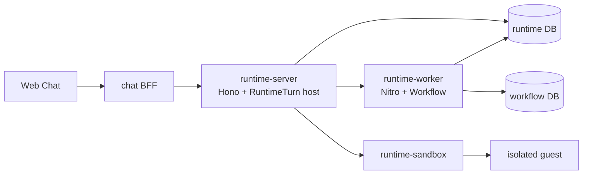

# Session Runtime：单一执行内核与三运行角色

状态：**架构已采用，生命周期验收尚未完成**。三角色与 BFF 分工已进入工作区实现；下文的可靠性要求是实施门槛，不能仅凭目录迁移视为已满足。不保留旧执行服务的长期兼容层。

决策键：如何让交互式 Agent loop、消息、Sandbox 与 detached durable Job 具有一个 owner，同时保持执行恢复与高权限计算的进程隔离？

## 决定

`runtime` 是唯一云端 Agent 执行 app。它拥有 Session、messages、Turn/run journal、云端工具/workspace、Sandbox 会话和 durable Job；实际 Turn/context kernel 复用 `@repo/agent-runtime`，与 Desktop host 共用同一个 AI SDK loop adapter。`chat` 是 Web 产品 BFF，只拥有产品 conversation 元数据及 `conversation_id -> runtime_session_id` 映射。

Runtime 使用一个镜像、三个显式 command 入口。结构参照 Canvas 的 `cmd` 装配方式：入口负责选择进程角色和该角色配置，业务模块仍统一位于 Runtime 顶层 `api/application/domain/infrastructure`，不存在嵌套的 worker 子项目，也不通过 `RUNTIME_ROLE` 在运行时分支：

| 角色 | 端口 | 核心职责 | 隔离原因 |
| --- | ---: | --- | --- |
| `runtime-server` | 8015 | Hono API、Session/messages、shared `RuntimeTurn` host、inline tools、stream/continuation | 交互主路径；loop 在 server 进程内，不存在独立 `runtime-agent` |
| `runtime-worker` | 8011 | Nitro + Workflow，执行 detached durable Job、等待、重试和恢复 | 独立扩缩、部署恢复和长任务资源预算 |
| `runtime-sandbox` | 8014 | 创建、限制、查询与回收 Docker/Kubernetes guest | 单独 ServiceAccount/容器权限；不持有业务或 provider 凭据 |

三个角色复用 `runtime` image 和版本，但不共享进程内状态。生产分别部署 Pod/容器；本地分别启动三个命令。Sandbox guest 是 controller 创建的第四类临时 workload，不是 Runtime 服务角色。

配置同样按入口装配：server 使用 `getServerSettings()`，worker 使用 `getWorkerSettings()`，sandbox 使用 `getSandboxSettings()`；server/worker 只共享 PostgreSQL 基础解析。进程配置在启动时校验并缓存，业务层不得反向依赖 `bootstrap/`。不能为了“同一镜像”把三个角色的凭据、端口或启动校验合成一份全局配置。

## 交互 loop 与 Workflow 边界

每个 Turn 是一个 shared `RuntimeTurn`，内部只创建一个 AI SDK `ToolLoopAgent`，不是 Workflow run。模型 step、普通 Bash、artifact、workspace 保存、搜索、普通工具调用和 Agent 审批都在 `runtime-server` 进程内执行。Session/lease/journal finalizer 由 Runtime host 拥有；input queue、context projection/compaction、tool admission 和 loop adapter 由 shared kernel 拥有，边界见 [Agent runtime](agent-runtime.md)。浏览器断线只影响订阅，不改变已经受理的 Turn。

Workflow 只用于脱离当前 Turn 后仍必须跨进程、重启、部署或长等待继续的 Job，例如多阶段媒体生成、provider 长轮询与持久等待。工具提交 Job 后得到稳定 task/job ID；主 Agent 可以继续或结束 Turn。不得为了“可能耗时”把普通工具或整个 Agent loop 包进 Workflow，也不引入 `WorkflowAgent`。

Server 通过内部 role transport 调用 worker。Worker 先把幂等 task admission 写入 Runtime 业务库，再启动 Workflow；`owner_service=runtime` 与稳定 `owner_ref` 防止同一 tool call 重复创建任务。Workflow World 是引擎恢复数据，不是 messages 或 Job 业务真源，Runtime 代码不得查询 World 表来回答产品 API。

Worker 不可用时，普通 Turn 和 inline tools 仍可运行。确定未受理的提交可以失败；请求超时或响应丢失则必须按原幂等键查询，不能假定未受理，也不能换键重提。已有 admission 可以是 queued，不能伪装成执行中。Workflow step 的 at-least-once 语义不等于外部副作用 exactly-once；付费或不可逆操作必须使用稳定 operation ID、远端幂等键或可查询关联 ID。

Job admission 与 dispatch intent 必须在同一 Runtime 事务提交；worker 用持久派发记录恢复启动。`start()` 异常可能表示结果未知，不能直接记为确定失败。run 绑定在等待期间持续有效；重复 run 的唯一 claim 不能代替同一 run 内每次副作用的取消、授权与幂等检查。完成/失败通过幂等 settlement 写入业务状态，reconciler 修复引擎终态与业务未收口的窗口，不能仅依赖内存 completion watcher。

审批和外部结果先写持久状态及待唤醒记录，再恢复 Hook；早到决策、重复 resume、丢响应都需对账。Workflow replay 不会重新执行已成功的权限检查 step，因此敏感副作用实际执行前必须重查当前权限和取消状态。未知付费结果无法查询时进入 reconciliation，不能由默认 step retry 再次收费。

## Session 与 Chat 边界

Runtime 内部 API 以 `/v1/sessions` 为根，只有 `chat` workload identity 可以调用当前云端入口。Session 保存完整 messages、run/stream 状态、工具结果、文件/Artifact 引用、memory 与执行关系。

一个宿主对象可以映射一个 Runtime Session；对 Web Chat 而言，该宿主对象是 product conversation。Runtime 不保存或理解 conversation 聚合，Session 才是全部执行事实的聚合根。messages、Turn、工具、审批、Job 与 workspace 都归属于 Session；独立状态机、分表或局部版本控制不改变归属。Chat 的 product conversation 是产品入口与展示投影，不是第二份执行会话。workload identity 只认证调用服务；每次读写仍校验最终用户的 tenant/workspace/user scope、Session 归属和对象关联，不能把可信 BFF 等同于任意用户授权。

Chat 继续向浏览器提供 `/conversations` 产品 API：

- 创建 product conversation 时先创建 Runtime Session，再保存本地映射；
- 查询和所有 conversation 子资源按映射转发；Chat 在边界把 Session 标识、资源 URL 和上下文分类投影为 conversation-facing wire contract，不能把 `runtime_session_id` 暴露给浏览器；
- 列表、标题、项目/Canvas 绑定等产品投影留在 Chat；
- fork 先让 Runtime 复制 Session 历史与文件快照，再为新 Session 建立 product conversation 映射；对浏览器只返回新的 conversation ID；
- Chat 不持久化 messages、run journal、tool execution、Sandbox 或 Job；
- Chat 不调用 Admin、Knowledge、Storage、Canvas、worker 或 sandbox，所有这些依赖只由 Runtime 使用。

Chat 与 Runtime 使用独立 PostgreSQL database，并明确禁止通过 XA/2PC、共享数据库或跨库事务把两个服务重新耦合。创建是一段最终一致的业务流程：Chat 使用稳定 `request_id` 调用 Runtime 创建/返回同一 Session，再幂等写入本地映射；响应丢失按原键重试。进程若在 Runtime 成功后、本地映射提交前崩溃，当前实现仍需要识别并回收孤立 Session；它尚未持久化 create/delete saga。未来增强方向是 Chat 本地持久化 intent/outbox、补偿和 reconciliation，不是追求跨库 ACID。删除先请求 Runtime，再删除本地映射，未知结果必须沿原身份对账，不能先删映射而失去 Runtime 清理责任。

产品标题、项目/Canvas 绑定以 Chat 为权威，不进入 Runtime Session 表。Canvas 上下文只在每次 Agent run 由 Chat 以 `host_context` 注入，Runtime 把它当作该 run 的宿主上下文，不把它升级为 Session 元数据。产品 conversation 的创建/删除/查询始终经已授权映射，禁止直接信任客户端传入的 runtime_session_id。

fresh baseline 仅用于全新数据库。现有已应用 baseline 不得改写；存量部署使用版本化迁移，任何数据清除是另行授权的部署操作。不维护旧 API 兼容层不等于可以丢弃用户资产或未对账的外部副作用。

## Messages 查询与交互恢复

Runtime 必须提供按 Session 查询持久化 messages 的能力，包含稳定 message ID、顺序、Turn 关联和官方 AI SDK parts。当前详情响应携带 messages 不等于已具备长历史分页：分页接口应固定分支与读取边界，避免并发追加或切换历史导致重复/漏读；相关字段在 schema 中定义。Job、审批、文件详情按关联查询，不要求一次加载会话内所有资源。

持久化历史在没有在线 worker、没有活跃流或 replay buffer 已过期时仍可查询。UIMessage/工具结果是语义事实，实时 delta 是传输；Item 具有稳定身份，delta 不成为新消息。复用官方消息协议，遵守 [stream 契约](../../schemas/streaming/chat-uimessage-stream.md)。当前 Redis 活跃流恢复与长期消息保留分别管理，不能把恢复订阅描述成恢复 Agent 进程。

snapshot、分支 revision 与流恢复位置必须能够一致衔接，订阅/查询竞争通过补读或协议重放覆盖；cursor 失效明确要求重新加载。Session revision 保护历史结构，不能让每个 token/Job 进度推进用户命令的共同前置条件。幂等查询先于新操作的版本检查，同键异参拒绝。

同一 Session 最多一个 active Turn。steer 进入明确目标 Turn 的 inbox，queue 等待后续 Turn，二者不自动互换；accepted 不等于 delivered。待答工具/审批恢复同一 Turn，客户端不能替 server tool 提交执行结果。进程失联后旧 owner 的迟到写入必须被租约/执行代际拒绝，不能假定租约过期就已杀死旧进程。

server 重启从已提交消息、工具结果和文件状态恢复上下文。完整 step 或明确 waiting 边界可重新发起 SDK invocation；未知外部副作用必须先对账。纯模型输出中断可按预算重新生成，但不得冒充原调用无损续跑。浏览器断线只释放订阅；持久取消先阻止新执行，再传播 AbortSignal 和清理责任。

## Sandbox 边界

`runtime-sandbox` 可以与另外两个角色使用同一 Node 镜像，但必须独立容器/Pod、Service 和 ServiceAccount。它只接受 `runtime` workload token；guest 不获得 Runtime DB、Workflow DB、Storage、模型或 provider 凭据。

controller 通过 Docker 或 Kubernetes adapter 管理 guest。生产 K8s 使用 gVisor、独立执行 namespace、网络策略、配额和 egress proxy；缺失隔离条件时启动/执行失败，不回退宿主机。未来若需要预热池、跨节点调度、快照迁移或高密度编排，可在同一 role contract 后替换 Go control plane；Go 组件仍是计算 adapter，不成为 Session 或 Agent owner。

workspace 是 Session 的持久文件状态，guest 是临时计算资源。命令以稳定 operation ID 创建/查询，响应丢失先查原命令；checkpoint 必须协调活跃写入。Job 如需文件计算，使用不可变输入与独立输出区，发布时按路径/revision CAS，冲突保留候选结果，不能覆盖用户或前台的新修改。

清理责任必须持久化，server/controller 重启后仍能回收资源。保存失败不得标记成功；达到计算硬期限仍需回收并报告未保存范围。关闭 Session 拒绝新输入与 Job，取消未完成执行，保留历史和资产；删除是独立操作。fork 只复制完整历史切点及对应文件快照，不复制 live Job、审批授权或副作用执行权。

## 数据与部署

Runtime 业务 schema 统一在 `apps/backend/services/runtime/migrations/v1.0.0/v1.0.0.0.up.sql`。Chat 只保留产品映射 baseline。Workflow 使用自管理 PostgreSQL World 和官方 schema setup；业务迁移与 World migration 分开执行、备份和恢复。

同一 Runtime image 必须同时包含：

- server TypeScript source 与共享 runtime libraries；
- Nitro 编译的顶层 `.output`；
- sandbox controller 所需的 Docker/kubectl client；
- worker 媒体步骤需要的 ffmpeg。

角色启动命令分别为：

- server：`node --import tsx src/cmd/server/main.ts`
- worker：`node --import tsx src/cmd/worker/production.ts`
- sandbox：`node --import tsx src/cmd/sandbox/main.ts`

源码入口分别位于 `src/cmd/server`、`src/cmd/worker`、`src/cmd/sandbox`。worker 的开发入口负责加载 Workflow 开发产物；Nitro production build 生成 `.output/server/index.mjs` server，由 `production.ts` 在加载前固定 application-managed shutdown 模式。HTTP listener 与 Runtime bootstrap 各有一个明确 owner，但共享同一进程和 bundle lifecycle；不得从 bundle 外再次导入一份 bootstrap。`src/index.ts` role dispatcher、`RUNTIME_ROLE` 环境分支和 `/runtime/worker` 子包都属于禁止恢复的旧结构。

部署使用同一个 `runtime:<immutable-tag>`，但分别配置 readiness、资源和凭据。Sandbox controller 不挂 Runtime/Workflow DB secret。Server、worker、sandbox 可以独立扩缩；发布必须同时验证三角色构建，不能只验证 server。

独立 database 不等于独立故障域：同 PostgreSQL 集群仍共享容量和故障。World retention 覆盖活跃 Job、Hook 等待及恢复窗口；业务结果先持久化，不能靠仍未清理的引擎日志提供历史。备份恢复必须核对业务/引擎时间点和外部 operation，缺失 run 不自动触发重做。

Postgres World 是自托管 reference implementation。flow route 必须只接受受保护的内部 delivery，Gateway 不公开转发，业务 middleware 不得消费其请求体；不假定引擎自带鉴权或端到端加密。shutdown 保持 flow handler/数据库可用直到 `world.close()` 收口，再关闭依赖。并发、队列积压、补偿 backlog、未知结果与资源回收均需可观测。

durable Job 必须能跨正常部署继续：绑定 definition/release，兼容变更验证 replay；不兼容变更保留旧代码及其 delivery 路由直到旧 Job 收口。reference World 不自动提供版本路由；未验证该能力前采用兼容发布或停收 drain，不能用同一镜像标签掩盖恢复代码已经消失。

## 被否决方案

| 方案 | 结论 |
| --- | --- |
| 单独 `runtime-agent` | 本阶段不采用。server 内运行 loop 简化交接；未来若有资源/扩缩证据可拆进程，Session ownership 与协议保持不变 |
| 每个 Turn 使用 Workflow/WorkflowAgent | 否决。增加 replay、版本与 World 耦合，且普通 artifact/Bash 没有 durable Job 需求 |
| 保留独立 Executor/Sandbox 服务，Runtime 只做 facade | 否决。继续存在多执行 owner、独立数据库和跨服务胶水 |
| 三角色放在一个进程 | 否决。worker 的恢复/扩缩与 sandbox 的权限边界需要进程隔离 |
| Runtime server 同时用 Node 和 Go | 否决。单进程不混合语言；未来 Go 只作为独立 sandbox control-plane adapter |

## 实现与验证边界

事实入口：

- Runtime server 与 ToolLoop：[server entry](../../apps/backend/services/runtime/src/cmd/server/main.ts)、[agent application](../../apps/backend/services/runtime/src/application/agent)
- Runtime worker：[production wrapper](../../apps/backend/services/runtime/src/cmd/worker/production.ts)、[Nitro app and lifecycle owner](../../apps/backend/services/runtime/src/cmd/worker/app.ts)、[task application](../../apps/backend/services/runtime/src/application/tasks)、[workflows](../../apps/backend/services/runtime/workflows)
- Sandbox controller：[sandbox app assembly](../../apps/backend/services/runtime/src/bootstrap/sandbox-app.ts)、[engine](../../apps/backend/services/runtime/src/sandbox/engine.ts)
- 启动装配：[bootstrap](../../apps/backend/services/runtime/src/bootstrap)
- 进程配置：[config](../../apps/backend/services/runtime/src/config)；配置解析不属于 bootstrap，底层模块不得导入启动装配层
- Chat BFF：[HTTP composition](../../apps/backend/services/chat/internal/api/http/router.go)、[conversation projection](../../apps/backend/services/chat/internal/application/projection.go)
- 服务图：[services.yaml](../../services.yaml)
- K8s 三角色：[runtime base](../../infra/k8s/base/runtime)

完成门槛包括 Runtime/Chat tests 与 builds、三份 OpenAPI contract、transport codegen、fresh migration integration、service graph、K8s render、Single-VPS Compose、同一 Linux image 启动三个角色。类型检查或 mock 单测不能替代 Workflow World、Docker/gVisor/Kubernetes 与多进程故障验证。

当前实现已要求 Chat 与 Runtime 复用稳定 `request_id`，Runtime 以调用 scope 和请求键返回同一 Session、异参冲突；durable task 的 `(owner_service, owner_ref)` 同时绑定 type 与规范化 payload。业务 task row 也是持久 dispatch intent：`start()` 结果未知时保持 queued，周期恢复可启动候选 run，首个 `claimTaskStep` 原子绑定唯一 run，其他候选在副作用前失败。仍待补齐的 Session 边界是：Chat 尚未把创建/删除意图作为可恢复状态持久化，当前依靠稳定请求键重试和后续孤立 Session 回收收敛。该缺口应通过本地 saga 状态、reconciliation 和 cleanup 修复；跨数据库 ACID 不是目标，也不是完成标准。

当前本地证据覆盖 Runtime/Chat 单测、两者构建、三份 OpenAPI/codegen、全仓 lint/typecheck、migration checksum、service graph、Kubernetes render 与 Single-VPS Compose 解析。Runtime 测试中的 PostgreSQL/Redis integration case 在未启用集成环境时跳过；真实 Postgres World 恢复、Docker/gVisor/Kubernetes guest 生命周期和同一 Linux image 三入口启动仍是部署验收项，不能由本地类型检查替代。

最低故障验收覆盖：创建映射中途崩溃、同键异参、跨 Session 引用、分页与追加竞争、断线/过期 replay、steer 与终态竞争、旧 owner 迟到写入、start 丢响应、step 重投、早到审批、取消/成功竞争、文件 CAS 冲突、保存失败回收及跨版本恢复。文档检查不能替代这些实现测试。

## 公开实践与适用边界

- [Codex App Server](https://openai.com/index/unlocking-the-codex-harness/)：借鉴 Thread/Turn/Item、稳定 Item 生命周期与服务端会话历史；不推导跨进程透明恢复或固定进程数。
- [Anthropic Managed Agents](https://www.anthropic.com/research/managed-agents)：借鉴 Session、harness、Sandbox 的生命周期分离；会话聚合与计算隔离可以同时成立，不照搬托管内部保证。
- [AI SDK ToolLoopAgent](https://ai-sdk.dev/docs/reference/ai-sdk-core/tool-loop-agent)：复用 SDK-owned loop 与原生消息/工具协议，持久授权和执行事实仍由 Runtime 负责。
- [Workflow 幂等](https://workflow-sdk.dev/docs/foundations/idempotency)、[版本管理](https://workflow-sdk.dev/docs/foundations/versioning)：区分 run 去重与副作用幂等；接口必须核对安装版本，托管版本路由不能套用于自托管 World。
- [Postgres World](https://github.com/vercel/workflow/blob/main/packages/world-postgres/README.md)、[Hono integration](https://workflow-sdk.dev/docs/getting-started/hono)：验证自托管鉴权、shutdown、重投与官方构建路径。

三角色、Session 聚合、权限与业务状态是本项目决策；公开实践用于验证边界，不替代代码和目标环境验收。
